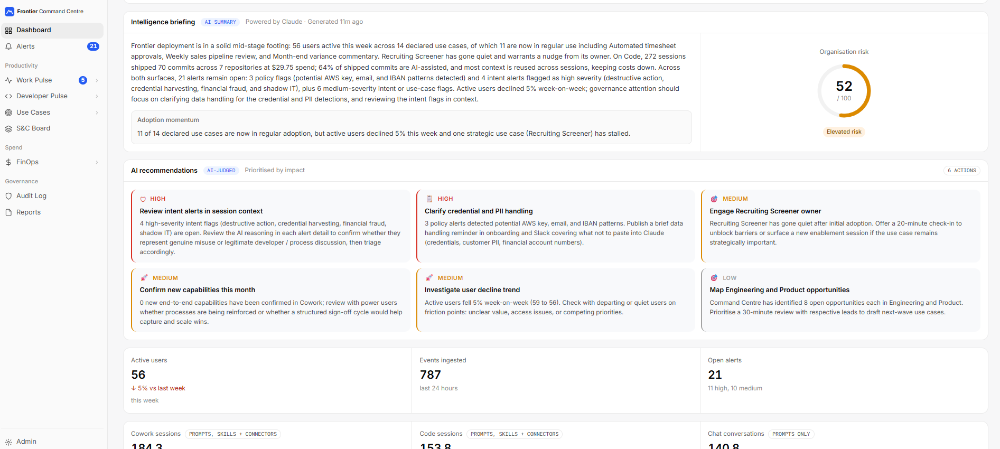

<div align="center">

<picture>
  <source media="(prefers-color-scheme: dark)" srcset="public/frontier-logo.svg">
  
</picture>

**Understand, measure and manage how AI is transforming your organisation.**

Works with Claude Code, Claude Cowork and Claude Chat.

[](https://github.com/frontiercc/command-centre/actions/workflows/ci.yml) [](https://github.com/frontiercc/command-centre/actions/workflows/codeql.yml) [](https://scorecard.dev/viewer/?uri=github.com/frontiercc/command-centre) [](LICENSE)

</div>

https://github.com/user-attachments/assets/1b69cf0e-c9d1-411e-923e-cee1eceecad7

Command Centre gives organisations a complete picture of how Claude is being used across their business, the work it's delivering, what it costs, where the risks sit and whether their investment is creating measurable value. It brings together productivity, adoption, financial management and governance across Claude Code, Claude Cowork and Claude Chat, providing visibility from individual employees through to departments, engineering teams and the organisation as a whole.

Command Centre shows how employees are progressing from simple prompting to delegating substantial work and entire business processes, while identifying valuable use cases that may otherwise remain undiscovered. Organisations can turn repeated processes into reusable skills, track how those capabilities spread, understand engineering output and identify where coaching or further investment will deliver the greatest benefit.

Command Centre also provides the financial and governance controls needed to manage AI at scale. Leaders can examine expenditure by employee, department, cost centre and model, identify opportunities to reduce costs, detect sensitive information and risky activity in prompts, and maintain searchable audit trails and compliance evidence.

Somewhere in your organisation, someone may already have handed an entire process to AI. Command Centre helps you discover that work, understand its value, make it repeatable and scale it across the business, with the financial accountability, security and governance needed to do so responsibly.

## Who it is for

- **Leaders (CIO, COO, CTO, CFO)** who need to know whether Claude is making teams more productive, and what that is worth.
- **Heads of department and team leads** who want to see how their people work with Claude and where to coach.
- **Engineering leaders** who want to see what Claude Code produces and what it costs.
- **Finance teams** who need AI spend by cost centre and by month.
- **Security, privacy and compliance teams** who need an audit trail of prompts, alerts on personal data and evidence for GDPR, the EU AI Act, ISO 27001 and ISO 42001.
- **The Claude administrator** who installs Command Centre and connects Claude.

Command Centre works with Claude for Teams and Claude for Enterprise:

| Claude product | What Command Centre receives | Claude for Teams | Claude for Enterprise |
|---|---|---|---|
| **Claude Code** | Prompts, models, tokens and cost, the tools, skills, connectors and subagents used, active time, lines of code, commits, pull requests and accepted edits | Yes | Yes |
| **Claude Cowork** | Prompts, models, tokens and cost, the tools, skills, connectors and subagents used, and the files people upload and Claude produces | Yes | Yes |
| **Claude Chat** | Every conversation: people's prompts in full, the files they attach, the model, the connectors used, and the artifacts and files Claude made | No | Yes |

**Get started:** [1. Try it with sample data](#1-quick-start-try-it-with-sample-data) · [2. Connect Claude for Teams](#2-connect-claude-for-teams) · [3. Connect Claude for Enterprise](#3-connect-claude-for-enterprise)

**Explore:** [What it does](#what-it-does) · [How it works](#how-it-works) · [Your first ten minutes](docs/first-ten-minutes.md) · [Walkthrough video](https://vimeo.com/1238818389) · [FAQ](#questions-people-ask-first) · [Documentation](#documentation)

## What it does

| Page | What it does | Read more |
|---|---|---|
| **Dashboard** | Brings together the week's AI activity, productivity, spending and governance risks into an executive briefing, with an organisation-wide risk score and recommendations on where to focus attention. | [Product overview](docs/product-overview.md#the-dashboard) |
| **Alerts** | Identifies personal data, exposed secrets and potentially risky intent in prompts, with supporting evidence to help security teams investigate and prioritise concerns. | [Product overview](docs/product-overview.md#alerts) · [Detection](docs/security-and-data-protection.md#pii-and-secret-detection) |
| ***Productivity*** | | |
| **Work Pulse** | Measures how deeply employees delegate work to Claude Cowork, from individual tasks to substantial processes. Compares adoption and delegation patterns across people and departments to identify progress and coaching opportunities. | [Product overview](docs/product-overview.md#work-pulse) · [Measured and AI-judged](docs/ai-data-flow.md#measured-and-ai-judged) |
| **Developer Pulse** | Shows how engineers use Claude Code, the work being produced and its associated costs, helping engineering leaders understand delivery activity, productivity and where AI is contributing to development. | [Product overview](docs/product-overview.md#developer-pulse) |
| **Use Cases** | Discovers recurring business processes emerging from everyday Claude activity, identifies opportunities to share successful approaches and helps turn repeated work into reusable skills that can be adopted across teams. | [Product overview](docs/product-overview.md#use-cases) |
| **S&C Board** | Provides an organisation-wide view of the skills and connectors employees are using, who owns them and where they are being adopted, helping teams manage and share reusable AI capabilities. | [Product overview](docs/product-overview.md#skills-and-connectors-board) |
| ***Spend*** | | |
| **FinOps** | Tracks AI expenditure across employees, departments, cost centres and models, giving finance and technology leaders visibility into spending patterns, allocation and the financial impact of AI adoption. | [Product overview](docs/product-overview.md#finops) |
| **Spend Review** | Examines what each employee's Claude expenditure is being used for, identifies expensive usage patterns and recommends opportunities to complete similar work more economically. | [Product overview](docs/product-overview.md#spend-review) |
| ***Governance*** | | |
| **Audit Log** | Maintains a searchable record of Claude prompts and activity, including who accessed prompt content, supporting investigations, accountability and oversight of AI usage across the organisation. | [Product overview](docs/product-overview.md#the-audit-log) · [Who can read prompts](docs/security-and-data-protection.md#who-can-read-prompt-text) · [AI data flow](docs/ai-data-flow.md) |
| **Reports** | Produces executive briefings, weekly summaries and supporting evidence for governance and compliance activities, including GDPR, the EU AI Act and relevant ISO standards. | [Product overview](docs/product-overview.md#reporting-and-outputs) |
| **Admin** | Manages users, permissions, organisational settings and subagent visibility, providing the administrative controls needed to operate Command Centre across teams and departments. | [Product overview](docs/product-overview.md#administration) · [Roles](docs/security-and-data-protection.md#roles) |



*Sample data from Acme Corp, a fictional company.* More screenshots are in the [product overview](docs/product-overview.md#at-a-glance).

[Read the full product overview](docs/product-overview.md), with every page and screenshot.

## How it works

Command Centre is two parts that you run, the **Hub** (the web application you sign in to) and the **collector** (which receives the activity data Claude sends), plus a **PostgreSQL database**. Where they run depends on how you use it:

| | On your computer | On one server | On AWS or Azure |
|---|---|---|---|
| **For** | Trying it with sample data | Your organisation | Your organisation, on managed cloud services |
| **Hub and collector** | Docker containers | Docker containers | AWS: Amazon ECS on Fargate. Azure: Azure Container Apps |
| **Database** | A PostgreSQL container, included | The included PostgreSQL container, or your own PostgreSQL | AWS: Amazon RDS for PostgreSQL. Azure: Azure Database for PostgreSQL |
| **HTTPS** | Not needed (`http://localhost`) | A reverse proxy you provide, such as Caddy | AWS: Application Load Balancer. Azure: Container Apps ingress with a managed certificate |
| **Secrets** | `.env` | `.env` | AWS Secrets Manager / Azure Key Vault |
| **How to set it up** | [1. Quick start](#1-quick-start-try-it-with-sample-data) | [2. Teams](#2-connect-claude-for-teams) or [3. Enterprise](#3-connect-claude-for-enterprise) | [Running in Azure or AWS](docs/running-in-azure-or-aws.md) |


### How it integrates

| Claude product | How it connects | Plans |
|---|---|---|
| **Claude Code** | OpenTelemetry, set up in Claude Code's managed settings in claude.ai Organization settings | Teams and Enterprise |
| **Claude Cowork** | OpenTelemetry, set up in the monitoring settings in claude.ai Organization settings | Teams and Enterprise |
| **Claude Chat** | Anthropic's Compliance API, using a Compliance Access Key | Enterprise |

Command Centre's own AI features, such as grading work, briefings and reports, send requests to Claude through Anthropic's API, using the Claude API key you enter on **Admin → Access & Keys**. [AI data flow](docs/ai-data-flow.md) lists every feature, what it sends and how to switch each one off.

Command Centre sees prompts only after they reach Claude: it can flag them, alert on them and control who reads them, but it cannot stop or change them. Command Centre stores what people asked, never Claude's replies.

### Measured and AI-judged

**Measured** figures are counted from Claude Code, Claude Cowork and Claude Chat activity, such as the number of prompts, spend, lines of code and commits. **AI-judged** figures are Claude's assessment of that work, such as how deeply someone delegated a task, or which use case a session belongs to. The app labels judged figures as AI judgements. [What is measured and what is AI-judged](docs/ai-data-flow.md#measured-and-ai-judged) lists each one, and how the AI's judgements are checked.

### Your data stays with you

Frontier Command Centre runs on your own computer, server or cloud account, and everything it collects stays there. It sends no telemetry, usage data or heartbeat to anyone. The only outside services it calls are the ones you set up: Anthropic's API for its AI features, and optionally your sign-in provider, email server, Slack or GitHub. It stores people's prompts, never Claude's replies. [Security and data protection](docs/security-and-data-protection.md) has the detail.

## 1. Quick start: try it with sample data

This runs Command Centre on your own computer with a fictional organisation's data, so you can see every page before you connect anything. Use it to try Command Centre, not for real work.

### What you need

- **A computer** running Windows 10 or 11, macOS or Linux, with at least 8 GB of memory and 5 GB of free disk space.
- **Docker:** [Docker Desktop](https://www.docker.com/products/docker-desktop/) installed and running on Windows or macOS. Linux users can use Docker Engine with the Docker Compose plugin.
- **Git:** [Download Git](https://git-scm.com/downloads). On macOS, running `git` may prompt you to install Apple's Command Line Tools.
- **Ports 3001 and 4318** available on your computer.
- **A Claude API key (optional):** Required for AI-powered features such as grading work, generating briefings and producing reports. Create a key in a workspace through the [Claude Console](https://platform.claude.com/settings/keys). Command Centre requires a workspace-associated key. This is the only API key needed for the initial setup.

You can explore Command Centre using sample data without an API key. See [What works without a key](docs/ai-data-flow.md#running-with-ai-features-off) for the capabilities available.

AI-powered features incur Anthropic API charges. Sample-data evaluation is expected to cost around $5 initially, depending on usage. See [indicative costs](docs/costs.md).

Run the commands below in PowerShell on Windows, or Terminal on macOS and Linux.

### Steps

1. **Download Command Centre**, then move into its folder. Run every later command from inside this folder.

   ```bash
   git clone https://github.com/frontiercc/command-centre.git
   cd command-centre
   ```

2. **Create your settings file.** This command creates `.env` for you. You do not need to edit anything.

   ```bash
   docker run --rm -v "${PWD}:/app" -w /app node:22-alpine node scripts/setup.cjs
   ```

3. **Start Command Centre.** The first time takes about four minutes while it builds.

   ```bash
   docker compose up -d --build
   ```

   When the command finishes, open http://localhost:3001. If the page does not load yet, wait a few seconds and refresh.

4. **Create your admin account.** The page asks for a one-time setup token, which Command Centre prints in its log.

   On Windows, in PowerShell:

   ```powershell
   docker compose logs hub | Select-String "setup token"
   ```

   On Windows, in Command Prompt:

   ```bat
   docker compose logs hub | findstr /C:"setup token"
   ```

   On macOS and Linux:

   ```bash
   docker compose logs hub | grep "setup token"
   ```

   If the log says a token was already printed, wait 10 minutes, run `docker compose restart hub`, then run the command again.

5. **Load the sample data**: Acme Corp, with nine weeks of Claude Code, Claude Cowork and Claude Chat activity, graded work, use cases, alerts and spend. Loading takes about two minutes. Create your admin account in step 4 first: once the sample data is loaded, the setup page closes.

   ```bash
   docker compose --profile demo run --rm demo-data
   ```

   Reload the page when it finishes: new items, such as FinOps and Use Cases, appear in the sidebar, and the pages fill in over the next few minutes.

### Or let Claude Code install it

If you use Claude Code, it can do steps 1 to 5 for you. Docker Desktop must be installed and running. Open Claude Code in an empty folder and paste:

```text
Clone https://github.com/frontiercc/command-centre.git and set up Command Centre
on this machine by following the quick start in its README. Create the settings file
with the setup command, start everything with Docker, and give me the one-time setup
token once it is ready. Wait while I create my admin account, then load the sample data.
```

Claude Code tells you what it runs and asks before each step. You end in the same place as the steps above.

### Completing setup

Select **Dashboard** in the sidebar. The Dashboard's **Get started** panel is your checklist from here, and ticks each step off as you do it:

- **Add your Claude API key** under Admin → Access & Keys. Use its test button, then select **Save settings**.
- **Review how work is classified**: check that the three tiers Work Pulse and Developer Pulse use to grade work fit your organisation. In Work Pulse they run from routine tasks to whole processes, and in Developer Pulse from single-step edits to substantial work the engineer supervises. Admins can change both: **Tier config** in Admin → Work Pulse, and **Tiers** in Admin → Developer Pulse.

You don't need the panel's other three steps for the sample data. They are for connecting your own organisation, in journey 2 or 3.

### You have finished when

The Dashboard shows Acme Corp's briefing and recommendations, and Work Pulse, Developer Pulse, FinOps and Use Cases are filled in.

### Next steps

- **[Your first ten minutes](docs/first-ten-minutes.md)**: what to look at first in the sample data.
- **Run it for your organisation:** [2. Connect Claude for Teams](#2-connect-claude-for-teams) or [3. Connect Claude for Enterprise](#3-connect-claude-for-enterprise).
- **Something not working?** See [Troubleshooting and FAQ](docs/troubleshooting.md).

### Need to start again?

Don't connect your own Claude to this installation: the sample data is mixed in with everything, including your own account, so your real figures would be wrong. To start again from empty, run:

```bash
docker compose down -v
docker compose up -d
```

The first command deletes everything Command Centre stored, including the sample data and your admin account; your `.env` is kept. The second starts a fresh installation. Open http://localhost:3001 and you are taken to setup, with a new setup token in the log (quick start step 4).

## 2. Connect Claude for Teams

This deployment runs Command Centre within your organisation and connects Claude Code and Claude Cowork activity, giving you visibility into how employees use Claude, the work they delegate and the value being created across teams.

### Before you begin

You need:

- **A Linux server** accessible to the employees and devices sending telemetry, with Git, Docker Engine and the Docker Compose plugin, at least 8 GB of memory, and 5 GB of free disk space plus capacity for your data. For a cloud deployment, see [Running in Azure or AWS](docs/running-in-azure-or-aws.md) instead of steps 1 to 5 below.
- **Two HTTPS addresses** pointing to the deployment: one for employees to access Command Centre, such as `command-centre.your-company.com`, and another for collecting Claude activity through OpenTelemetry, such as `otel.your-company.com`. Both require valid TLS certificates.
- **A Claude API key**, created within a workspace in the [Claude Console](https://platform.claude.com/settings/keys), for AI-powered analysis, assessments, briefings and reports. Telemetry collection can operate without this key.
- **A Claude organisation Owner or Primary Owner** with permission to configure organisation-wide Claude Code and Claude Cowork telemetry settings.

### Steps

Run these commands on the server.

1. **Download Command Centre and create your settings file**: quick start steps 1 and 2.

2. **Delete the two localhost lines from `.env`**: `CCC_INSECURE_COOKIES=true` and `CCC_ALLOW_INSECURE_COOKIES=true`. They are only needed to sign in over `http://` on your own computer.

3. **Serve it over HTTPS.** Command Centre does not include this: put a web server in front of it. With [Caddy](https://caddyserver.com/docs/install), which gets the certificates for you, put this in `/etc/caddy/Caddyfile` with your own addresses:

   ```caddyfile
   command-centre.your-company.com {
       reverse_proxy 127.0.0.1:3001
   }

   otel.your-company.com {
       reverse_proxy 127.0.0.1:4318
   }
   ```

   Open ports 80 and 443 on the server's firewall, then run `sudo systemctl reload caddy`.

4. **Start Command Centre.** The first time takes about four minutes while it builds.

   ```bash
   docker compose up -d --build
   ```

5. **Create your admin account.** Open your `https://` sign-in address. The page asks for a one-time setup token, which Command Centre prints in its log:

   ```bash
   docker compose logs hub | grep "setup token"
   ```

6. **Add your Claude API key.** Open **Admin → Access & Keys**, enter it in the **Claude API Key** field, use its test button, then select **Save settings**.

7. **Connect Claude Code.** On **Admin → Ingestion**, select **Edit** beside the collector address, enter your collector address, such as `https://otel.your-company.com`, and save, so the settings you copy include it. Then select **Copy Claude Code settings**. In claude.ai, open **Organization settings → Claude Code → Managed settings**, paste them and save. Claude Code picks them up when it next starts, and each person is asked to approve them the first time.

   <details>
   <summary>The Claude Code settings, if you would rather copy them from here</summary>

   Replace the address with your collector address, and `<your bearer token>` with the token shown on Admin → Ingestion:

   ```json
   {
     "env": {
       "CLAUDE_CODE_ENABLE_TELEMETRY": "1",
       "OTEL_EXPORTER_OTLP_ENDPOINT": "https://otel.your-company.com",
       "OTEL_EXPORTER_OTLP_HEADERS": "Authorization=Bearer <your bearer token>",
       "OTEL_EXPORTER_OTLP_METRICS_TEMPORALITY_PREFERENCE": "delta",
       "OTEL_EXPORTER_OTLP_PROTOCOL": "http/protobuf",
       "OTEL_LOGS_EXPORTER": "otlp",
       "OTEL_LOG_TOOL_DETAILS": "1",
       "OTEL_LOG_USER_PROMPTS": "1",
       "OTEL_METRICS_EXPORTER": "otlp",
       "OTEL_SERVICE_NAME": "claude-code"
     }
   }
   ```

   </details>

8. **Connect Claude Cowork.** In claude.ai, open **Organization settings → Data and Privacy → Monitoring** and enter:

   | Field | Value |
   |---|---|
   | OTLP endpoint | Your collector address, such as `https://otel.your-company.com` |
   | OTLP protocol | `http/json` |
   | OTLP headers | `Authorization=Bearer <your bearer token>`, with a space before the token |

   Claude Cowork picks these up when a new session starts. Then, in **Organization settings**, switch off **Cowork in the cloud** (under Claude Cowork) and **Chat and Cowork unified** (under Capabilities): sessions run in the cloud don't currently send their activity reliably. [Connect Claude](docs/connect-claude.md#claude-cowork) explains why.

The settings in steps 7 and 8 send people's prompts, which the Audit Log, personal-data alerts and grading need. Agree this with whoever looks after data protection first. [Connect Claude](docs/connect-claude.md) explains every setting and the other ways to roll them out.

### You have finished when

A prompt sent from Claude Code or Claude Cowork appears in the **Audit Log** within a minute or two. Claude Cowork work is graded within five minutes, and Claude Code sessions within an hour of going idle. Work Pulse and Developer Pulse then fill in.

If nothing arrives, see [Troubleshooting and FAQ](docs/troubleshooting.md#connecting-claude).

## 3. Connect Claude for Enterprise

This does everything in journey 2 and adds Claude Chat.

### Before you begin

- The same as [journey 2](#before-you-begin), except that you need the Primary Owner of your Claude for Enterprise organisation.
- Command Centre installed on the server, served over HTTPS and with your Claude API key added: journey 2, steps 1 to 6.

### Steps

1. **Connect Claude Code**, as in [journey 2, step 7](#2-connect-claude-for-teams).
2. **Connect Claude Cowork**, as in [journey 2, step 8](#2-connect-claude-for-teams).
3. **Connect Claude Chat.** In claude.ai, open [Organization settings → API](https://claude.ai/admin-settings/api-access). The Primary Owner turns the Compliance API on there, then creates a Compliance Access Key with the scopes `read:compliance_user_data` and `read:compliance_activities`. Anthropic shows the key only once. In Command Centre, open **Admin → Access & Keys**, enter it in the **Compliance Access Key** field, use its test button to check it works, then select **Save settings**.

### You have finished when

Claude Chat prompts appear in the **Audit Log** alongside Claude Code and Claude Cowork, within a few minutes. The first sync brings in the last 30 days of Claude Chat.

## Questions people ask first

**Is it free?** Yes. It is open source under Apache 2.0. You pay only for where you run it, and for the Claude API calls its AI features make. See [Indicative costs](docs/costs.md).

**Does my data leave my network?** No. It runs on infrastructure you control and sends nothing back. See [Your data stays with you](#your-data-stays-with-you).

**Which Claude plans does it work with?** Claude Code and Claude Cowork on Claude for Teams and Claude for Enterprise. Claude Chat on Claude for Enterprise, through Anthropic's Compliance API.

**Do I need a Claude API key?** Not to explore the sample data, but yes if you want to bring every feature to life. Grading work, briefings and summaries use your organisation's own key.

**Can it block risky prompts?** No. It sees activity after it reaches Claude, so it flags and alerts rather than blocks.

**Is it an Anthropic product?** No. It is an independent open-source project and is not endorsed by Anthropic.

## Documentation

| I want to | Read |
|---|---|
| See what to look at first in the sample data | [Your first ten minutes](docs/first-ten-minutes.md) |
| Understand everything Command Centre does | [Product overview](docs/product-overview.md) |
| Change how Claude is connected | [Connect Claude](docs/connect-claude.md) |
| Run it on AWS or Azure | [Running in Azure or AWS](docs/running-in-azure-or-aws.md) |
| Set up every feature, such as single sign-on | [Configure Command Centre](docs/configure-command-centre.md) |
| Know what it costs to run | [Indicative costs](docs/costs.md) |
| Review its security, and what is sent to AI | [Security and data protection](docs/security-and-data-protection.md) · [AI data flow](docs/ai-data-flow.md) |
| Fix a problem, or update it | [Troubleshooting and FAQ](docs/troubleshooting.md) · [Updating](docs/troubleshooting.md#updating) |
| Remove it | [Uninstall](docs/uninstall.md) |
| See every document | [Documentation index](docs/README.md) |

## Roadmap

- Integration with Anthropic's Analytics and Admin APIs, for Claude for Enterprise.
- Signing in with SAML.
- A benchmark kit, so you can test Command Centre's AI grading against your own examples.
- Publishing skills drafted in Command Centre to your organisation's skills marketplace, through GitHub.
- ChatGPT and Codex activity, coming through Work Pulse and Developer Pulse alongside Claude.

Vote or add ideas in [Discussions](https://github.com/frontiercc/command-centre/discussions).

## Status

1.0.0 is the first public release. Command Centre was built with Claude Code, then reviewed, tested and run in production; it has been in daily use since mid-2026. Several features ship switched off and are turned on from the admin pages: FinOps, Use Cases, Weekly Highlights, Dev Framework Alignment and single sign-on.

## Support

Command Centre is maintained by Lee James, on a best-effort basis with no service level. Ask questions and share ideas in [Discussions](https://github.com/frontiercc/command-centre/discussions); report bugs and request features in [Issues](https://github.com/frontiercc/command-centre/issues). Issues stay open until they are fixed, answered or declined with a reason. Requests we are unlikely to build soon are labelled "help wanted", so anyone can pick them up. To report a security issue, follow [SECURITY.md](SECURITY.md) rather than opening an issue.

## Contributing

Contributions are welcome. [CONTRIBUTING.md](CONTRIBUTING.md) explains how to run, change and test Command Centre, how to sign the Contributor Licence Agreement, and how we review. If you use an AI assistant, point it at [CLAUDE.md](CLAUDE.md).

## Contributors

Thanks to the people who built, reviewed and tested Command Centre:

- David Wing ([@davidwing-alt](https://github.com/davidwing-alt))
- Ricardo Sueiras ([@indiricardo](https://github.com/indiricardo))
- Steve Bryen ([@mesh-stevebryen](https://github.com/mesh-stevebryen))
- Vinicius Nava ([@viniciusmnava](https://github.com/viniciusmnava))
- Vitor Avancini ([@vitoravancini](https://github.com/vitoravancini))

Special thanks to Steve Bryen for his guidance, support and belief in the Command Centre concept from the start.

## Licence

Frontier Command Centre is licensed under the [Apache License 2.0](LICENSE). The licences of the libraries it uses are listed in [THIRD-PARTY-NOTICES.md](THIRD-PARTY-NOTICES.md).

Frontier Command Centre is an independent open-source project. It is not an Anthropic product and is not endorsed by Anthropic, PBC. Claude, Claude Code and Claude Cowork are trademarks of Anthropic, PBC.
