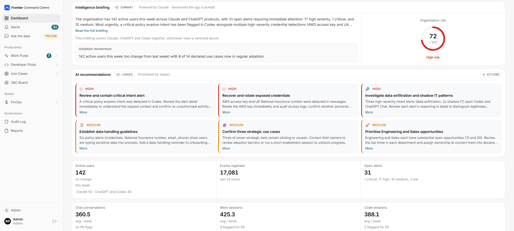

<div align="center">

<picture>
  <source media="(prefers-color-scheme: dark)" srcset="public/frontier-logo.svg">
  
</picture>

**See whether AI is changing your organisation's work, and what it is worth.**

Works with Claude, ChatGPT and Codex.

[](https://github.com/frontiercc/command-centre/actions/workflows/ci.yml) [](https://github.com/frontiercc/command-centre/actions/workflows/codeql.yml) [](https://scorecard.dev/viewer/?uri=github.com/frontiercc/command-centre) [](https://www.bestpractices.dev/projects/15963) [](LICENSE)

</div>

https://github.com/user-attachments/assets/90b28fb9-3691-4856-9218-40c7b374a670

Command Centre shows whether AI is making your teams more productive, and what that is worth. It covers Claude and ChatGPT for everyday work and Claude Code and Codex for coding, showing the results for each person, each department and the organisation as a whole.

It shows how far people have moved from quick questions to handing over substantial work and whole processes. It finds the recurring work teams have already given to AI, helps turn that work into skills others can use, and shows where coaching or further investment would help most.

Finance and security teams get what they need from the same place. Spend is broken down by person, department, cost centre, model and vendor, with suggestions for doing the same work for less. Prompts are checked for personal data, secrets and risky intent, and a searchable audit trail supports GDPR, the EU AI Act, ISO 27001 and ISO 42001.

Someone in your organisation may already have handed a whole process to AI. Command Centre helps you find that work, see what it is worth and spread it to other teams, while keeping track of spend, security and governance.

## Who it is for

- **Leaders (CIO, COO, CTO, CFO)** who need to know whether AI is making teams more productive, and what that is worth.
- **Heads of department and team leads** who want to see how their people work with AI and where to coach.
- **Engineering leaders** who want to see what Claude Code and Codex produce and what they cost.
- **Finance teams** who need AI spend by cost centre and by month.
- **Security, privacy and compliance teams** who need an audit trail of prompts, alerts on personal data and evidence for GDPR, the EU AI Act, ISO 27001 and ISO 42001.
- **The administrator** who installs Command Centre and connects Claude, ChatGPT or both.

## What it works with

Command Centre works with Claude for Teams, Claude for Enterprise, and ChatGPT Enterprise and Edu. You can connect Claude, ChatGPT or both, and each product sends the following:

| Product | What Command Centre receives |
|---|---|
| **Claude Chat** | Every conversation: people's prompts in full, the names of the files they attach, the model, the connectors used, and how many artifacts and files Claude made |
| **ChatGPT Chat and ChatGPT Work** | Prompts, the names of files people attach, the skills ChatGPT used, the model and time of each reply, and spend from OpenAI's hourly cost records |
| **Claude Cowork** | Prompts, models, tokens and cost, the tools, skills, connectors and subagents used, and the files people upload and Claude produces |
| **Claude in Office and Google apps** | Prompts in Excel, Word, PowerPoint, Outlook, Google Sheets, Docs and Slides, models and tokens, the tools Claude used, and the names of the documents it changed. Spend is estimated from published prices. |
| **Claude Code** | Prompts, models, tokens and cost, the tools, skills, connectors and subagents used, active time, lines of code, commits, pull requests and accepted edits |
| **Codex** | Prompts, models, tokens and cost for each turn, the connectors used, and each action's outcome, including commits |

ChatGPT and Codex support is in preview, and we are looking for organisations on ChatGPT Enterprise or Edu to test it. To take part, say hello in [Discussions](https://github.com/frontiercc/command-centre/discussions).

[How it integrates](#how-it-integrates) shows how each product connects and which plan it needs.

**Get started:** [1. Try it with sample data](#1-quick-start-try-it-with-sample-data) · [2. Connect Claude for Teams](#2-connect-claude-for-teams) · [3. Connect Claude for Enterprise](#3-connect-claude-for-enterprise) · [4. Connect ChatGPT and Codex](#4-connect-chatgpt-and-codex)

**Explore:** [What it does](#what-it-does) · [How it works](#how-it-works) · [Your first ten minutes](docs/first-ten-minutes.md) · [Walkthrough video](https://vimeo.com/1247091267) · [FAQ](#questions-people-ask-first) · [Documentation](#documentation)

## What it does

| Page | What it does | Read more |
|---|---|---|
| **Dashboard** | The week in one place: a briefing written by Claude, a risk score, recommendations, and who uses each product, how deep the work is, what coding shipped and cost. The briefing needs the Claude API key. | [Product overview](docs/product-overview.md#the-dashboard) |
| **Alerts** | Flags personal data, secrets and risky requests in prompts, with the evidence for each. | [Product overview](docs/product-overview.md#alerts) · [Detection](docs/security-and-data-protection.md#pii-and-secret-detection) |
| **Ask the data** (preview) | Answers an admin's questions in their own words from the pages' own figures, with links to those pages. Off until an admin turns it on. It sends each question and the page figures it needs to Anthropic's Claude API, and does not store the answer. | [AI data flow](docs/ai-data-flow.md#ask-the-data) · [Configure](docs/configure-command-centre.md#ask-the-data-preview) |
| ***Productivity*** | | |
| **Work Pulse** | How deeply people hand everyday work to Claude and ChatGPT (Claude Chat, Claude Cowork, Claude in Office and Google apps, ChatGPT Chat and Work), from quick questions to whole processes. Overview, My Pulse, Users and Departments show the organisation, each person and each department. | [Product overview](docs/product-overview.md#work-pulse) · [Measured and AI-judged](docs/ai-data-flow.md#measured-and-ai-judged) |
| **Work Pulse So What** | Answers a leader's question about one team, such as a request to hire or someone leaving: the gap between the team's best people and everyone else, what closing it is worth, and a decision to record. A decided card comes back after 30 days with what has happened since. For admins and managers. | [Product overview](docs/product-overview.md#so-what) |
| **Work Pulse Team Coaching** | A coaching plan for one team: where it is, what to work on, who to learn from and what to try, and whether what the team did moved the figure. For admins and managers. | [Product overview](docs/product-overview.md#team-coaching) |
| **Developer Pulse** | What Claude Code and Codex produce and what they cost, for the organisation, each person and each department. Value estimates what the work is worth, counting time saved from pull requests and commits only. | [Product overview](docs/product-overview.md#developer-pulse) |
| **Developer Pulse So What** | The same questions as Work Pulse So What, answered from engineers and their coding work. For admins and managers. | [Product overview](docs/product-overview.md#developer-pulse-so-what) |
| **Developer Pulse Team Coaching** | A coaching plan for one engineering team, and whether what they did moved the figure. For admins and managers. | [Product overview](docs/product-overview.md#developer-pulse-team-coaching) |
| **Use Cases** | Finds the work teams repeat with AI, tracks who does each piece of work, and drafts a Claude skill from it so others can use it. Governance shows the use cases you declare and their measured outcomes. | [Product overview](docs/product-overview.md#use-cases) |
| **S&C Board** | The skills and connectors people use, who owns each one, how widely it has spread and how to install it. | [Product overview](docs/product-overview.md#skills-and-connectors-board) |
| ***Spend*** | | |
| **FinOps** | AI spend by person, department, cost centre, product and model, with month-end close for chargeback. For admins and managers only. | [Product overview](docs/product-overview.md#finops) |
| **Spend Review** | What each person's spend goes on, and where colleagues do the same work for less: a skill, a connector or another model. | [Product overview](docs/product-overview.md#spend-review) |
| ***Governance*** | | |
| **Audit Log** | Every prompt from Claude, ChatGPT and Codex in one searchable record, with a log of who read which prompt. | [Product overview](docs/product-overview.md#the-audit-log) · [Who can read prompts](docs/security-and-data-protection.md#who-can-read-prompt-text) · [AI data flow](docs/ai-data-flow.md) |
| **Reports** | Briefings, the weekly digest, and reports with evidence for GDPR, the EU AI Act, ISO 27001 and ISO 42001. | [Product overview](docs/product-overview.md#reporting-and-outputs) |
| **Admin** | Users and roles, keys, alert settings, grading rubrics, cost centres, retention and system health. | [Product overview](docs/product-overview.md#administration) · [Roles](docs/security-and-data-protection.md#roles) |



*Sample data from Acme Corp, a fictional company.* More screenshots are in the [product overview](docs/product-overview.md#at-a-glance).

[Read the full product overview](docs/product-overview.md), with every page and screenshot.

## How it works

Command Centre is two parts that you run, plus a **PostgreSQL database**. The **Hub** is the web application you sign in to; it also fetches Claude Chat, ChatGPT and Codex activity from Anthropic's and OpenAI's Compliance APIs. The **collector** receives the activity Claude Code, Claude Cowork and Claude in Office and Google apps send. Where they run depends on how you use it:

| | On your computer | On one server | On AWS or Azure |
|---|---|---|---|
| **For** | Trying it with sample data | Your organisation | Your organisation, on managed cloud services |
| **Hub and collector** | Docker containers | Docker containers | AWS: Amazon ECS on Fargate. Azure: Azure Container Apps |
| **Database** | A PostgreSQL container, included | The included PostgreSQL container, or your own PostgreSQL | AWS: Amazon RDS for PostgreSQL. Azure: Azure Database for PostgreSQL |
| **HTTPS** | Not needed (`http://localhost`) | A reverse proxy you provide, such as Caddy | AWS: Application Load Balancer. Azure: Container Apps ingress with a managed certificate |
| **Secrets** | `.env` | `.env` | AWS Secrets Manager / Azure Key Vault |
| **How to set it up** | [1. Quick start](#1-quick-start-try-it-with-sample-data) | Claude: [2. Teams](#2-connect-claude-for-teams) or [3. Enterprise](#3-connect-claude-for-enterprise). ChatGPT and Codex: [4](#4-connect-chatgpt-and-codex) | [Running in Azure or AWS](docs/running-in-azure-or-aws.md) |


### How it integrates

| Product | How it connects | Plans |
|---|---|---|
| **Claude Code** | OpenTelemetry, set up in Claude Code's managed settings in claude.ai Organization settings | Claude for Teams and Enterprise |
| **Claude Cowork** | OpenTelemetry, set up in the monitoring settings in claude.ai Organization settings | Claude for Teams and Enterprise |
| **Claude in Office and Google apps** | OpenTelemetry, set up in Office agents → Monitoring in claude.ai Organization settings | Claude for Teams and Enterprise |
| **Claude Chat** | Anthropic's Compliance API, using a Compliance Access Key | Claude for Enterprise |
| **ChatGPT and Codex** | OpenAI's Compliance API, using an OpenAI Admin API key | ChatGPT Enterprise and Edu |

Command Centre's own AI features, such as grading work, briefings and reports, run on Claude through Anthropic's API, using the Claude API key you enter on **Admin → Access & Keys**, whichever products you connect. They send prompts from every connected product, Claude and OpenAI alike, to Anthropic. [AI data flow](docs/ai-data-flow.md) lists every feature, what it sends and how to switch each one off.

Command Centre sees prompts only after they reach Claude, ChatGPT or Codex: it can flag them, alert on them and control who reads them, but it cannot stop or change them. Command Centre stores what people asked, never the replies of Claude, ChatGPT or Codex.

### Measured and AI-judged

**Measured** figures are counted from the activity of every connected product, such as the number of prompts, spend, lines of code and commits. **AI-judged** figures are Claude's assessment of that work, such as how deeply someone delegated a task, or which use case a session belongs to. The app labels judged figures as AI judgements. [What is measured and what is AI-judged](docs/ai-data-flow.md#measured-and-ai-judged) lists each one, and how the AI's judgements are checked.

### Your data stays with you

Frontier Command Centre runs on your own computer, server or cloud account, and everything it collects stays there. It sends no telemetry, usage data or heartbeat to anyone. The only outside services it calls are the ones you set up: Anthropic's API for its AI features, Anthropic's Compliance API for Claude Chat, OpenAI's API for ChatGPT and Codex, and your sign-in provider, email server, Slack or GitHub. It stores people's prompts, never the AI's replies. [Security and data protection](docs/security-and-data-protection.md) has the detail.

## 1. Quick start: try it with sample data

This runs Command Centre on your own computer with a fictional organisation's data, so you can see every page before you connect anything. Use it to try Command Centre, not for real work.

### What you need

- **A computer** running Windows 10 or 11, macOS or Linux, with at least 8 GB of memory and 5 GB of free disk space.
- **Docker:** [Docker Desktop](https://www.docker.com/products/docker-desktop/) installed and running on Windows or macOS. Linux users can use Docker Engine with the Docker Compose plugin.
- **Git:** [Download Git](https://git-scm.com/downloads). On macOS, running `git` may prompt you to install Apple's Command Line Tools.
- **Ports 3001 and 4318** available on your computer.
- **A Claude API key (optional):** the AI features need it, such as grading work, briefings and reports. Create it inside a workspace in the [Claude Console](https://platform.claude.com/settings/keys): Command Centre needs a key that belongs to a workspace. It is the only key you need to start.

You can explore the sample data without a key, but the Dashboard briefing and Ask the data need one. [What works without a key](docs/ai-data-flow.md#running-with-ai-features-off) lists the rest.

Anthropic charges for the AI features. Trying it with sample data costs about $5 at first, depending on how much you use it. See [indicative costs](docs/costs.md).

Run the commands below in PowerShell on Windows, or Terminal on macOS and Linux.

### Steps

1. **Download Command Centre**, then move into its folder. Run every later command from inside this folder.

   ```bash
   git clone https://github.com/frontiercc/command-centre.git
   cd command-centre
   ```

2. **Create your settings file.** This command creates `.env` for you. You do not need to edit anything.

   ```bash
   docker run --rm -v "${PWD}:/app" -w /app node:22-alpine node scripts/setup.cjs
   ```

3. **Start Command Centre.** The first time takes about four minutes while it builds.

   ```bash
   docker compose up -d --build
   ```

   When the command finishes, open http://localhost:3001. If the page does not load yet, wait a few seconds and refresh.

4. **Create your admin account.** The page asks for a one-time setup token, which Command Centre prints in its log.

   On Windows, in PowerShell:

   ```powershell
   docker compose logs hub | Select-String "setup token"
   ```

   On Windows, in Command Prompt:

   ```bat
   docker compose logs hub | findstr /C:"setup token"
   ```

   On macOS and Linux:

   ```bash
   docker compose logs hub | grep "setup token"
   ```

   If the log says a token was already printed, wait 10 minutes, run `docker compose restart hub`, then run the command again.

5. **Load the sample data**: Acme Corp, with thirteen weeks of Claude Chat, ChatGPT and Codex activity and about two months of Claude Code, Claude Cowork and Claude in Office/Google activity, graded work, use cases, alerts and spend. Loading takes about six minutes. Create your admin account in step 4 first: once the sample data is loaded, the setup page closes.

   ```bash
   docker compose --profile demo run --rm demo-data
   ```

   Reload the page when it finishes: new items, such as FinOps and Use Cases, appear in the sidebar, and the pages fill in over the next few minutes.

### Or let Claude Code install it

If you use Claude Code, it can do steps 1 to 5 for you. Docker Desktop must be installed and running. Open Claude Code in an empty folder and paste:

```text
Clone https://github.com/frontiercc/command-centre.git and set up Command Centre
on this machine by following the quick start in its README. Create the settings file
with the setup command, start everything with Docker, and give me the one-time setup
token once it is ready. Wait while I create my admin account, then load the sample data.
```

Claude Code tells you what it runs and asks before each step. You end in the same place as the steps above.

### Completing setup

Select **Dashboard** in the sidebar. The Dashboard's **Get started** panel is your checklist from here, and ticks each step off as you do it:

- **Add your Claude API key** under Admin → Access & Keys. Use its test button, then select **Save settings**. The Dashboard briefing needs it: until it is added, the briefing panel asks for it.
- **Review how work is classified**: check that the three tiers Work Pulse and Developer Pulse use to grade work fit your organisation. In Work Pulse they run from routine tasks to whole processes, and in Developer Pulse from single-step edits to substantial work the engineer supervises. Admins can change both: **Tier config** in Admin → Work Pulse, and **Tiers** in Admin → Developer Pulse.

You don't need the panel's other steps for the sample data. They are for running it for your own organisation, as in journeys 2 to 4.

### You have finished when

Work Pulse, Developer Pulse, FinOps and Use Cases are filled in, and, once your Claude API key is added, the Dashboard shows Acme Corp's briefing and recommendations.

### Next steps

- **[Your first ten minutes](docs/first-ten-minutes.md)**: what to look at first in the sample data.
- **Run it for your organisation:** connect Claude ([2. Teams](#2-connect-claude-for-teams) or [3. Enterprise](#3-connect-claude-for-enterprise)), ChatGPT and Codex ([4](#4-connect-chatgpt-and-codex)), or both.
- **Something not working?** See [Troubleshooting and FAQ](docs/troubleshooting.md).

### Need to start again?

Don't connect your own Claude, ChatGPT or Codex to this installation: the sample data is mixed in with everything, including your own account, so your real figures would be wrong. To start again from empty, run:

```bash
docker compose down -v
docker compose up -d
```

The first command deletes everything Command Centre stored, including the sample data and your admin account; your `.env` is kept. The second starts a fresh installation. Open http://localhost:3001 and you are taken to setup, with a new setup token in the log (quick start step 4).

## 2. Connect Claude for Teams

This runs Command Centre for your organisation and connects Claude Code, Claude Cowork and Claude in Office/Google, so you can see how people use Claude, what work they hand over and what it is worth.

### Before you begin

You need:

- **A Linux server** accessible to the employees and devices sending telemetry, with Git, Docker Engine and the Docker Compose plugin, at least 8 GB of memory, and 5 GB of free disk space plus capacity for your data. For a cloud deployment, see [Running in Azure or AWS](docs/running-in-azure-or-aws.md) instead of steps 1 to 5 below.
- **Two HTTPS addresses** pointing to the deployment: one for employees to access Command Centre, such as `command-centre.your-company.com`, and another for collecting Claude activity through OpenTelemetry, such as `otel.your-company.com`. Both require valid TLS certificates.
- **A Claude API key**, created within a workspace in the [Claude Console](https://platform.claude.com/settings/keys), for the AI features, such as grading work, briefings and reports. Activity is still collected without it.
- **A Claude organisation Owner or Primary Owner** with permission to configure organisation-wide Claude Code, Claude Cowork and Claude in Office/Google telemetry settings.

### Steps

Run these commands on the server.

1. **Download Command Centre and create your settings file**: quick start steps 1 and 2.

2. **Delete the two localhost lines from `.env`**: `CCC_INSECURE_COOKIES=true` and `CCC_ALLOW_INSECURE_COOKIES=true`. They are only needed to sign in over `http://` on your own computer.

3. **Serve it over HTTPS.** Command Centre does not include this: put a web server in front of it. With [Caddy](https://caddyserver.com/docs/install), which gets the certificates for you, put this in `/etc/caddy/Caddyfile` with your own addresses:

   ```caddyfile
   command-centre.your-company.com {
       reverse_proxy 127.0.0.1:3001
   }

   otel.your-company.com {
       reverse_proxy 127.0.0.1:4318
   }
   ```

   Open ports 80 and 443 on the server's firewall, then run `sudo systemctl reload caddy`.

4. **Start Command Centre.** The first time takes about four minutes while it builds.

   ```bash
   docker compose up -d --build
   ```

5. **Create your admin account.** Open your `https://` sign-in address. The page asks for a one-time setup token, which Command Centre prints in its log:

   ```bash
   docker compose logs hub | grep "setup token"
   ```

6. **Add your Claude API key.** Open **Admin → Access & Keys**, enter it in the **Claude API Key** field, use its test button, then select **Save settings**.

7. **Connect Claude Code.** On **Admin → Ingestion**, select **Edit** beside the collector address, enter your collector address, such as `https://otel.your-company.com`, and save, so the settings you copy include it. Then select **Copy Claude Code settings**. In claude.ai, open **Organization settings → Claude Code → Managed settings**, paste them and save. Claude Code picks them up when it next starts, and each person is asked to approve them the first time.

   <details>
   <summary>The Claude Code settings, if you would rather copy them from here</summary>

   Replace the address with your collector address, and `<your bearer token>` with the token shown on Admin → Ingestion:

   ```json
   {
     "env": {
       "CLAUDE_CODE_ENABLE_TELEMETRY": "1",
       "OTEL_EXPORTER_OTLP_ENDPOINT": "https://otel.your-company.com",
       "OTEL_EXPORTER_OTLP_HEADERS": "Authorization=Bearer <your bearer token>",
       "OTEL_EXPORTER_OTLP_METRICS_TEMPORALITY_PREFERENCE": "delta",
       "OTEL_EXPORTER_OTLP_PROTOCOL": "http/protobuf",
       "OTEL_LOGS_EXPORTER": "otlp",
       "OTEL_LOG_TOOL_DETAILS": "1",
       "OTEL_LOG_USER_PROMPTS": "1",
       "OTEL_METRICS_EXPORTER": "otlp",
       "OTEL_SERVICE_NAME": "claude-code"
     }
   }
   ```

   </details>

8. **Connect Claude Cowork.** In claude.ai, open **Organization settings → Data and Privacy → Monitoring** and enter:

   | Field | Value |
   |---|---|
   | OTLP endpoint | Your collector address, such as `https://otel.your-company.com` |
   | OTLP protocol | `http/json` |
   | OTLP headers | `Authorization=Bearer <your bearer token>`, with a space before the token |

   Claude Cowork picks these up when a new session starts. Then, in **Organization settings**, switch off **Cowork in the cloud** (under Claude Cowork) and **Chat and Cowork unified** (under Capabilities): sessions run in the cloud don't currently send their activity reliably. [Connect Claude](docs/connect-claude.md#claude-cowork) explains why.

   If your organisation uses Claude in Excel, Word, PowerPoint, Outlook or Google Sheets, Docs or Slides, open **Organization settings → Office agents → Monitoring**, select **Copy settings from Cowork** and save. See [Connect Claude](docs/connect-claude.md#claude-in-office).

The settings in steps 7 and 8 send people's prompts, which the Audit Log, personal-data alerts and grading need. Agree this with whoever looks after data protection first. [Connect Claude](docs/connect-claude.md) explains every setting and the other ways to roll them out.

### You have finished when

A prompt sent from Claude Code, Claude Cowork or Claude in Office/Google appears in the **Audit Log** within a minute or two. Claude Cowork work is graded within five minutes, and Claude Code sessions within an hour of going idle. Work Pulse and Developer Pulse then fill in.

If nothing arrives, see [Troubleshooting and FAQ](docs/troubleshooting.md#connecting-claude).

## 3. Connect Claude for Enterprise

This does everything in journey 2 and adds Claude Chat.

### Before you begin

- The same as [journey 2](#before-you-begin), except that you need the Primary Owner of your Claude for Enterprise organisation.
- Command Centre installed on the server, served over HTTPS and with your Claude API key added: journey 2, steps 1 to 6.

### Steps

1. **Connect Claude Code**, as in [journey 2, step 7](#2-connect-claude-for-teams).
2. **Connect Claude Cowork**, as in [journey 2, step 8](#2-connect-claude-for-teams).
3. **Connect Claude Chat.** In claude.ai, open [Organization settings → API](https://claude.ai/admin-settings/api-access). The Primary Owner turns the Compliance API on there, then creates a Compliance Access Key with the scopes `read:compliance_user_data` and `read:compliance_activities`. Anthropic shows the key only once. In Command Centre, open **Admin → Access & Keys**, enter it in the **Compliance Access Key** field, use its test button to check it works, then select **Save settings**.

### You have finished when

Claude Chat prompts appear in the **Audit Log** alongside Claude Code and Claude Cowork, within a few minutes. The first sync brings in the last 30 days of Claude Chat.

## 4. Connect ChatGPT and Codex

> **Preview.** ChatGPT and Codex support is in preview. We are looking for organisations on ChatGPT Enterprise or Edu to test it; to take part, say hello in [Discussions](https://github.com/frontiercc/command-centre/discussions).

ChatGPT work then appears in Work Pulse and Codex work in Developer Pulse, graded on the same tiers as Claude's, and their spend appears in FinOps and Spend Review. You can connect OpenAI on its own or together with Claude (journey 2 or 3).

### Before you begin

- ChatGPT Enterprise or Edu, and a ChatGPT workspace owner to create an OpenAI Admin API key.
- Command Centre installed on the server, served over HTTPS and with your Claude API key added: journey 2, steps 1 to 6. The collector address is needed only for Claude Code, Claude Cowork and Claude in Office/Google. Command Centre fetches ChatGPT and Codex activity itself. Its AI features still need the Claude API key.

### Steps

1. **Create the key in OpenAI's admin console**, with read access to conversation messages, Codex logs, Codex turns and costs. Note your ChatGPT workspace ID and OpenAI organisation ID. ChatGPT spend needs the organisation ID.
2. **Enter them in Command Centre.** Open **Admin → Access & Keys → OpenAI (ChatGPT and Codex)**, fill in the three fields, select **Test**, then **Save settings**.

[Connect ChatGPT and Codex](docs/configure-command-centre.md#connect-chatgpt-and-codex) explains each step, and what to check in OpenAI's console.

### You have finished when

The **Last sync** line under the fields shows ChatGPT and Codex prompts, and they appear in the **Audit Log**. The first sync reaches back 30 days, oldest first, so on a busy workspace the newest activity can take some hours to arrive.

## Questions people ask first

**Is it free?** Yes. It is open source under Apache 2.0. You pay only for where you run it, and for the Claude API calls its AI features make. See [Indicative costs](docs/costs.md).

**Does my data leave my network?** No. It runs on infrastructure you control and sends nothing back. See [Your data stays with you](#your-data-stays-with-you).

**Which plans does it work with?** Claude for Teams and Claude for Enterprise, and ChatGPT Enterprise and Edu. Claude Code, Claude Cowork and Claude in Office/Google work on both Claude plans; Claude Chat needs Claude for Enterprise, through Anthropic's Compliance API. ChatGPT and Codex come through OpenAI's Compliance API. See [How it integrates](#how-it-integrates).

**Do I need a Claude API key?** Not to explore the sample data, but yes for the AI features. Grading work, briefings and summaries use your organisation's own key, including when ChatGPT and Codex are your only products.

**Can it block risky prompts?** No. It sees activity after it reaches Claude, ChatGPT or Codex, so it flags and alerts rather than blocks.

**How are departments set?** By hand on **Admin → Access & Keys**, from a CSV under **Admin → Ingestion → Pre-populate users**, from a `department` attribute in Claude Code telemetry, or, with single sign-on through Microsoft Entra ID, from the directory with [department sync](docs/configure-command-centre.md#department-sync).

**Is it an Anthropic or OpenAI product?** No. It is an independent open-source project and is not endorsed by Anthropic or OpenAI.

## Documentation

| I want to | Read |
|---|---|
| See what to look at first in the sample data | [Your first ten minutes](docs/first-ten-minutes.md) |
| Understand everything Command Centre does | [Product overview](docs/product-overview.md) |
| Change how Claude is connected | [Connect Claude](docs/connect-claude.md) |
| Connect ChatGPT and Codex | [Connect ChatGPT and Codex](docs/configure-command-centre.md#connect-chatgpt-and-codex) |
| Run it on AWS or Azure | [Running in Azure or AWS](docs/running-in-azure-or-aws.md) |
| Set up every feature, such as single sign-on | [Configure Command Centre](docs/configure-command-centre.md) |
| Know what it costs to run | [Indicative costs](docs/costs.md) |
| Review its security, and what is sent to AI | [Security and data protection](docs/security-and-data-protection.md) · [AI data flow](docs/ai-data-flow.md) |
| Fix a problem, or update it | [Troubleshooting and FAQ](docs/troubleshooting.md) · [Updating](docs/troubleshooting.md#updating) |
| Remove it | [Uninstall](docs/uninstall.md) |
| See every document | [Documentation index](docs/README.md) |

## Roadmap

- Integration with Anthropic's Analytics and Admin APIs, for Claude for Enterprise.
- Signing in with SAML.
- Department sync from Google Workspace, beside Microsoft Entra ID.
- A benchmark kit, so you can test Command Centre's AI grading against your own examples.
- Publishing skills drafted in Command Centre to your organisation's skills marketplace, through GitHub.

Vote or add ideas in [Discussions](https://github.com/frontiercc/command-centre/discussions).

## Status

1.0.0, in October 2026, was the first public release; 1.4.0 redesigned every page, added So What and Team Coaching to Work Pulse and Developer Pulse, and added Ask the data in preview. 1.4.1 made Work Pulse faster on large hubs and fixed panels that disappeared when they should have said why they were empty. 1.4.2 kept So What's waves right once retention has run and made its "used it once and hardly since" count faster. 1.4.3 records which Claude Desktop version and operating system sent each Claude Cowork prompt. 1.4.4 stored token totals as 64-bit numbers and made the hourly jobs lighter on a large hub. The current release, 1.4.5, shows automated runs as their own kind of work in Developer Pulse, renames its catch-all kind of work to non-coding tasks, and bases So What's hiring answer on Tier 2/3 work and commits from people's own sessions. Command Centre was built with Claude Code, then reviewed, tested and run in production; it has been in daily use since mid-2026. Several features ship switched off and are turned on from the admin pages: FinOps, Use Cases, Ask the data, the Weekly Digest, Weekly Highlights, human time, Dev Framework Alignment, single sign-on and department sync.

## Support

Command Centre is maintained by Lee James, on a best-effort basis with no service level. Ask questions and share ideas in [Discussions](https://github.com/frontiercc/command-centre/discussions); report bugs and request features in [Issues](https://github.com/frontiercc/command-centre/issues). Issues stay open until they are fixed, answered or declined with a reason. Requests we are unlikely to build soon are labelled "help wanted", so anyone can pick them up. To report a security issue, follow [SECURITY.md](SECURITY.md) rather than opening an issue.

## Contributing

Contributions are welcome. [CONTRIBUTING.md](CONTRIBUTING.md) explains how to run, change and test Command Centre, how to sign the Contributor Licence Agreement, and how we review. If you use an AI assistant, point it at [CLAUDE.md](CLAUDE.md).

## Contributors

Thanks to the people who built, reviewed and tested Command Centre:

- David Wing ([@davidwing-alt](https://github.com/davidwing-alt))
- Ricardo Sueiras ([@indiricardo](https://github.com/indiricardo))
- Steve Bryen ([@mesh-stevebryen](https://github.com/mesh-stevebryen))
- Vinicius Nava ([@viniciusmnava](https://github.com/viniciusmnava))
- Vitor Avancini ([@vitoravancini](https://github.com/vitoravancini))

Special thanks to Steve Bryen for his guidance, support and belief in the Command Centre concept from the start.

## Licence

Frontier Command Centre is licensed under the [Apache License 2.0](LICENSE). The licences of the libraries it uses are listed in [THIRD-PARTY-NOTICES.md](THIRD-PARTY-NOTICES.md).

Frontier Command Centre is an independent open-source project. It is not an Anthropic product and is not endorsed by Anthropic, PBC. Claude, Claude Code and Claude Cowork are trademarks of Anthropic, PBC. It is not affiliated with or endorsed by OpenAI. ChatGPT is a trademark of OpenAI.
