# Frontier Command Centre: Product Overview

This document describes what Frontier Command Centre is, the question it answers and what each part of the product does. [Security and Data Protection](security-and-data-protection.md) and [AI Data Flow and Sub-processors](ai-data-flow.md) cover how it handles data; [Running in Azure or AWS](running-in-azure-or-aws.md) covers running it in the cloud.

**Contents:** [What Command Centre is](#what-command-centre-is) · [At a glance](#at-a-glance) · [The problem it answers](#the-problem-it-answers) · [What it observes](#what-it-observes) · [How Command Centre measures productivity](#how-command-centre-measures-productivity) · [The dashboard](#the-dashboard) · [Work Pulse](#work-pulse) · [Developer Pulse](#developer-pulse) · [Use Cases](#use-cases) · [Skills and Connectors Board](#skills-and-connectors-board) · [FinOps](#finops) · [Governance and risk](#governance-and-risk) · [Reporting and outputs](#reporting-and-outputs) · [Administration](#administration) · [What Command Centre does not do](#what-command-centre-does-not-do)

## What Command Centre is

Command Centre is a self-hosted web application that receives telemetry from your organisation's use of Anthropic's Claude, analyses it and shows whether teams are becoming more productive with it. Command Centre runs on infrastructure you control: a single machine with Docker Compose, or your own servers or cloud. Command Centre's main inputs are the telemetry that Claude Code and Claude Cowork already send, and the Claude Chat conversation export that Anthropic provides to Claude for Enterprise customers through Anthropic's Compliance API.

The object of measurement is the work people hand to Claude. Command Centre answers four questions for every employee and department:

- Is each employee and department producing more valuable work with the same time?
- Is each employee and department using AI for simple tasks, or fundamentally changing how work gets done?
- How many new types of work has each employee and department handed to Claude?
- Would this capability survive if the best AI person in the department left tomorrow?

Anthropic's administration console already reports who uses Claude and how often. Command Centre tells leaders whether the investment is changing the work, where it is changing fastest, where capability is fragile and where the next gains lie. Governance and security controls sit underneath that view. They are a substantial part of the product and a secondary benefit: they allow an organisation to leave the telemetry switched on with confidence.

## At a glance

This section lists the parts of Command Centre in the order of the app's menu. All screenshots show sample data from Acme Corp, a fictional company.

**Dashboard**

Command Centre opens on the dashboard. An AI briefing explains what changed this week and what to do next, with recommendations and an organisation risk score beside it. Below are activity over the last 14 days, how it splits across Claude Code, Claude Cowork and Claude Chat, each department's activity, and the five most active people. On a new installation, its Get started panel walks you through setup.

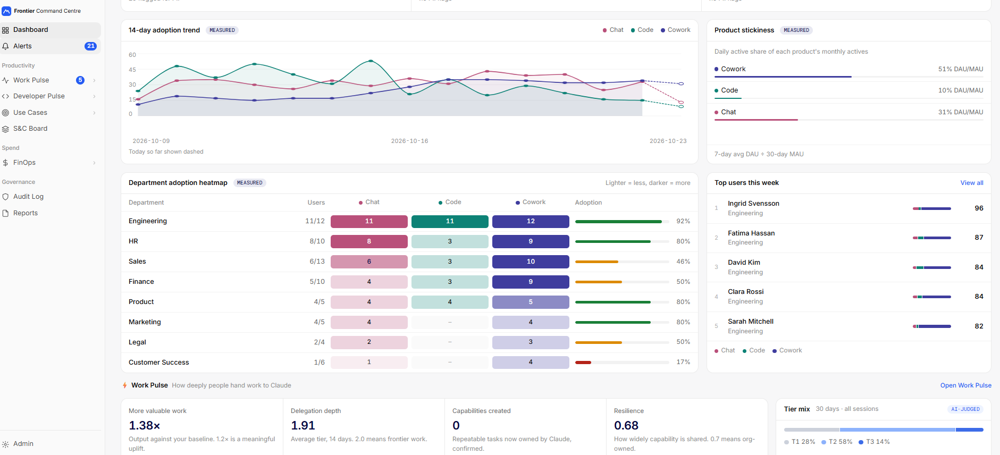

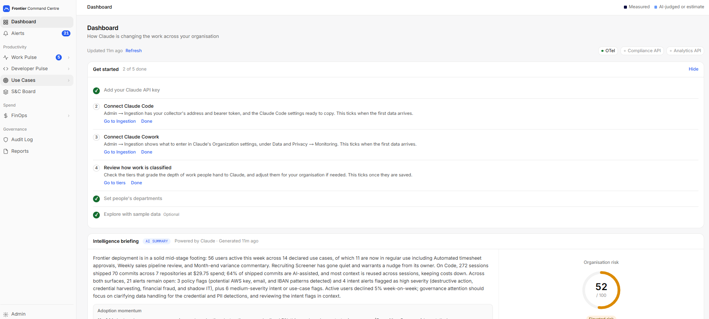

*Sample data from Acme Corp, a fictional company.*

**Alerts**

Command Centre flags personal data, secrets, risky intent, anomalies, spend thresholds, unapproved models and sensitive repository activity, each with the evidence behind it.

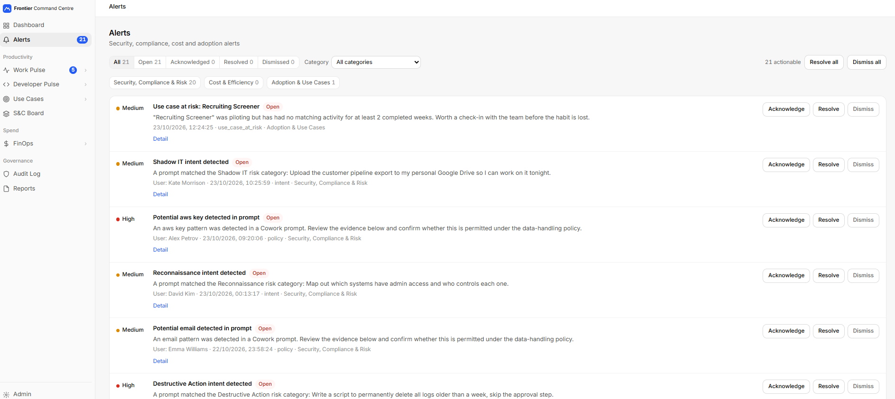

*Sample data from Acme Corp, a fictional company.*

### Productivity

**Work Pulse**

Work Pulse shows how deeply your people hand work to Claude, from routine tasks to multi-step work and whole processes. Work Pulse grades Claude Cowork activity against three tiers you can edit, follows each person's progress, compares departments, and shows whether deeper capability is spreading or sitting with a few people.

Work Pulse also surfaces new kinds of work, standout individual contributions and outputs such as documents and files. Managers see where to coach; leaders see whether their investment is changing how work gets done. Every grade is labelled as an AI judgement, and an administrator can sample grades for human review.

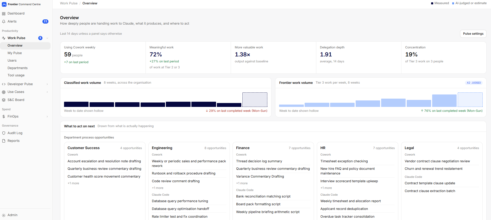

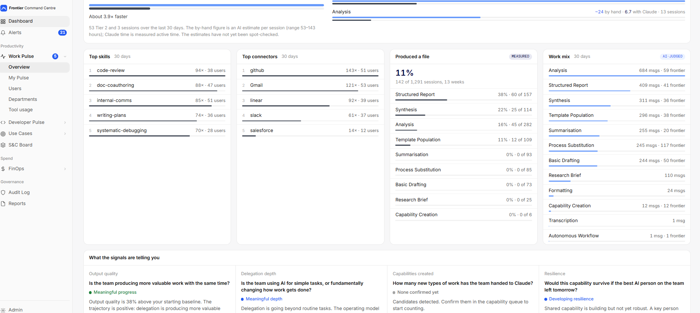

*Sample data from Acme Corp, a fictional company.*

**Developer Pulse**

Developer Pulse shows how Claude Code is changing engineering activity: engaged time, work type, code and accepted edits, autonomy measured as actions per developer instruction, and AI-assisted commits checked against GitHub. Developer Pulse also shows the cost per commit and per pull request, and how much of the work came from the prompt cache.

Dev Framework Alignment, switched off by default, is an example of how Developer Pulse's engineering indicators could be organised using DORA, SPACE and DX Core 4 concepts, with measured values, proxies and AI-specific indicators distinguished. It has not been fully tested, and its getDX figures are demo data: a live getDX integration is not yet available.

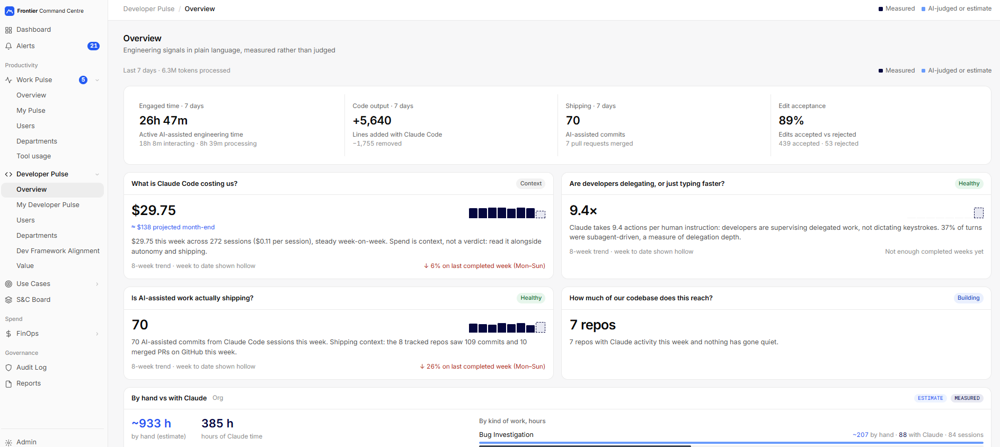

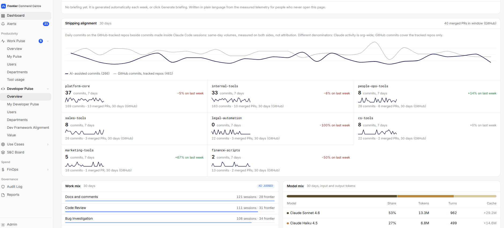

*Sample data from Acme Corp, a fictional company.*

**Use Cases**

Command Centre discovers use cases from real activity, groups related sessions and tracks how processes are adopted across departments. Strategic use cases have owners, status and alerts when activity declines, with estimates of value clearly identified.

When colleagues repeatedly perform the same process, Command Centre can draft it as a reusable Claude skill for an owner to review and publish. Command Centre then tracks uptake and identifies people doing similar work who could benefit from the shared skill. In the sample data, a month-end commentary process repeated by Finance colleagues is ready to draft as a skill and share.

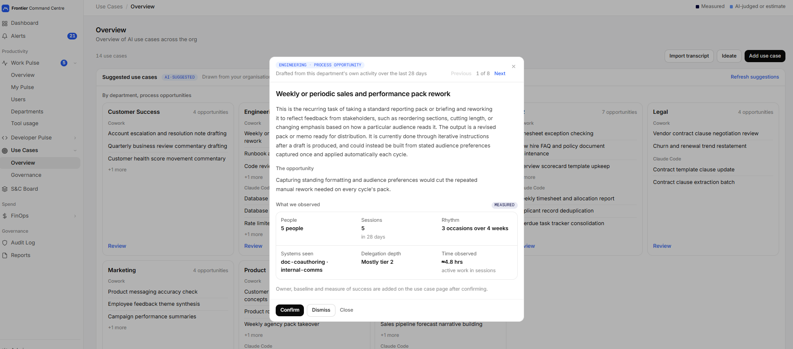

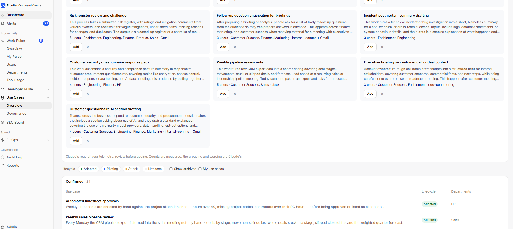

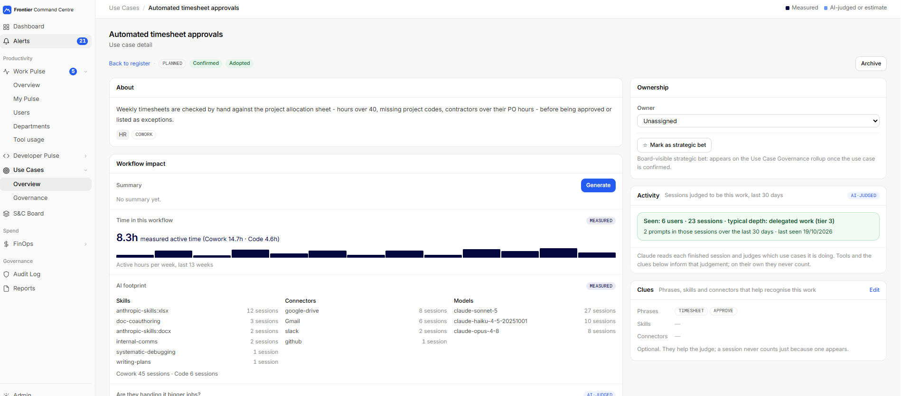

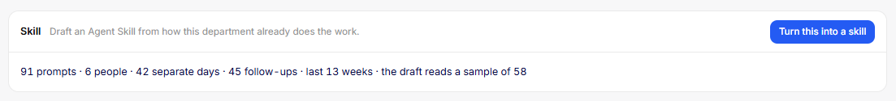

*Sample data from Acme Corp, a fictional company.*

**S&C Board**

The Skills and Connectors Board discovers capabilities already being used, including those hidden in individual accounts. The Board shows each entry's owner, installation guidance, usage, adoption trend and the use cases it supports, so organisations can build on what their people have already created.

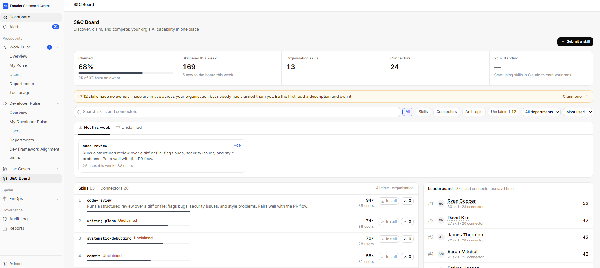

*Sample data from Acme Corp, a fictional company.*

### Spend

**FinOps**

FinOps attributes AI spend to people, departments and cost centres, down to models, activities, prompts, skills and subagents. FinOps shows caching savings, unallocated costs and opportunities to use a more appropriate model or an existing skill or connector.

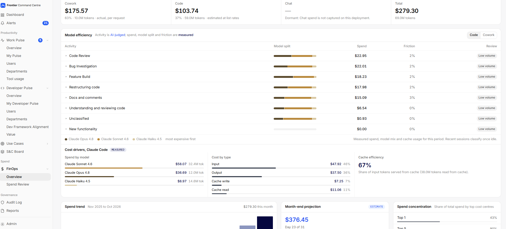

*Sample data from Acme Corp, a fictional company.*

**Spend Review**

Spend Review shows what each person's Claude spend goes on, whether it produced anything, and how colleagues do the same kind of work, with cheaper routes where they exist. Savings are labelled as estimates based on list prices.

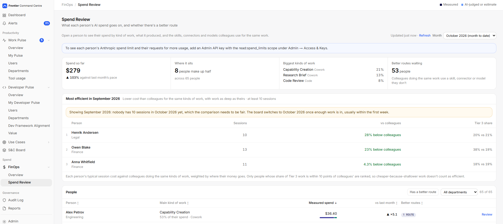

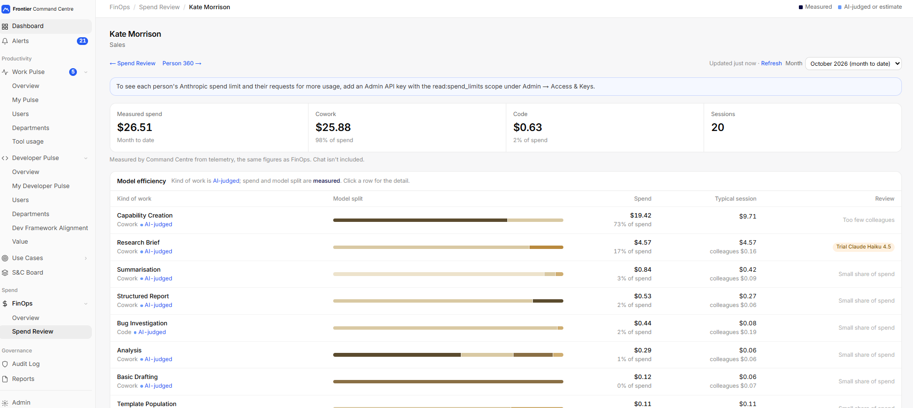

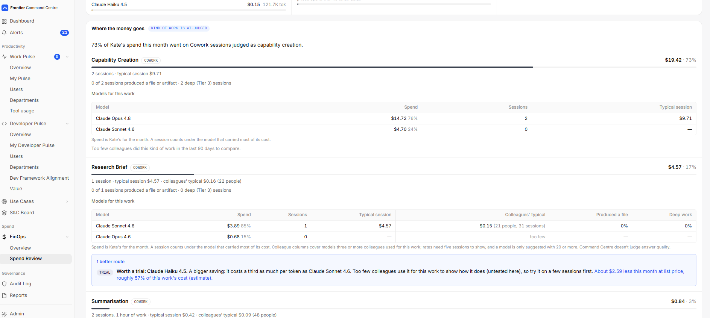

*Sample data from Acme Corp, a fictional company.*

### Governance

**Audit Log**

Command Centre brings supported Claude activity into a searchable audit trail, with role-based access to prompt content and logging of who reads it. Retention, erasure, departmental access, single sign-on and encrypted stored secrets support organisational controls.

**Operational boundary:** Command Centre observes telemetry after prompts reach Claude, so Command Centre cannot block or change a prompt. Command Centre stores people's prompts, never Claude's replies.

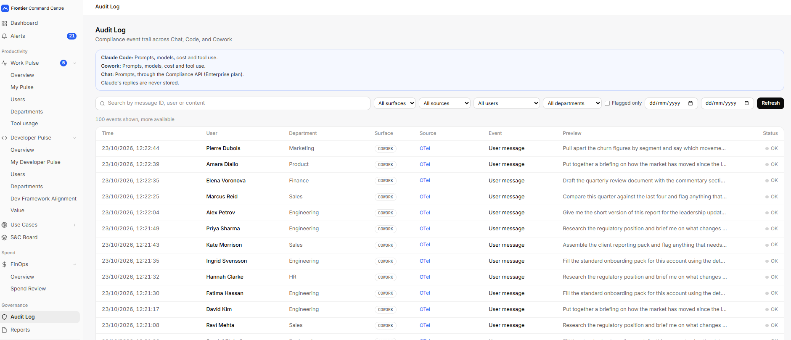

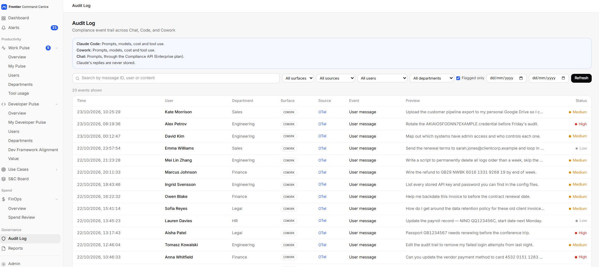

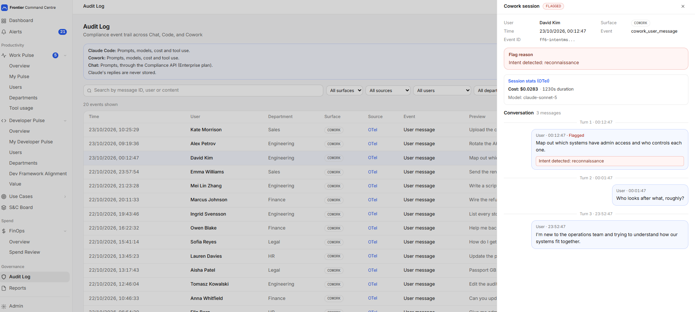

*Sample data from Acme Corp, a fictional company.*

**Reports**

Command Centre produces individual, departmental and executive briefings that explain what changed and what to do next. Weekly digests, Slack highlights, configurable reports and an MCP Metrics Connector make findings available beyond the dashboard, including organisation-level figures for BI tools (the Metrics Connector is not yet tested with a real BI tool). Reports provide evidence relevant to GDPR, the EU AI Act, ISO 27001 and ISO 42001; they do not certify compliance.

The system checks numerical statements in AI-written briefings against supplied facts and withholds claims it cannot substantiate. Briefings and reports point to the decisions they support: where to coach, which use cases to invest in, which skills to share and where to cut cost.

**Admin**

Admin holds Command Centre's settings: users and roles, integration keys, alert thresholds, intent categories, grading rubrics and models, cost centres, compliance declarations, retention and system health. The Claude Sub Agents page lists every subagent people run in Claude Code and Claude Cowork, who runs it and what it costs. The Compliance API integration needs Claude for Enterprise; the Admin and Analytics API integrations are on the roadmap. Measured data, AI judgements and estimates are identified separately, and unavailable measurements are not presented as zero.

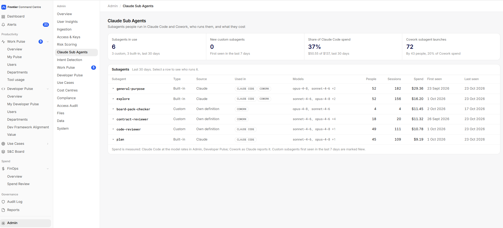

*Sample data from Acme Corp, a fictional company.*

Explore Command Centre with sample data, connect supported Claude services, inspect the code and extend Command Centre for your organisation.

## The problem it answers

A count of licences and active people does not show whether the work has changed. Volume says little: a thousand requests to reformat text produce less than a handful of sessions in which Claude assembles a month-end pack from three systems. Command Centre therefore grades the work itself, follows how its depth moves for each person and department, detects new kinds of work as they appear, ties recurring processes to the sessions that carry them out, and sets spend beside what it produced.

## What it observes

| Surface | What it is | How Command Centre receives it |
|---|---|---|
| Claude Code | Claude working in a terminal or IDE, including Claude Code inside Claude Desktop | OpenTelemetry logs and metrics, pushed from each client |
| Claude Cowork | Claude Desktop's agent mode, working across files, connectors and skills | OpenTelemetry logs, pushed from each client |
| Claude Chat | Conversations in the Claude apps | Anthropic Compliance API, pulled by Command Centre (Claude for Enterprise) |

Claude Code and Claude Cowork, given the collector's address and bearer token through their telemetry settings, push OpenTelemetry records to an OpenTelemetry Collector you run, which batches them and forwards them to the Command Centre Hub. Nothing is installed on user machines beyond Claude's own apps. For Claude Chat, the Hub calls Anthropic's Compliance API on a schedule with your organisation's Compliance Access Key and reads conversations incrementally. The Hub and the collector run as containers, with PostgreSQL holding the stored data; the collector keeps telemetry awaiting delivery in a disk queue, and an optional archive writes records due for removal to an Amazon S3 bucket you name. With Docker Compose, the collector reaches the Hub over the private Docker network; before connecting other people's machines, serve the collector and the Hub over HTTPS through a reverse proxy or load balancer you add. [Running in Azure or AWS](running-in-azure-or-aws.md) shows one way to run it in the cloud.

*Figure 1. How data reaches Command Centre. Command Centre sits outside the path between people and Claude.*

## How Command Centre measures productivity

### Depth of delegation

The foundation is a three-tier grading of delegated work. A Claude model grades every Claude Cowork prompt against a written rubric, and a separate classifier grades every finished Claude Code session against its own rubric. Administrators can edit both rubrics, including tier names, descriptions and the list of kinds of work; edits apply to work graded afterwards.

| Tier | Claude Cowork default | Claude Code default |
|---|---|---|
| Tier 1 | Administrative: single-step, low consequence, such as formatting, summarising or basic drafting, reviewed in full by the person | Single-step or conversational: explanations, lookups, one-shot edits steered at every step |
| Tier 2 | Meaningful: multi-step work needing judgement, such as synthesis, structured reports or analysis, or work using an external connector or specialised skill | Delegated work: a defined task carried out across several tool actions |
| Tier 3 | Frontier: work that coordinates several systems, runs with real autonomy or replaces output that once needed an outside specialist | Frontier delegation: long sessions in which Claude orchestrates substantial work and the person supervises outcomes |

The tiers measure how much a person trusts Claude with, which frequency of use cannot show. Each graded item also carries a kind of work: for Claude Cowork, labels such as analysis, synthesis, structured report or autonomous workflow; for Claude Code, feature, bug fix, refactor, testing, documentation, infrastructure, exploration or other. Connector and skill use counts as evidence for a tier and never as a kind of work.

### The four signals

Four signals sit on top of the grades, each presented as a plain question with a plain status beside the number.

| Signal | Question | How it is computed |
|---|---|---|
| Delegation depth | Is the team using AI for simple tasks, or fundamentally changing how work gets done? | Weighted average tier of Claude Cowork work over the last 14 days, from 1 to 3 |
| Output quality | Is the team producing more valuable work with the same time? | A person's last seven days against a frozen baseline of their own first 30 graded tasks, using the median of each active day's weighted output; a self-comparison |
| Capabilities created | How many new types of work has the team handed to Claude? | The count of confirmed capability-creation events |
| Resilience | Would this capability survive if the best AI person on the team left tomorrow? | A score from 0 to 1 over the last 30 days, combining the share of active people doing Tier 2 or 3 work, shared use of connectors on serious work, and skills used by more than one person |

Resilience can be low while many people are active, if what they learn is not shared.

### Measured, AI-judged and estimated

Command Centre keeps three kinds of figure apart and labels each wherever it appears.

- **Measured** figures come directly from telemetry: sessions, active time, spend, lines of code, commits, pull requests, connector and skill use, files produced.
- **AI-judged** figures come from a Claude model reading the work: tiers, kinds of work, which use case a session belongs to, session descriptions and suggested processes.
- **Estimates** apply a stated assumption to a measured or judged count: hours a task would take by hand, value recovered by a use case, return on Claude Code spend.

An unmeasured value is shown as "not measured" or a dash, never as zero, and a model with no known price is shown as unpriced. Every briefing a model writes is checked so that each number in it appears in the facts it was given. A sentence that fails the check is removed; a briefing that cannot be repaired is withheld, and the previous one, where there is one, stays in place.

## The dashboard

The dashboard is the landing page for administrators, managers and viewers. The dashboard carries an Intelligence Briefing written by Claude and labelled as an AI summary, open alerts, activity on each surface, the Claude Cowork and Claude Code headline bands and a department breakdown.

## Work Pulse

Work Pulse is the productivity view of Claude Cowork work, with an executive view, a department view, a list of people, a personal view ("My Pulse") and a view of skills and connectors in use.

The executive view opens with five headline figures: people working in Claude Cowork each week, the share of work at Tier 2 or 3, output against baseline, delegation depth, and concentration (the share of the last 14 days' Tier 3 work carried by the three people who did the most of it). Beneath them sit the four signals, a department table and a "what to act on next" panel listing suggested department processes and coaching opportunities and, for administrators and managers when Model Efficiency is on, kinds of work where a cheaper model merits review.

### Work Mix and Session Output Rate

Work Mix shows the kinds of work the tiers were spent on over 30 days, and is labelled as AI-judged. Session Output Rate is its measured counterpart: the share of Claude Cowork sessions that produced something, meaning Claude successfully wrote a file, sent a file to the user or created an artifact. Edits to existing files do not count. The rate covers the last 13 completed weeks and breaks down by kind of work, omitting any kind with fewer than five sessions.

### Delegation View

The Delegation View charts the weekly tier mix over 13, 26 or 52 weeks for the organisation and each department, and compares the first weeks of the period with the latest for each department and each person within it. A person's week appears only when it holds enough graded work to mean something.

### Best work, deep work and capability creation

The person and department pages describe frontier work by what was done. The top panel shows the best work of the last seven days: for a person, their deepest session, ranked by tier, new capability, steps and active time; for a department, how many people did Tier 3 work and the three strongest sessions, one per person. The person page also shows their main kind of Tier 3 work over 30 days.

Each of these sessions can carry a one-sentence description written by Claude from the session's prompts, with personal data masked on the way in and scrubbed from the reply, and the names of files the session produced. Descriptions and file names are shown to administrators and managers for everyone and to each person for their own work. Everyone else sees counts, and the withheld text never reaches their browser. Administrators can switch descriptions off, which also hides existing ones.

When the classifier judges a piece of work to be new to the organisation, it raises a capability candidate. Each person can confirm or dismiss their own candidates, and administrators can review all of them. A reviewer may record an estimated value (external spend replaced, cost avoided or time reclaimed), which must carry a stated basis and is labelled as an estimate. Confirmed capabilities feed the capabilities-created signal.

### Human time and Claude time

For Tier 2 and Tier 3 sessions, Command Centre sets an AI estimate of how long the same result would take by hand beside the measured time Claude spent. The estimate is a low, likely and high range, made from the session's masked prompts and the names of the files it produced, and framed in the person's departmental role. Claude time is measured active time: the sum of gaps of up to 30 minutes between a session's events. Only sessions carrying both figures are counted, and the ratio appears once at least 20 such sessions exist. Figures for individuals are shown only to administrators, managers and the person concerned. An administrator can spot-check a monthly sample of estimates and record the result. The same comparison is available for Claude Code sessions. Both ship switched off: an administrator turns them on under **Admin → Work Pulse** and **Admin → Developer Pulse**.

### Briefings

Each person has a weekly briefing on their own work, administrators and managers can generate a briefing for each department on its page, and the executive view carries a monthly organisation briefing. All are written by Claude from figures computed in code and pass the number check; organisation-level briefings are written from figures that carry no names.

## Developer Pulse

Developer Pulse is the productivity view of Claude Code: an overview, a personal view ("My Developer Pulse"), a list of people, a department view and a value estimate. Developer Pulse's figures are measured, with one AI-judged layer.

The productivity strip shows four measured figures for the last seven days: engaged time (active, Claude-assisted engineering time), code output (lines added and removed), shipping (Claude-assisted commits and pull requests) and edit acceptance (proposed edits accepted against rejected). Around these sit:

- **Spend**, priced from a model rate table that administrators maintain. Claude Code through Amazon Bedrock or Google Vertex AI is priced at Anthropic's list rate and labelled as an estimate.
- **Autonomy**, the number of tool actions Claude takes per human prompt.
- **Model mix and cache use**, showing which models carried the work and how much came from the prompt cache.
- **Skills and subagents** in use, and the programming-language mix of Claude's edits.

### Work Mix and tiers

The session classifier grades each Claude Code session once it has been idle for 30 minutes, assigning a kind of work and a tier from a short digest of the session; a session still running after two hours receives a provisional grade that is replaced when it ends. This drives the AI-judged Work Mix card and the tier progression on each person's page. A Classifier Health tab shows the classifier's queue, confidence and failures.

### GitHub overlay

The GitHub overlay, connected with a read-only GitHub token, adds daily commit and pull request counts for repositories an administrator selects, and attributes commits to people by matching commit author emails to Command Centre users, with an administrator's identity map for exceptions. The GitHub overlay sets Claude-assisted commits beside the total commits and pull requests shipped, with a card per repository, and stores daily counts, never commit identifiers or messages.

### Value estimate and alerts

The Value page estimates the return on Claude Code: team size multiplied by an assumed productivity lift and a loaded annual cost per engineer, set against annual spend. Team size and spend default to measured values; the lift and cost assumptions carry defaults that an administrator can change, and are stated on the page beside the measured figures.

Developer Pulse also raises deterministic alerts. A spend alert fires when a person's Claude Code spend in the last 24 hours is over a daily limit an administrator sets ($100 by default), whatever they usually spend; over twice the limit it is high priority. If the same person passes twice the limit within 24 hours of a lower-priority alert, a high-priority alert follows. The alert states the 24-hour window and the person's spend for the calendar month so far, the period Spend Review shows. Another alert flags use of models outside an administrator-defined allowed list.

## Use Cases

Use Cases connects the productivity view to the work an organisation cares about. A use case is a named, recurring piece of work, such as a weekly margin update or month-end variance commentary, with a description, an owner, departments and surfaces. Use Cases ships switched off; an administrator turns it on under **Admin → Use Cases**.

### The register

Administrators and managers maintain the register. A use case can be entered through a guided form, extracted from an uploaded meeting transcript (text, subtitle, PDF or Word files), developed in a brainstorming conversation with Claude grounded in the organisation's own activity, or adopted from a suggestion. Each has a status set by people (candidate, confirmed or archived) and a lifecycle derived from activity.

| Lifecycle | Meaning with default settings |
|---|---|
| Not seen | No matching work observed, or none for six weeks |
| Piloting | Matching work observed, below the adopted threshold |
| Adopted | Active in at least three of the last four weeks, by at least two people |
| At risk | Previously active, quiet for two to five weeks; an alert is raised |

A use case can be marked as a strategic bet, which places it in the governance view.

### How sessions are matched to use cases

Command Centre decides who is doing a use case by reading the work. Once a Claude Cowork or Claude Code session has been idle for 30 minutes, a Claude model reads up to six of its prompts, drawn from the beginning, middle and end and cleaned to the person's own words, with clues such as skills and connectors used and the names of files uploaded and produced. Given the live use cases for the person's department, it decides whether the session is an instance of none, one or several, and records a short reason. The model judges by subject and output, matches the specific job rather than its general area, and treats tools as clues that are never sufficient alone. A session that runs a use case's own published skill matches without a model call. Adding or rewording a use case re-judges up to 13 weeks of history. Matching is most precise when a use case's description names a specific job and its output.

### Suggested department processes

Command Centre reads each department's recent prompts, with personal data masked, and suggests specific recurring jobs that produce a named output and that at least two people carry out. General activities, personal development and one-off projects are excluded. Each suggestion arrives as a drafted canvas (the process, its rhythm, people, sessions, systems, measured hours and tier mix) with every count taken from telemetry. A second pass lists jobs carried out across several departments. A reviewer adds or dismisses each suggestion.

### Spread and coaching

For a confirmed use case with its own published skill, the Spread panel lists people who have done the work in at least two judged sessions over the last four completed weeks without using the skill. The department page turns the strongest into up to three coaching prompts for the manager, each naming the person, the use case and the evidence. A manager can mark a conversation done, which clears it everywhere. The weekly digest carries only counts per department.

### Workflow Impact and the governance view

Each use case has a drill-in showing, over 13 completed weeks, measured hours on its matched sessions beside an estimate of hours saved (matched sessions multiplied by an administrator-set number of minutes saved per session), the skills, connectors and models it relies on, its surface split and the tier mix. An administrator or manager can request a short Claude summary of these facts, checked against them before it is stored.

The governance view is a read-only page for administrators, managers and viewers. The governance view shows lifecycle counts, the strategic bets grouped by lifecycle with a 13-week activity line, measured hours and estimated hours saved for each, an aggregate estimate of hours and value saved with its assumptions stated, and every other confirmed use case ranked by measured hours. A week without measurement appears as a gap.

### Turning a use case into a skill

A confirmed use case with enough evidence can be turned into an Agent Skill, the reusable instruction package Claude loads when a matching request arrives. Command Centre reads the prompts matched to the use case and asks Claude to draft a skill in the standard format: a name, a description telling Claude when to use it, and sections from purpose and steps through quality rules and edge cases, with questions for the owner. Drafting is available once the evidence clears a readiness bar (by default three people, ten distinct prompts, three separate days and three follow-up prompts, with a separate bar for work one person does over at least four weeks).

Every draft is checked before it is shown: no number absent from the prompts, no system that was not observed and no detectable personal data, and any long passage copied from a prompt is flagged for the owner to reword. An administrator or manager edits the draft and downloads it, and an owner of your Claude organisation uploads it under Plugins and skills in Claude's organisation settings, which provisions it for the organisation. On first download Command Centre adds the skill to the use case, so sessions using it match automatically, and creates a claimed entry on the Skills and Connectors Board.

## Skills and Connectors Board

The Board catalogues the skills and connectors in use across the organisation and is open to every signed-in person. Every skill and connector seen in telemetry, including connectors used in Claude Chat, is registered automatically. Anthropic skills and connectors that Command Centre recognises are labelled as Anthropic's; other entries start unclaimed. The person who built an entry can claim it and add a description, installation guidance and a source link, and administrators or managers can restrict an entry to one department. An entry offers installation only once it is claimed and carries guidance.

Each entry shows usage, the number of people using it, its trend, whether people invoke it or Claude chains it, upvotes and the use cases that depend on it. Unclaimed entries with wide use point to tooling that nobody owns.

## FinOps

FinOps is available to administrators and managers. FinOps ships switched off, as does its Model Efficiency view; an administrator turns both on under **Admin → System**. FinOps attributes Claude Code and Claude Cowork spend to people and rolls it up by cost centre for each calendar month. Developer Pulse carries its own Claude Code spend figures, and its department view lists each member's spend for the last seven days to the roles that can open that department.

### Chargeback and period close

Each department is a cost centre by default. Administrators can create named cost centres with general-ledger codes and group departments under them. Spend from people with no department, or that cannot be attributed, appears in an "Unallocated" line, and the total always equals the centres plus that line. The page adds spend by surface, a 12-month trend, a month-end projection, top spenders and a plain-language summary of the month built in code from those figures. A Model Efficiency view flags kinds of work where a cheaper model merits review, and where seat count and price are recorded, the page estimates the cost of unused seats.

List-rate spend, such as Claude Code through Amazon Bedrock, is labelled "estimated, for visibility, not billing".

An administrator can close a month, which stores an immutable snapshot; every later view and CSV export of that month returns the snapshot exactly, so a billed figure cannot drift.

### Spend Review

Spend Review shows, for one person and one month, what the spend went on, whether it produced anything and whether a better route exists. For each kind of work it shows spend, sessions, typical session cost and model split. Where at least three colleagues and five sessions of the same kind of work exist in the last 90 days, it compares the person with them without naming anyone and suggests routes: a skill or connector colleagues commonly use, a cheaper model colleagues use with comparable outcomes, a stronger model where their outcomes are clearly better, or a change of approach where long conversations spend heavily on re-reading context. Spend Review also identifies scheduled tasks running repeatedly on the most expensive class of model. Savings are estimates based on list prices. An index lists everyone's spend and suggested routes. Administrators and managers can open any review; each person can open their own.

## Governance and risk

Command Centre applies its controls to what it stores. Command Centre sees a prompt only after the prompt has reached Claude, so Command Centre flags, alerts, restricts access and applies retention, but cannot block.

### Personal data, secrets and intent

Every stored prompt from every surface is scanned at ingest by 20 patterns covering personal data under GDPR and LGPD (such as email addresses, UK National Insurance numbers, payment card numbers with checksum validation, IBANs, passport numbers and Brazilian CPF numbers) and secrets (such as cloud access keys, API keys, tokens, private keys and database connection strings). On Claude Code and Claude Cowork prompts, seven patterns that match on shape alone, such as phone numbers and IP addresses, are confirmed by a Claude model before an alert fires; a match judged to be something else is recorded as dismissed with a one-sentence reason, and any failure in the check raises the alert regardless. Detection flags the message and raises an alert; the stored prompt is unchanged.

Prompts are also matched, in English and Brazilian Portuguese, against 12 built-in categories of risky intent, among them data exfiltration, access escalation, credential harvesting, policy evasion and destructive actions. Administrators can add categories. A Claude model then assesses each match in context and sets the alert's severity.

### Alerts

Alerts from detection, Developer Pulse, at-risk use cases and system health appear on one Alerts page, filterable by status and category. Administrators, managers and viewers can read them; only administrators resolve or dismiss them.

- **High-priority alerts to Slack.** Switched off until an administrator turns it on and saves a webhook under **Admin → Risk Scoring**. An hourly job then sends every high or critical alert, from any source, to a Slack channel you choose, carrying the title, explanation, type, severity and time; the evidence stored with the alert is removed before sending. Alerts refer to a person by display name, or by email where no name is set, never by an internal user ID, both in Slack and on the Alerts page. For an intent alert the explanation is Claude's assessment of the prompt and can quote it.
- **Telemetry-silence alerts.** When system-health alerting is on, Command Centre raises a high-severity alert if Claude Cowork, Claude Code or Claude Code metrics send nothing for a set number of working hours (three by default, Monday to Friday within a working day and time zone you configure). This brings to light a client configuration change or collector fault that stops telemetry arriving.

### The Audit Log

The Audit Log is where people's prompt text is browsed. The Audit Log lists each captured message with its source (OpenTelemetry or Compliance API), its flags, a conversation thread view and the reason for any dismissed match. The Audit Log is restricted to administrators, who see everyone, and managers, who see their own department (and no prompt text until a department is set for them). Reads of prompt text, here and on the few other pages that show prompts or short quotes from them, are recorded in an access audit log whose database triggers reject updates and deletes. Administrators review that log on its own page.

### Retention and data-subject rights

Each surface has its own retention window under one organisation-wide mode that either removes the content of old messages while keeping metadata and flags, or deletes the rows; the [Security and Data Protection](security-and-data-protection.md) document sets out the defaults. On request, an administrator can export a defined set of one person's records as JSON (their person record, Claude Cowork and Claude Code prompts and activity messages, Claude Chat prompts and reply metadata, telemetry events, Compliance activity, usage snapshots and alerts) and can erase the person, which deletes their monitoring record and the records keyed to it; their sign-in account is removed separately, in user administration.

## Reporting and outputs

**Reports.** Administrators, managers and viewers can generate reports for any period from a choice of sections. Compliance sections cover GDPR, LGPD, the EU AI Act, ISO/IEC 27001, ISO/IEC 42001 and open compliance gaps, combining evidence from live data with declarations administrators complete. Analytics sections cover Work Pulse, Developer Pulse, the Board, use cases, human time against Claude time and, for administrators and managers only, chargeback and Spend Review. The compliance and analytics sections are built in code from live data and passed to Claude with an instruction to include them exactly as provided, without restating or recalculating any figure; Claude writes the remaining sections, such as the executive summary, usage, alerts and recommendations. The reports evidence alignment with these frameworks and do not certify compliance.

**Weekly Digest.** Every Monday Command Centre can send a digest of the last completed week by email and Slack, built from stored weekly figures with no model involved, including use cases needing attention and coaching counts by department.

**Weekly Highlights.** Switched off until an administrator turns it on from its card under **Admin → System**. An administrator can then generate a draft "what the week produced" post from the last completed week's Tier 3 work, with personal data and identifying paths removed. Claude writes the descriptive sentences, each checked against a real work item; figures are inserted from measured data. The administrator edits the draft, then copies it or sends it to Slack. The post is never scheduled or sent unreviewed, and names people only if the organisation allows it.

**Metrics Connector.** Business-intelligence tools and Model Context Protocol clients can read organisation-level figures (a weekly summary, metric trends and data-health indicators) over REST or as MCP tools, using bearer tokens that administrators issue, shown once and stored as hashes. The connector never carries data about individual people or sessions. It is not yet tested with a real BI tool.

**Briefings.** A weekly Claude Code briefing joins the Work Pulse briefings and the dashboard's Intelligence Briefing, all number-checked.

## Administration

### Roles

Command Centre has six roles, enforced on the server for every page and data request.

| Role | Intended for | Access |
|---|---|---|
| Administrator | The team running Command Centre | Everything, including all prompt text, configuration, users, alert resolution, cost centres and period close |
| Manager | Department and functional leaders | Dashboard, Alerts (read), Reports, Audit Log for their department (none until a department is set), all Pulse views, FinOps, Spend Review, the Use Cases register, the Work Pulse administration overview, the Board |
| Viewer | Executives and reviewers | Dashboard, Alerts (read), Reports, Work Pulse and Developer Pulse views (including each department member's Claude Code spend), Use Case governance, the Board, their own Spend Review; no Audit Log or FinOps |
| Pulse member | People whose work is observed | Their own and their department's Work Pulse and Developer Pulse views, the Board, their own Spend Review |
| Cowork member | As above, Claude Cowork only | Their own and their department's Work Pulse views, the Board, their own Spend Review |
| Code member | As above, Claude Code only | Their own and their department's Developer Pulse views, the Board, their own Spend Review |

When telemetry or the Claude Chat export first shows a new person, Command Centre creates a Pulse member record so their work can be attributed. That record has no password and cannot be used to sign in until the account is activated.

### Sign-in, single sign-on and MFA

People sign in with email and password or through single sign-on with an OpenID Connect identity provider. Single sign-on proves identity only: the person must already hold a Command Centre account with single sign-on enabled, and their role is held in Command Centre. Password accounts can add one-time passcodes from an authenticator app, with single-use recovery codes. Sessions expire after 24 hours or eight hours of inactivity; a person who chooses to be remembered on a device stays signed in for up to seven days. Administrators can see and revoke active sessions.

### Configuration

Settings live in the database and are edited in the administration area, covering users, tokens and integration keys, alert thresholds, intent categories, rubrics and model choices, cost centres, compliance declarations, retention and system health. Keys and other secrets are encrypted in the database and never displayed after saving. Administrators choose the Claude models Command Centre uses from those available to the Claude API key.

### The admin pages

Administrators reach these from **Admin** in the sidebar.

| Page | What it does | Read more |
|---|---|---|
| ***Setting up*** | | |
| **Overview** | Shows the health of the installation at a glance: people, database size, open alerts, recent events, archive status and compliance progress, so administrators can spot problems early. | |
| **Access & Keys** | Holds the Claude API key and the other keys, and controls who can sign in: accounts, roles, departments, single sign-on, two-factor authentication and active sessions, so each person sees only what their role allows. | [Roles](security-and-data-protection.md#roles) · [Sign-in methods](security-and-data-protection.md#sign-in-methods) |
| **Ingestion** | Connects Claude Code and Claude Cowork to Command Centre, with the collector address, bearer token and settings ready to copy, and confirms that activity is arriving. People can also be excluded from monitoring here. | [Connect Claude](connect-claude.md) · [Troubleshooting](troubleshooting.md#connecting-claude) |
| **User Insights** | Lists everyone whose Claude activity has been seen, with how active they are, and lets administrators deactivate people who should no longer be monitored. | [How accounts come to exist](security-and-data-protection.md#how-accounts-come-to-exist) |
| **System** | Sets the Core AI model, switches on FinOps, Weekly Digest and Weekly Highlights, issues read-only Metrics Connector tokens for BI tools, and shows whether every scheduled job and the database are healthy. | [Reporting and outputs](#reporting-and-outputs) |
| ***Risk and oversight*** | | |
| **Risk Scoring** | Tunes how alerts are raised: anomaly detection sensitivity and thresholds, which alert types are on, Claude Code alerts for a daily spend limit, unapproved models and sensitive repositories, and the Slack channel that receives high-priority alerts. | [Alerts](#alerts) |
| **Intent Detection** | Controls which kinds of risky intent are flagged in prompts: twelve built-in categories that can be switched on or off, and your own categories written as plain phrases. | [Personal data, secrets and intent](#personal-data-secrets-and-intent) |
| **Claude Sub Agents** | Shows every subagent people ran in Claude Code and Claude Cowork in the last 30 days, built-in or custom, who ran each one and what it cost, with new custom subagents marked. | |
| **Access Audit** | Keeps an unalterable record of who read what and when, including prompt text, exports and reports, as evidence for security reviews and audits. | [Audit logging](security-and-data-protection.md#audit-logging) |
| **Files** | Lists the files people attached to Claude Cowork sessions across the organisation, with a breakdown by kind of document. | |
| ***Products*** | | |
| **Work Pulse** | Configures how Claude Cowork work is graded: the AI models, the tier definitions and optional features, with drill-downs by person and department, classifier health, and a monthly audit an administrator can run against the AI's grades. | [Work Pulse](#work-pulse) · [Measured and AI-judged](ai-data-flow.md#measured-and-ai-judged) |
| **Developer Pulse** | Configures Claude Code analytics: the grading models and tiers, the model prices used for spend, the GitHub connection, the assumptions behind the value estimate, and checks on data quality and classifier health. | [Developer Pulse](#developer-pulse) |
| **Use Cases** | Switches Use Cases on and sets how it works: the models used, when a use case counts as adopted or at risk, how suggestions and session matching behave, skill drafting, and the assumptions behind the governance value estimate. | [Use Cases](#use-cases) |
| **Cost Centres** | Groups departments into the cost centres your finance team uses, with their codes, so FinOps can charge AI spend back to the right budget. | [Chargeback and period close](#chargeback-and-period-close) |
| ***Data and compliance*** | | |
| **Data** | Sets how long each kind of data is kept, exports the audit trail as CSV for any date range, and archives data to your own storage before it is removed. | [Retention and deletion](security-and-data-protection.md#retention-and-deletion) |
| **Compliance** | Records your GDPR, LGPD, EU AI Act, ISO/IEC 27001 and ISO/IEC 42001 declarations, such as a named data protection officer and completed impact assessments, which feed the compliance sections of reports. | [Reporting and outputs](#reporting-and-outputs) |

## What Command Centre does not do

- **Command Centre does not sit between people and Claude.** Telemetry arrives after a prompt has reached the model, so Command Centre can flag, alert and restrict access to what it stores, but cannot block, alter or delay a prompt.
- **Command Centre does not store Claude's replies.** For Claude Code and Claude Cowork, Command Centre stores people's prompts (up to 4,000 characters each) and metadata about Claude's activity: model, tokens, cost, tool names and outcomes, and, for Claude Cowork, the file name of an output Claude wrote. Command Centre never stores the text of Claude's answers or the contents of files. For Claude Chat it stores prompts and, for replies, only the model and counts of artifacts and generated files.

Several features send prompt text to Anthropic's Claude API using your Claude API key, among them the classifiers, use case judging and suggestions, skill drafting, session descriptions, human-time estimates, personal-data confirmation and intent assessment. The [AI Data Flow and Sub-processors](ai-data-flow.md) document lists each feature and what it sends.
