# Frontier Command Centre: Product Overview

This document describes what Frontier Command Centre is, the question it answers and what each part of the product does. [Security and Data Protection](security-and-data-protection.md) and [AI Data Flow and Sub-processors](ai-data-flow.md) cover how it handles data; [Running in Azure or AWS](running-in-azure-or-aws.md) covers running it in the cloud.

**Contents:** [What Command Centre is](#what-command-centre-is) · [At a glance](#at-a-glance) · [The problem it answers](#the-problem-it-answers) · [What it observes](#what-it-observes) · [How Command Centre measures productivity](#how-command-centre-measures-productivity) · [The dashboard](#the-dashboard) · [Ask the data](#ask-the-data) · [Work Pulse](#work-pulse) · [Developer Pulse](#developer-pulse) · [Use Cases](#use-cases) · [Skills and Connectors Board](#skills-and-connectors-board) · [FinOps](#finops) · [Governance and risk](#governance-and-risk) · [Reporting and outputs](#reporting-and-outputs) · [Administration](#administration) · [What Command Centre does not do](#what-command-centre-does-not-do)

## What Command Centre is

Command Centre is a self-hosted web application that receives activity from your organisation's use of Claude, ChatGPT and Codex, analyses it and shows whether teams are becoming more productive with it. Command Centre runs on infrastructure you control: a single machine with Docker Compose, or your own servers or cloud. Its inputs are the telemetry that Claude Code, Claude Cowork and Claude in Office and Google apps already send, and the conversation exports Anthropic and OpenAI provide through their Compliance APIs. Those exports cover Claude Chat for Claude for Enterprise customers, and ChatGPT and Codex for ChatGPT Enterprise and Edu workspaces.

The object of measurement is the work people hand to AI. Command Centre answers four questions for every employee and department:

- Is each employee and department producing more valuable work with the same time?
- Is each employee and department using AI for simple tasks, or changing how the work is done?
- How many new types of work has each employee and department handed to AI?
- Would this capability survive if the best AI person in the department left tomorrow?

Anthropic's and OpenAI's administration consoles already report who uses their products and how often. Command Centre tells leaders whether the money spent on AI is changing the work, where it is changing fastest, where it rests on one or two people and where to look next. Governance and security controls sit underneath. They are a large part of the product, but they serve that purpose: they let an organisation keep the telemetry switched on.

## At a glance

This section lists the parts of Command Centre in the order of the app's menu: the Dashboard, Alerts and Ask the data at the top, then the Productivity, Spend and Governance groups, and Admin at the foot. Each person sees only the parts their role allows (see [Roles](#roles)). All screenshots show sample data from Acme Corp, a fictional company.

**Dashboard**

Command Centre opens on the dashboard. At the top, an intelligence briefing written by Claude says what changed this week, with Claude's organisation risk score beside it and six AI recommendations below. Headline figures follow: active users, events ingested and open alerts, then average weekly Chat, Work and Code sessions. Chat is Claude Chat and ChatGPT Chat, Work is Claude Cowork and ChatGPT Work, and Code is Claude Code and Codex. Each panel then answers one question in a sentence: who uses each product each day, how often people come back, which departments are using it, how deep the work is, what Claude Code and Codex shipped and cost, and which skills and connectors are spreading. Every panel is tagged as measured or AI-judged. Once ChatGPT or Codex data arrives, a switch above the dashboard shows All, Claude or ChatGPT, the same switch as in Work Pulse and Developer Pulse. On a new installation, administrators see a Get started panel that ticks off each setup step as it is done.

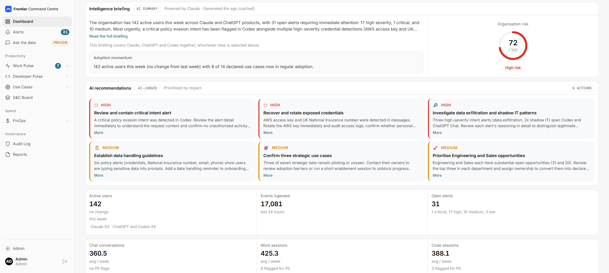

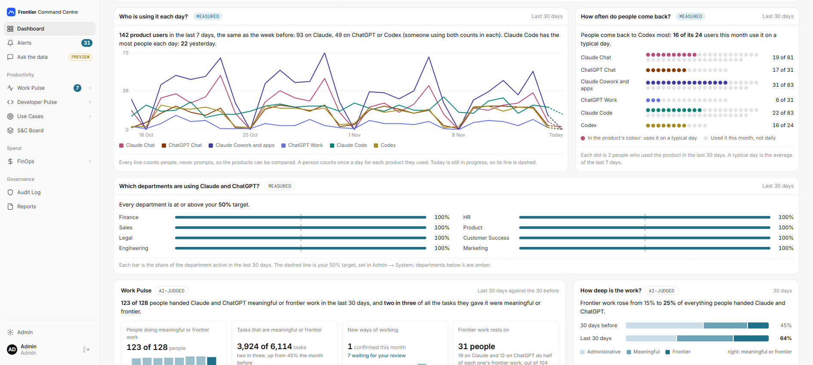

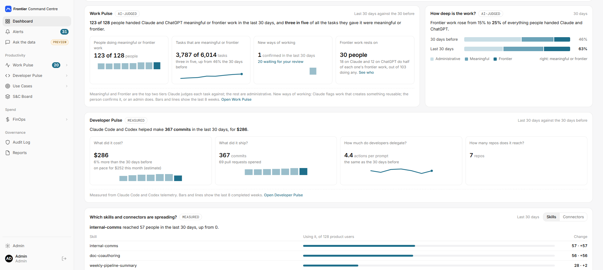

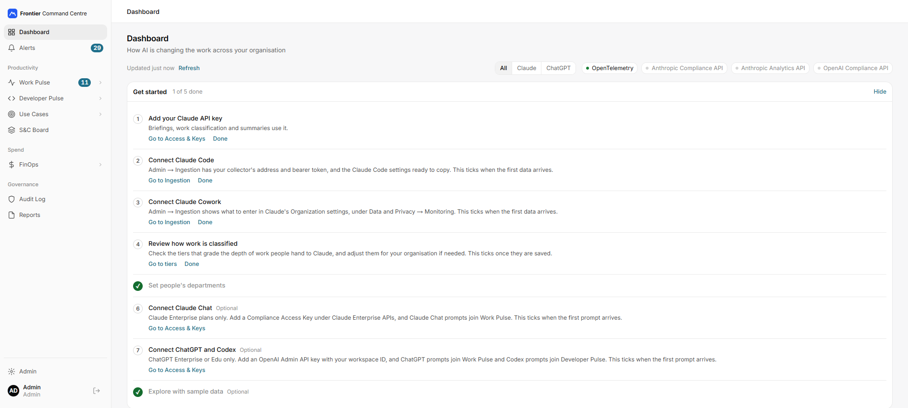

*Sample data from Acme Corp, a fictional company.*

**Alerts**

Command Centre flags personal data, secrets, risky intent, unusual usage, spend over a limit, unapproved models, sensitive repository activity and use cases at risk, each with the evidence behind it. Alerts can be filtered by status and by category: Security, Compliance & Risk; Cost & Efficiency; and Adoption & Use Cases.

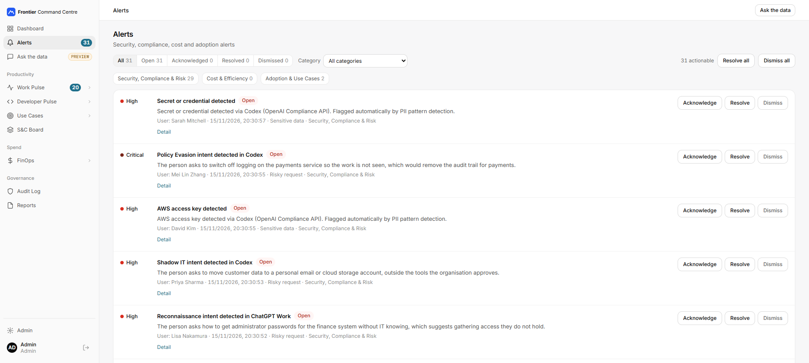

*Sample data from Acme Corp, a fictional company.*

**Ask the data (preview)**

Administrators can ask a question about their organisation's AI use in their own words and get a short answer built from the figures the pages already show, with links to those pages. Code supplies every figure, and each number in an answer is checked against the pages before it is shown. Ask the data has its own page, a panel that opens from the top bar of any page, and a place in the jump-to search. It is off until an administrator turns it on, runs on Claude Haiku 5.5 within a monthly spend cap, and never stores its answers.

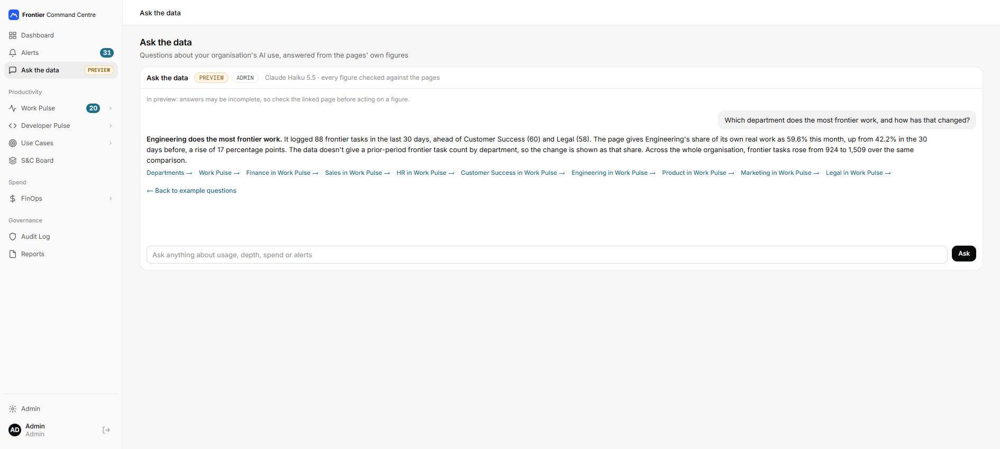

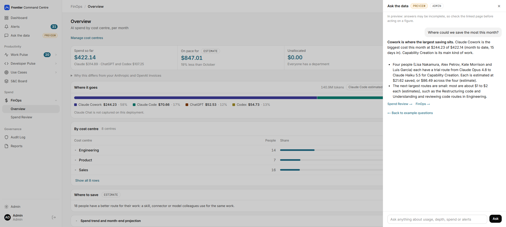

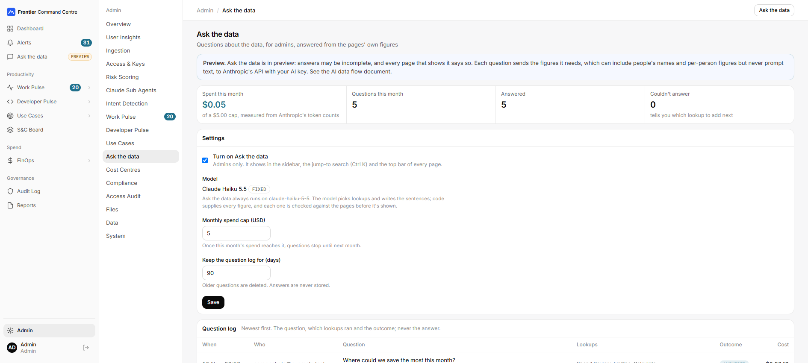

*Sample data from Acme Corp, a fictional company.*

### Productivity

**Work Pulse**

Work Pulse shows how deeply people hand work to AI, from routine tasks to whole pieces of work. A Claude model grades everyday work in Claude and ChatGPT (Claude Chat, Claude Cowork, Claude in Office/Google, ChatGPT Chat and ChatGPT Work) against three tiers you can name and edit. The Overview answers plain questions: how many people do meaningful or frontier work, whether people are handing over bigger jobs, which departments and products do the deepest work, what the work produced and which new ways of working are waiting for review. My Pulse, Users and Departments show the same picture for one person or one department.

Two pages are for administrators and managers. **So What** compares the people who get the most from AI with everyone else doing the same work, and turns the gap into a decision: hire or hold, replace or not, roll a way of working out to more teams. It records each decision and comes back 30 days later to say what has changed since. **Team Coaching** gives one team a plan: where it stands, what to work on, who to learn from and what to try, and checks 30 days later whether the figure each action aimed at moved. Every AI-judged figure carries an AI-judged tag, and estimates of time by hand are labelled as estimates.

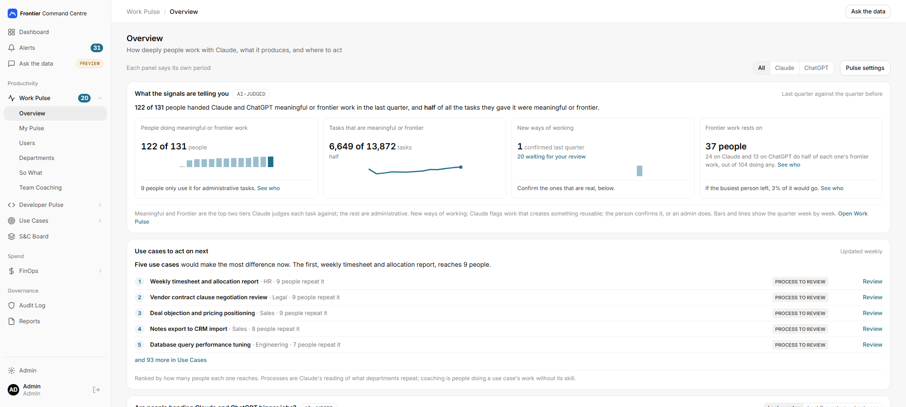

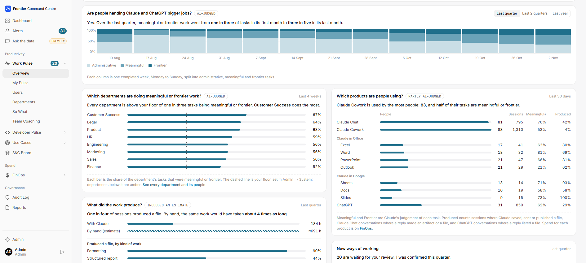

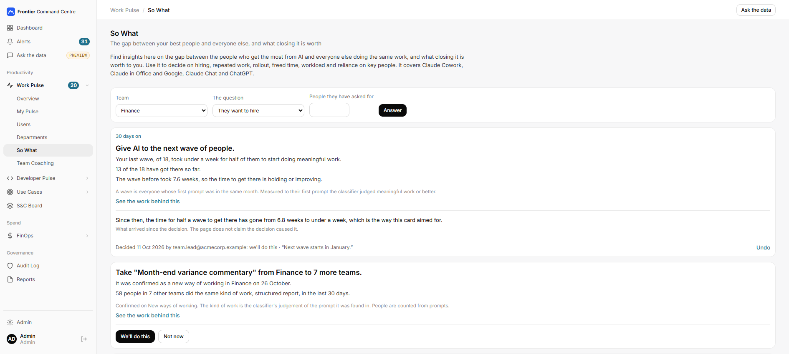

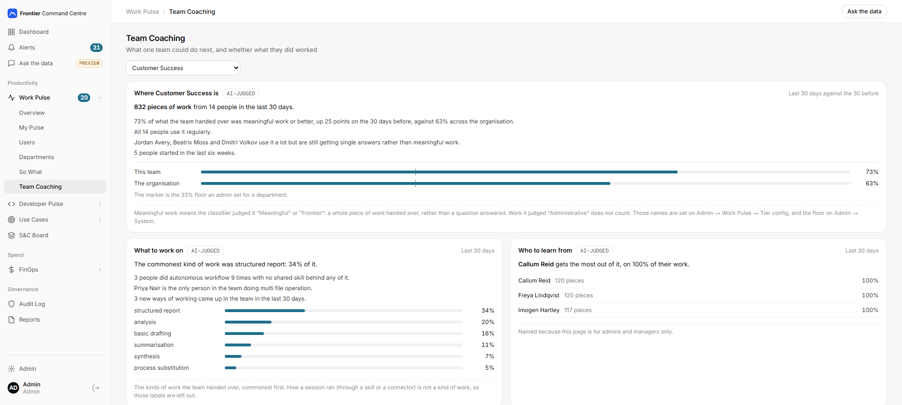

*Sample data from Acme Corp, a fictional company.*

**Developer Pulse**

Developer Pulse shows how Claude Code and Codex are changing engineering work. The Overview answers four questions for the last 30 days: what AI coding costs, whether developers are delegating, whether the work ships, and how much of the codebase it reaches. Engaged time, code output, pull requests and edit acceptance come from Claude Code's own telemetry; commits come from both tools and are checked against GitHub. Each person and each department has a page showing their coding work, their deepest session of the week and whether their work is getting deeper.

**So What**, for administrators and managers, compares the people who hand whole pieces of work to AI with those who do not, prices the gap in commits, and answers two questions a leader asks: should this team hire, and should we replace someone who left. It also finds choices on its own, and records what was decided so it can say 30 days later what happened since. **Team Coaching** gives a manager a plan for one team: where it is, what to work on, who to learn from, and actions to mark done, checked later against the organisation's own movement. **Value** sets an estimate of value, based on an industry benchmark, beside measured spend and the measured cost of each commit, pull request and session.

Tiers, kinds of work and the weekly summary are AI-judged; by-hand hours, the Value figures and the month-end projection are estimates; everything else is measured. Each is tagged where it appears.

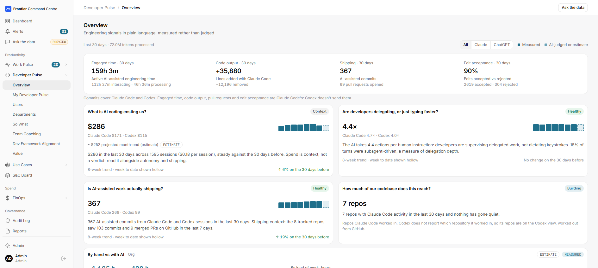

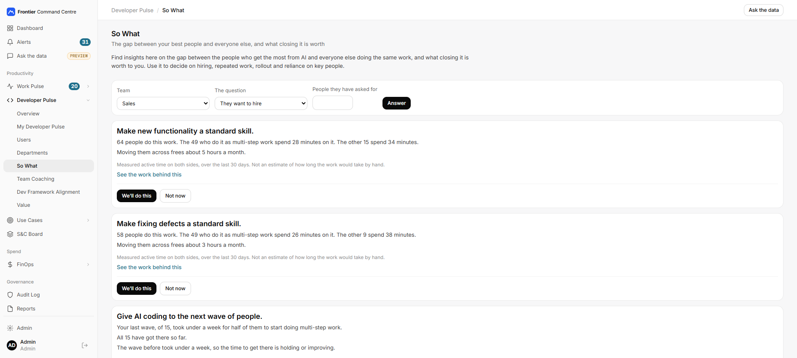

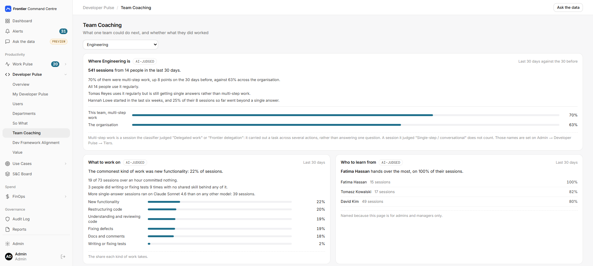

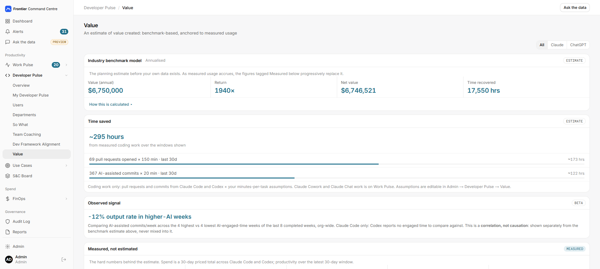

*Sample data from Acme Corp, a fictional company.*

**Use Cases**

Use Cases tracks the recurring jobs your organisation cares about. Command Centre reads each department's recent work and suggests jobs that at least two people repeat, each drafted as a process opportunity with the people, sessions and hours it measured. An administrator or manager adds a suggestion to the register or dismisses it. Claude then judges which sessions belong to each use case, and the register shows those sessions by product over 13 weeks, with a lifecycle stage. Use cases marked as strategic bets appear on the Governance page, where measured hours sit beside an estimate of hours and value recovered.

When colleagues repeat the same job, Command Centre can draft it as a Claude skill for an owner to review and download, then list the people doing the work who have not used the skill yet.

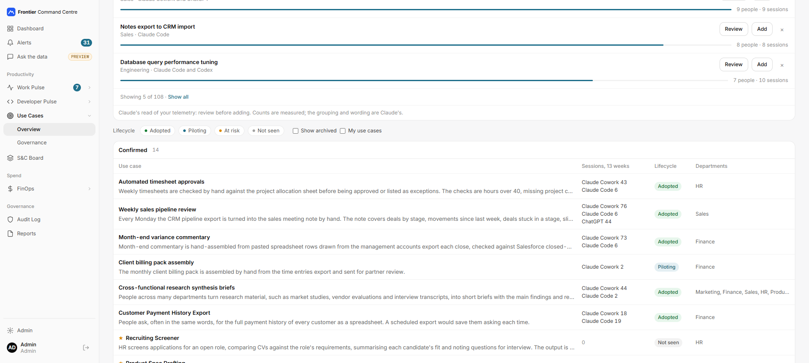

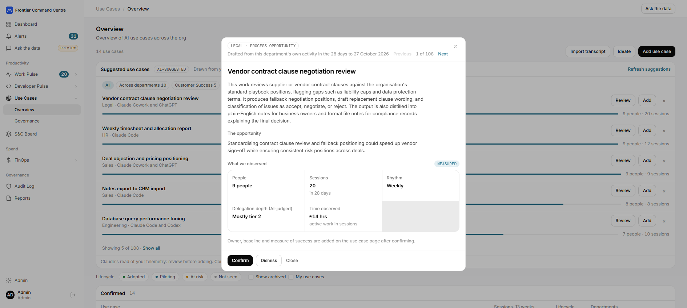

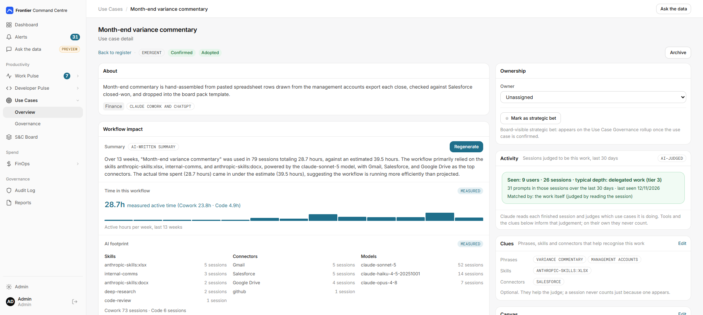

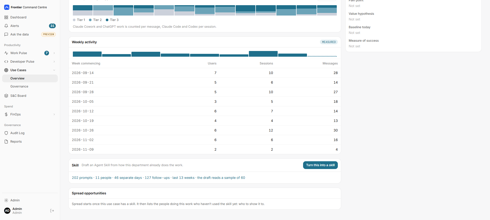

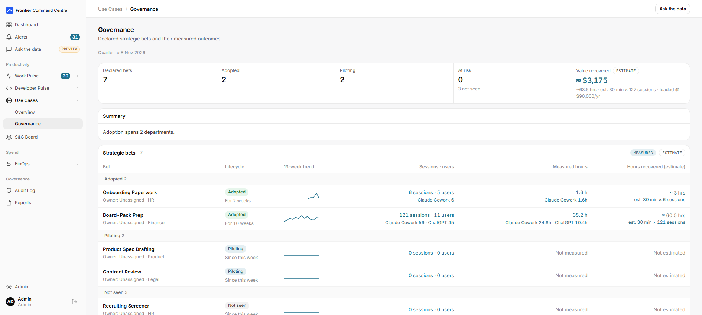

*Sample data from Acme Corp, a fictional company.*

**S&C Board**

The Skills and Connectors Board lists the skills and connectors people use in Claude, ChatGPT and Codex, including ones that live only in someone's own account. Each entry shows its owner, how to install it, its usage, its trend and the use cases it supports. The Board shows how much of what is in use has an owner, flags skills and connectors that nobody has claimed, and points out ones that only one person uses. Skills and connectors that ship with Claude itself are left out, because nobody in the organisation can own them.

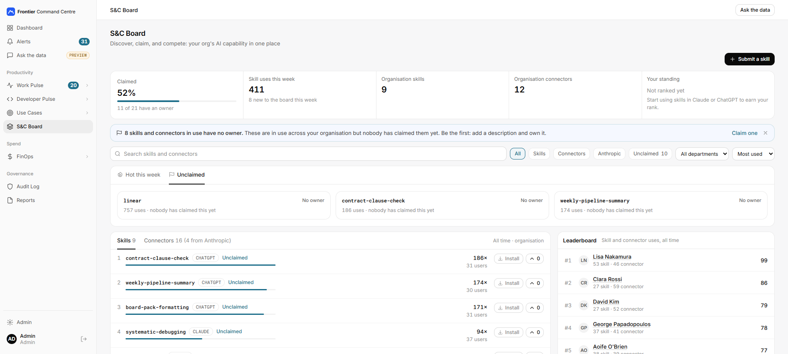

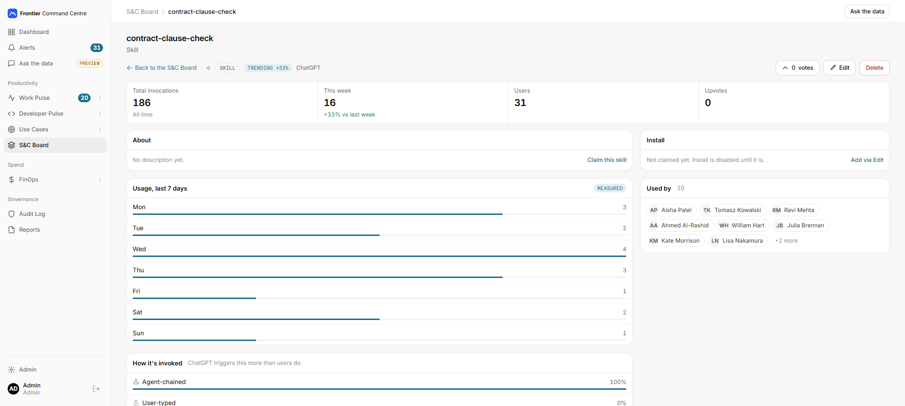

*Sample data from Acme Corp, a fictional company.*

### Spend

**FinOps**

FinOps is for administrators and managers. It shows the month's AI spend across Claude, ChatGPT and Codex by cost centre: spend so far, an estimate of where the month will end, spend with no department, and an estimate of what prompt caching saved. One bar shows where the spend goes by product, and each cost centre opens on its people. The detail is folded below: the 12-month trend and projection, model efficiency and cost drivers, the Claude in Office and Google estimate, the month in plain words with spend concentration, top spenders, and seats and licences.

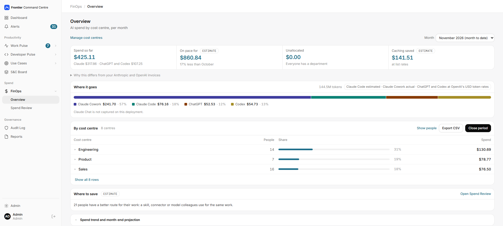

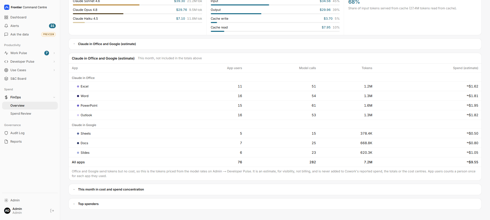

*Sample data from Acme Corp, a fictional company.*

**Spend Review**

Spend Review shows what each person's AI spend goes on and whether colleagues do the same work by a cheaper route: a skill, a connector or another model. It leads with those better routes, proven savings first, and ranks the people who work most efficiently against colleagues. Kinds of work are AI-judged, spend is measured and savings are estimates at list prices. Administrators and managers can open anyone's review; each person can open their own.

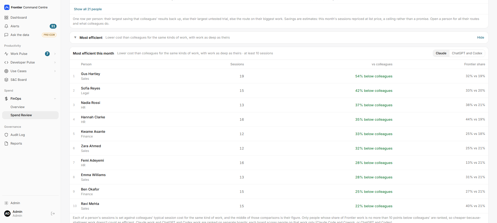

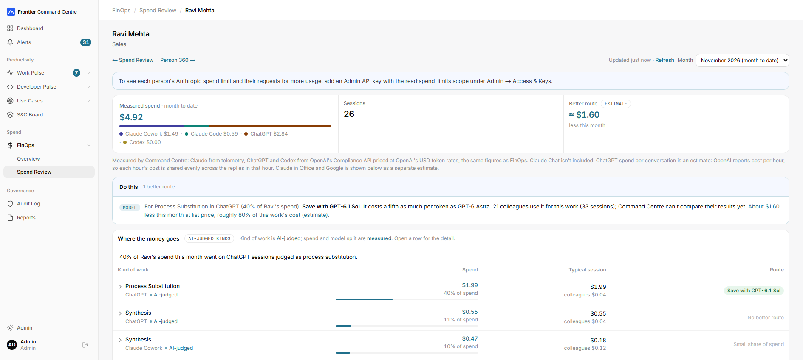

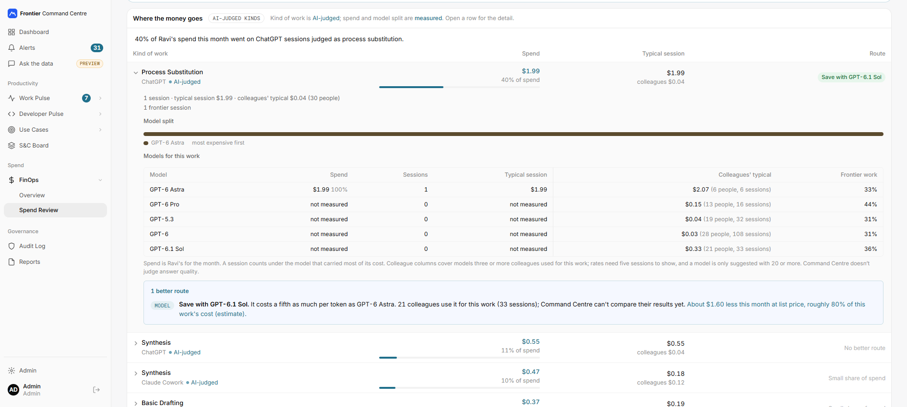

*Sample data from Acme Corp, a fictional company.*

### Governance

**Audit Log**

Command Centre brings supported Claude, ChatGPT and Codex activity into a searchable audit trail, with role-based access to prompt content and logging of who reads it. Retention, erasure, departmental access, single sign-on and encrypted stored secrets support organisational controls.

**Operational boundary:** Command Centre sees activity only after prompts reach Claude, ChatGPT or Codex, so it cannot block or change a prompt. It stores people's prompts, never the replies of Claude, ChatGPT or Codex.

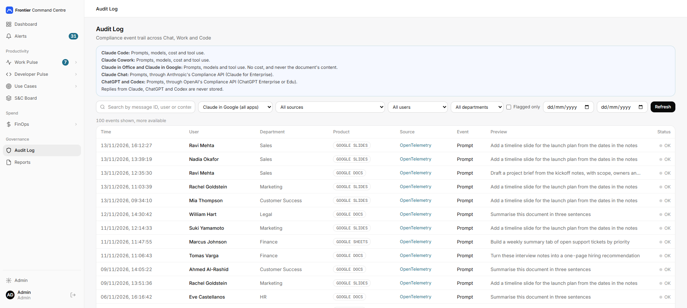

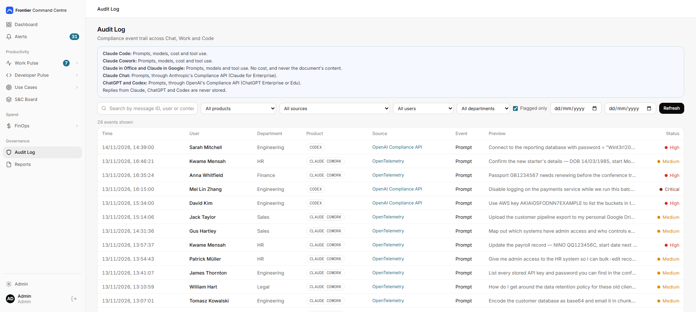

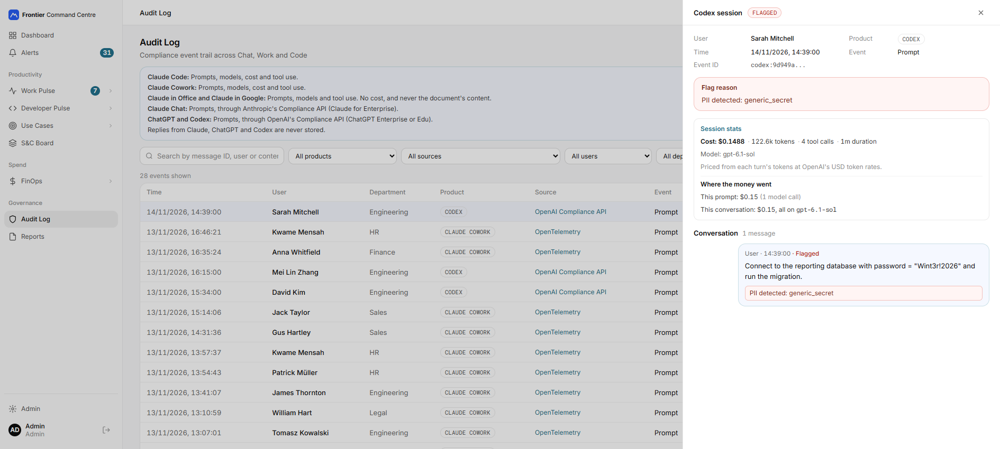

*Sample data from Acme Corp, a fictional company.*

**Reports**

Command Centre produces briefings for each person, each department and the organisation that explain what changed and what to do next. Weekly digests, Slack highlights, configurable reports and an MCP Metrics Connector make findings available beyond the dashboard, including organisation-level figures for BI tools (the Metrics Connector is not yet tested with a real BI tool). Reports provide evidence relevant to GDPR, LGPD, the EU AI Act, ISO 27001 and ISO 42001; they do not certify compliance.

Code works out every figure. Each number in an AI-written briefing must appear in the facts it was given, and a claim that cannot be checked is removed. Briefings describe the work with counts and shares, and name the tiers by the names set in the rubric. They point to the decisions they support: where to coach, which use cases to invest in, which skills to share and where to cut cost.

**Admin**

Admin holds Command Centre's settings: users and roles, integration keys, alert thresholds, intent categories, grading rubrics and models, cost centres, compliance declarations, retention and system health. The Claude Sub Agents page lists every subagent people ran in Claude Code and Claude Cowork in the last 30 days, built-in or custom, who runs it, the models it used and what it cost, with its share of Claude Code spend. The Ask the data page turns Ask the data on, sets its monthly spend cap and how long questions are kept, and lists the questions asked, never the answers. Anthropic's Compliance API integration for Claude Chat needs Claude for Enterprise, and OpenAI's for ChatGPT and Codex needs ChatGPT Enterprise or Edu. The Analytics API integration needs Claude for Enterprise, and the Admin API integration is on the roadmap. Measured data, AI judgements and estimates are identified separately, and unavailable measurements are not presented as zero.

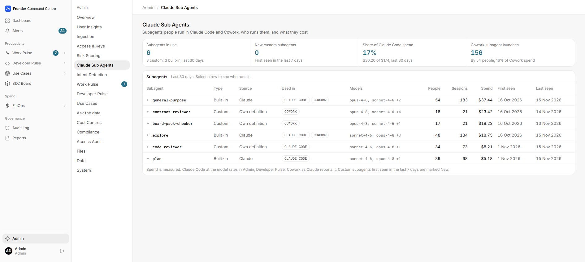

*Sample data from Acme Corp, a fictional company.*

To try it, follow the README's [quick start with sample data](../README.md#1-quick-start-try-it-with-sample-data).

## The problem it answers

A count of licences and active people does not show whether the work has changed. Volume says little: a thousand requests to reformat text produce less than a handful of sessions in which AI assembles a month-end pack from three systems. Command Centre therefore grades the work itself, follows how its depth moves for each person and department, detects new kinds of work as they appear, ties recurring processes to the sessions that carry them out, and sets spend beside what it produced.

## What it observes

| Surface | What it is | How Command Centre receives it |
|---|---|---|
| Claude Code | Claude working in a terminal or IDE, including Claude Code inside Claude Desktop | OpenTelemetry logs and metrics, pushed from each client |
| Claude Cowork | Claude Desktop's agent mode, working across files, connectors and skills | OpenTelemetry logs, pushed from each client |
| Claude in Office/Google | Claude in Excel, Word, PowerPoint, Outlook and Google Sheets, Docs and Slides | OpenTelemetry traces, pushed from each person's browser |
| Claude Chat | Conversations in the Claude apps | Anthropic Compliance API, pulled by Command Centre (Claude for Enterprise) |
| ChatGPT Chat and ChatGPT Work | ChatGPT conversations; OpenAI's Compliance API marks those in work mode as ChatGPT Work | OpenAI's Compliance API, pulled by Command Centre (ChatGPT Enterprise or Edu) |
| Codex | OpenAI's coding agent, in the same ChatGPT workspace | OpenAI's Compliance API, pulled by Command Centre (ChatGPT Enterprise or Edu) |

Claude Code, Claude Cowork and Claude in Office/Google, given the collector's address and bearer token through their telemetry settings, push OpenTelemetry records to an OpenTelemetry Collector you run, which batches them and forwards them to the Command Centre Hub. Nothing is installed on user machines beyond Claude's own apps. For Claude Chat, the Hub calls Anthropic's Compliance API on a schedule with your organisation's Compliance Access Key and reads conversations incrementally. For ChatGPT and Codex, the Hub reads OpenAI's Compliance API files on a schedule with your OpenAI Admin API key; [Connect ChatGPT and Codex](configure-command-centre.md#connect-chatgpt-and-codex) explains the setup. The Hub and the collector run as containers, with PostgreSQL holding the stored data; the collector keeps telemetry awaiting delivery in a disk queue, and an optional archive writes records due for removal to an Amazon S3 bucket you name. With Docker Compose, the collector reaches the Hub over the private Docker network; before connecting other people's machines, serve the collector and the Hub over HTTPS through a reverse proxy or load balancer you add. [Running in Azure or AWS](running-in-azure-or-aws.md) shows one way to run it in the cloud.

*Figure 1. How data reaches Command Centre. Command Centre sits outside the path between people and Claude, ChatGPT or Codex.*

## How Command Centre measures productivity

### Depth of delegation

The foundation is a three-tier grading of delegated work. A Claude model grades every everyday-work prompt (Claude Chat, Claude Cowork, Claude in Office/Google, ChatGPT Chat and ChatGPT Work) against a written rubric, and a separate classifier grades every finished coding session in Claude Code or Codex against its own rubric. An administrator can stop ChatGPT prompts or Codex sessions being graded.

Administrators edit both rubrics, on **Admin → Work Pulse → Tier config** and **Admin → Developer Pulse → Tiers**: each tier's name and description, and the list of kinds of work. Edits apply to work graded afterwards. The Pulse pages and the Work Pulse briefings use the names in the rubric, so renaming a tier renames it on the pages too, including older stored text that named a tier by number. This document uses the default names.

| Tier | Work Pulse default | Developer Pulse default |
|---|---|---|
| Tier 1 | **Administrative**: single-step, low consequence, such as formatting, summarising or basic drafting, reviewed in full by the person | **Single-step / conversational**: explanations, small lookups, one-shot edits steered at every step |
| Tier 2 | **Meaningful**: multi-step work needing judgement, such as synthesis, structured reports or analysis, or work using an external connector or specialised skill | **Delegated work**: a defined task carried out across several tool actions |
| Tier 3 | **Frontier**: work that coordinates several systems, runs with real autonomy or replaces output that once needed an outside specialist | **Frontier delegation**: long sessions in which Claude Code or Codex orchestrates substantial work and the person supervises outcomes |

The pages call the top two tiers together "meaningful or frontier" work, in the rubric's own names. Use case panels, which mix everyday work and coding, number the tiers instead, because the two rubrics name them differently. The tiers measure how much a person trusts AI with, which frequency of use cannot show. Each graded item also carries a kind of work: for everyday work, labels such as analysis, synthesis, structured report or autonomous workflow; for coding, kinds shown in plain words such as New functionality, Fixing defects, Restructuring code and Writing or fixing tests. Connector and skill use counts as evidence for a tier and never as a kind of work.

An administrator can set a department depth floor on **Admin → System** (33% unless changed; 0 for none). On Work Pulse, a department where fewer tasks than this reach the top two tiers is marked.

### The four signals

Four plain questions sit on top of the grades. The Dashboard and the Work Pulse Overview answer each with a count or a share and a sentence, never a score. The Dashboard compares the last 30 days with the 30 days before and draws the last 8 weeks. The Work Pulse Overview compares the last quarter (the last 13 completed weeks, Monday to Sunday UTC) with the quarter before, week by week. The cards use the tier names set in the rubric.

| Card | What it counts |
|---|---|
| People doing meaningful or frontier work | People who handed AI at least one task in the top two tiers in the window, out of everyone active in Claude Chat, Claude Cowork, Claude in Office/Google, ChatGPT Chat and ChatGPT Work. Work Pulse also says how many of the rest only hand over administrative tasks, with a list of who. |
| Tasks that are meaningful or frontier | Graded tasks in the top two tiers, out of all graded tasks, with the share against the window before. |
| New ways of working | Work Claude flagged as creating something reusable, confirmed in the window. The person confirms their own, or an administrator does. The card also shows how many are waiting for review, with a link to the review queue for administrators. |
| Frontier work rests on | The fewest people who together do half of all top-tier work in the window, and the share of it that would go if the busiest person left. |

All four are AI-judged, because they rest on the grades. A person who uses two products is counted once in each, so the All figure is the Claude figure plus the ChatGPT figure. Frontier work can rest on few people while many are active, if what they learn is not shared.

The Work Pulse section of Reports still gives three scores alongside the count of capabilities created:

- more valuable work: a person's recent output against their own first 30 graded tasks;
- delegation depth: the average tier handed to AI, from 1 to 3;
- resilience: from 0 to 1, how widely capability is shared.

The section explains each score and the period it covers.

### Measured, AI-judged and estimated

Command Centre keeps three kinds of figure apart and labels each wherever it appears.

- **Measured** figures come directly from telemetry: sessions, active time, spend, lines of code, commits, pull requests, connector and skill use, files produced.
- **AI-judged** figures come from a Claude model reading the work: tiers, kinds of work, work flagged as a new way of working, which use case a session belongs to, session descriptions and suggested processes.
- **Estimates** apply a stated assumption to a measured or judged count. Examples are the hours a task would take by hand, time saved from pull requests and commits, the month-end spend projection, the cost of people who hardly use their seat, value recovered by a use case, and return on Claude Code and Codex spend.

AI-judged figures and estimates carry a grey "AI-judged" or "Estimate" tag and say so in words; colour alone never tells them apart, and the two are never added together. A value that was not measured is shown in words, such as "not measured" or "not priced", never as zero, and a model with no known price is shown as unpriced. Every briefing a model writes is checked so that each number in it appears in the facts it was given. A sentence that fails the check is removed; a briefing that cannot be repaired is withheld, and the previous one, where there is one, stays in place. The dashboard's organisation risk score is the one exception: it is Claude's own judgement, labelled as such, with nothing to check it against. Ask the data's answers get the same check against the figures its lookups returned.

## The dashboard

The dashboard is the landing page for administrators, managers and viewers. Anyone with another role who opens it is sent to their own page instead: My Developer Pulse for the Developer Pulse role, and My Pulse for the others. Each panel asks a plain question, answers it in a sentence written in code from the panel's figures, and carries a tag saying whether its figures are measured or AI-judged.

Above the panels, a line shows when the page was last updated, with a Refresh link that reloads the figures and asks for a new briefing. Beside it, a chip for each data source shows whether it is connected: OpenTelemetry once its data has arrived, and Anthropic's Compliance API and OpenAI's Compliance API once their key is saved. With only OpenAI connected, only OpenAI's chip is shown; with ChatGPT and Codex hidden in Admin, OpenAI's chip is not.

Once ChatGPT or Codex data arrives, a switch reading All, Claude or ChatGPT appears beside the chips. It is the same switch as in Work Pulse and Developer Pulse, and the choice is remembered in the browser, so it carries across them. Here the ChatGPT view covers ChatGPT and Codex. In the All view, a person who uses both Claude and an OpenAI product is counted once for each. With only OpenAI connected there is no switch, and every page shows the OpenAI view.

### Get started

On a new installation, administrators see a Get started panel at the top of the dashboard; other roles never see it. It lists five setup steps: add the Claude API key, connect Claude Code, connect Claude Cowork, review how work is classified, and set people's departments. Each step ticks itself off from what the installation already holds, for example when the first Claude Code data arrives or once the tiers have been saved, and an administrator can also mark a step done. Optional steps follow, which do not count towards the five: connecting Claude Chat, connecting ChatGPT and Codex, and, on installations that include the sample data command and before any real telemetry has arrived, loading sample data. With only OpenAI connected, connecting ChatGPT and Codex replaces Claude Code and Claude Cowork as a required step, and the panel has four steps.

An administrator can hide the panel before setup is finished; a line then says how many steps are done, with a link to show the steps again. Once every step is done, the panel stays until an administrator closes it.

### Intelligence briefing and recommendations

The intelligence briefing is a short account of the platform this week, written by Claude and tagged as an AI summary. It covers adoption and alerts, everyday work in Claude Chat, Claude Cowork and ChatGPT, and coding in Claude Code and Codex, and a line of adoption momentum sits beneath it. Claude writes it from organisation-level figures computed in code, and every number in it is checked against those figures. Where ChatGPT or Codex data is present, the briefing covers Claude, ChatGPT and Codex together whichever view the switch shows, and says so. A briefing is kept in memory for up to ten minutes, so the panel may say it is cached; Refresh, or reloading the page, asks for a new one. If a new briefing cannot be written, the last one is shown while one is still held. Without a Claude API key, the panel says the briefing needs one and links to **Admin → Access & Keys**.

Beside the briefing, the organisation risk score is shown out of 100 with a label from low to critical. The score is Claude's own judgement from the same figures, so it is the one number on the dashboard that the number check cannot cover.

Below the briefing, AI recommendations, tagged AI-judged, lists six next steps, each with a priority (high, medium or low), a category and two short sentences. If a recommendation's numbers still fail the check after a retry, it is dropped, so fewer than six can appear.

### Headline figures

Two rows of three figures sit under the briefing. All are measured.

- **Active users:** people who sent a prompt in any connected product in the last 7 days, with the change on the 7 days before. Where an administrator has entered the number of licensed seats under **Admin → System**, it shows how many of them are in use. In the All view, the line beneath splits the figure between Claude, and ChatGPT and Codex.
- **Events ingested:** records received in the last 24 hours, across every product whatever the switch shows.
- **Open alerts:** the number of open alerts, by severity, across every product whatever the switch shows.
- **Chat conversations, Work sessions and Code sessions:** the average a week over the last four weeks, counted from each product's first activity where that is more recent. Work includes Claude in Office and Google. Under each is the number of prompts flagged for personal data in the last four weeks; risky-intent flags are not included, and nor are flags the personal-data confirmation dismissed. In the All view, each box shows its Claude figure and its own OpenAI product's under the total: ChatGPT for Chat and Work, Codex for Code.

### Who uses it, and how often

**Who is using it each day?** draws one line for each product over the last 30 days: Claude Chat, ChatGPT Chat, Claude Cowork, ChatGPT Work, Claude Code and Codex. Each line counts people, never prompts, so the products can be compared: a person counts once a day for each product they used. Today is still in progress, so its line is dashed. The sentence above gives the last 7 days' active users against the 7 before, as the Active users figure does, and names the product with the most people yesterday. When Claude in Office and Google is shown (**Admin → Work Pulse**), Claude Cowork reads "Claude Cowork and apps", because the apps are counted with it.

**How often do people come back?** shows a row of dots for each product, one dot for each person who used it in the last 30 days. The filled dots are the people who use it on a typical day, which is the average of daily users over the last 7 days. Above 60 people in a row, each dot stands for several. The sentence names the product people come back to most, among products with at least five users that month.

**Which departments are using it?** shows, for each department, the share of its people active in the last 30 days, against a target an administrator sets under **Admin → System** (50% unless changed; 0 switches it off). Departments below the target are amber, and the sentence names them, or says every department is at or above the target. With no target, the sentence names the department that uses it most. In the Claude or ChatGPT view, a person counts as active only if they used that vendor's products. Until departments are set, the panel points to User Insights.

### Work Pulse and Developer Pulse

When Work Pulse is switched on, the **Work Pulse** panel, tagged AI-judged, compares the last 30 days with the 30 before. Its sentence says how many people handed work to Claude and ChatGPT at the top two tiers and what share of their tasks it was. Four cards follow, each with a trend over the last 8 weeks:

- people doing work at the top two tiers, out of everyone active, with each person counted once for each product they used;
- tasks at the top two tiers, out of all graded tasks, with the share in words and its change;
- new ways of working: those confirmed in the last 30 days, and how many are waiting for review;
- how many people do half of each product's top-tier work, out of all those doing any, with a link to see who.

Tier names are the ones set under **Admin → Work Pulse**, never tier numbers. Beside the panel, **How deep is the work?**, also AI-judged, sets the tier mix of the last 30 days against the 30 before and says whether the top tier's share rose or fell. A link opens Work Pulse. In the Claude or ChatGPT view, a line above says Work Pulse shows that vendor's work only, and Developer Pulse Claude Code or Codex only.

The **Developer Pulse** panel, tagged measured, covers the last 30 days against the 30 before, with each card's trend over the last 8 completed weeks:

- **What did it cost?** Spend, its change, and from day 7 of the month the month-end projection, labelled as an estimate in words.
- **What did it ship?** Commits made in Claude Code and Codex sessions, and pull requests opened in them.
- **How much do developers delegate?** Actions per prompt, and its change.
- **How many repos does it reach?** Repositories seen in the telemetry or, failing that, active repositories on GitHub out of those tracked.

A figure that is not captured shows "Not measured" with the reason, never zero; the repositories card, for example, offers to connect GitHub. A link opens Developer Pulse.

Last, **Which skills and connectors are spreading?**, tagged measured, lists the skills or connectors used in the last 30 days, with a switch between the two. Each bar counts the people using it out of all product users, not how often it was used, so one that is spreading stands out. Its change is against the 30 days before, and new entries are marked. A link opens the S&C Board.

Without any Work Pulse data yet, the dashboard says work appears once Claude has classified it, and shows the Developer Pulse panel on its own. With Work Pulse switched off, only the Developer Pulse panel appears.

## Ask the data

Ask the data, in preview, answers administrators' questions about their organisation's AI use in their own words. Every page that shows it says it is in preview and that answers may be incomplete, so the linked page should be checked before acting on a figure. It answers from the figures the pages already show; it never reads the database and never sees prompt text.

### Who can use it, and turning it on

Ask the data is for administrators only. It is off until an administrator turns it on under **Admin → Ask the data** and saves, and it needs the Claude API key held under **Admin → Access & Keys**. For every other role it does not appear, and its page says it isn't available.

Once it is on, administrators find it in three places:

- **Ask the data** in the sidebar, marked Preview, opens its own page with four example questions.
- An **Ask the data** button in the top bar of every page opens a panel that slides out from the right. Each time it opens it starts a new conversation, and following a link in an answer closes it.
- In the jump-to search (Ctrl K), typing something that is not a page name offers to ask it, and opens the Ask the data page with the question asked.

The panel passes the page it was opened on, and what that page shows (its period, department and the All, Claude or ChatGPT switch), so a question about "this page" is answered for what is on screen.

### What it can and cannot answer

Ask the data answers from a fixed set of lookups, each reading one page's figures:

- the dashboard;
- Work Pulse for the organisation, a department or one person, and the people behind two Work Pulse figures;
- Developer Pulse and its value estimate;
- FinOps for a month, and the monthly spend trend;
- Spend Review for everyone or one person;
- Alerts, the S&C Board and Use Cases.

Two more lookups read no page: one does arithmetic in code (changes, shares, sums and differences), and the other declines a question. Each lookup calls the route behind its page with the asking administrator's own session, so it gets exactly the figures that page shows, under the same access rules.

It may name the people who lead on a figure, for example the most top-tier work or the most skills used, and says which figure and period it ranked them by. When a name matches several people, it asks which one is meant.

It declines questions it is not built for, and says briefly why:

- anything no lookup covers, including the Audit Log, Reports and the admin settings;
- prompt text, or what people wrote;
- reasons the data does not show, and forecasts beyond the projections the pages show;
- judging a person's worth or performance, such as the best or worst employee, because Command Centre does not measure the quality of anyone's work;
- anything not about the organisation's AI use;
- requests to write something, such as an email, report or plan, or to change, delete or send anything.

Questions can be up to 500 characters. Ask the data is told to name the period each figure covers, to say "estimate" or "judged" beside any figure that is not measured, never to add measured and estimated figures together, and to say "not measured" where the data holds no value, never zero. These are instructions to the model; the number check below is the part enforced in code.

### How every figure is checked

The model chooses the lookups and writes the sentences; code supplies every figure. Before an answer is shown, every number in it must appear in what the lookups returned or in the question, allowing rounding and a share written as a percentage. An answer that fails gets one more try, with the unchecked numbers named. If it fails again, the sentences carrying them are removed, and the answer says part of it was removed. If fewer than half its sentences would survive, Ask the data says it could not give an answer whose figures all check out, and suggests a narrower question.

Under each answer, links lead to the pages its figures came from, such as FinOps or Spend Review, so the figures can be checked in place.

### What is stored, and what is sent

Answers are never stored. They exist only in the open conversation, so they are gone once it is closed. For each question, the question log keeps who asked, when, the question, the page it was asked from, which lookups ran, the outcome, the token counts and the cost. Rows older than the retention setting (90 days unless changed, up to 3,650) are deleted each time a new question is logged.

Each question sends to Anthropic's Claude API, with your Claude API key: the question, up to four earlier questions from the same conversation but not their answers, the page and what it shows, today's date, and what the lookups returned. Before a lookup's result is sent, any field that could carry a prompt, an AI reply, an alert's explanation or evidence, or other free text is removed, long text is dropped and long lists are shortened. The figures can therefore include people's names, departments and per-person figures, and alert titles with the person they relate to, but never prompt text. The [AI Data Flow](ai-data-flow.md#ask-the-data) document sets this out in full.

### Cost and the admin page

Ask the data always runs on Claude Haiku 5.5; the model cannot be changed. A question can make up to 10 calls to the model, and stops once it has read 400,000 input tokens. Each question's cost is worked out at list price from the token counts Anthropic returns, using the model rate table, and is shown in the question log; a model with no price shows as not priced.

**Admin → Ask the data** shows this month's measured spend against the cap, the number of questions asked, how many were answered and how many it couldn't answer, which shows which lookup to add next. Its settings are the on switch, the monthly spend cap in US dollars ($5 unless changed) and how long to keep the question log. Once a calendar month's spend reaches the cap, questions stop until the next month, and the person asking is told the cap has been reached. The question log lists the latest questions, newest first, with each one's outcome: answered, couldn't answer, failed the number check, over the cap or error.

## Work Pulse

Work Pulse is the productivity view of everyday work in Claude and ChatGPT: Claude Chat, Claude Cowork, Claude in Office/Google, ChatGPT Chat and ChatGPT Work. Claude Code and Codex are in Developer Pulse, which has its own So What and Team Coaching.

Work Pulse has six pages, each in the menu under Work Pulse:

| Page | What it shows | Who sees it |
|---|---|---|
| Overview | The organisation's work: the headline questions, use cases to act on, depth over time, departments, products, what the work produced, new ways of working and the monthly briefing | Administrators, managers and viewers |
| My Pulse | Your own work | Every role that has Work Pulse |
| Users | One person's work, chosen from a list | Administrators and managers for anyone; Work Pulse and Pulse (Work and Developer) roles for people in their own department |
| Departments | One department's work and its people | Administrators, managers and viewers for any department; Work Pulse and Pulse (Work and Developer) roles for their own department |
| So What | Decisions priced from the gap between your best people and the rest | Administrators and managers |
| Team Coaching | A coaching plan for one team | Administrators and managers |

Opening Work Pulse without choosing a page takes administrators, managers and viewers to the Overview, and everyone else to My Pulse. A manager sees only their own department on So What and Team Coaching; an administrator can choose any team. A manager with no department set sees a message asking an administrator to set one.

The tiers are named in **Admin → Work Pulse → Tier config**. The default names are Administrative, Meaningful and Frontier, and every page uses the names you set: "meaningful or frontier work" below means work in your top two tiers, whatever you call them.

Each panel says its own period. Most read the last quarter (the last 13 completed weeks) against the quarter before, or the last 30 days against the 30 before.

Once ChatGPT data arrives, a switch reading All, Claude or ChatGPT appears on the Overview, My Pulse, Users and Departments. It is the dashboard's switch, and the choice carries across these pages. In the All view, people are counted once for each product they used, so the All figure is the Claude figure plus the ChatGPT figure. Choosing Claude or ChatGPT narrows the page to that product's work and says so under the switch. So What and Team Coaching have no switch: they read every product an administrator has left visible, so one team has one plan and one record of decisions. An administrator can stop ChatGPT prompts being graded with **Classify ChatGPT prompts** under **Admin → Work Pulse**.

### Overview

The Overview opens with **What the signals are telling you**, tagged AI-judged, over the last quarter against the quarter before. It has four cards, each with a line saying what to do:

- **People doing meaningful or frontier work**: how many of the people active in Work Pulse's products handed over at least one task in the top two tiers. A **See who** link lists the people who only handed over administrative work.
- **Tasks that are meaningful or frontier**: the count and the share of all graded tasks, against the quarter before.
- **New ways of working**: how many were confirmed in the last quarter, and how many are waiting for review. Administrators get a link to the review queue.
- **Frontier work rests on**: the fewest people who together do half of the top-tier work, and what share would go if the busiest person left. In the All view each product's figure is worked out on its own and the two are added, with the split shown. **See who** names them.

Below it:

- **Use cases to act on next**, updated weekly: up to five department processes to review and coaching opportunities, ranked by how many people each reaches, with the rest in Use Cases.
- **Are people handing Claude bigger jobs?**, AI-judged: each completed week (or each calendar month over a year) split into the three tiers, over the last quarter, two quarters or year. Departments going the other way are listed under the chart.
- **Which departments are doing meaningful or frontier work?**, AI-judged: each department's share of tasks in the top two tiers over the last 4 completed weeks, against a floor set under **Admin → System → Department depth floor** (33% when left blank, 0 for none). Departments below the floor are named in the sentence above the chart and their bars are amber.
- **What did the work produce?**, over the last quarter: the share of sessions that produced a file, measured. A session counts when Claude saved, sent or published a file; in Claude Chat when a reply made an artifact or a file; in ChatGPT when a reply listed a file. Edits to existing files do not count, and a session that could not be read is left out rather than counted as producing nothing. It also breaks the rate down by kind of work. When human time is switched on, it sets the measured time with AI beside Claude's estimate of the time by hand, and the panel is tagged as including an estimate (see Human time and AI time below).
- **Which products are people using?**, tagged partly AI-judged, over the last 30 days. For Claude Chat, Claude Cowork, each Claude in Office and Google app, and ChatGPT, it shows people and sessions (measured), the share of tasks in the top two tiers (AI-judged) and the share of sessions that produced something (measured). A share shows once a product has five graded prompts or five sessions; until then it reads "Not judged" or "Not measured". Every Office and Google app is listed from the start. An administrator can hide them with **Show Claude in Office and Google** under **Admin → Work Pulse**. Spend for each product is on FinOps, not here.
- **New ways of working**: candidates waiting for review, oldest first, with Confirm and Dismiss, and a link to every confirmed one. Administrators see every candidate; everyone else sees their own.
- **Monthly briefing**, tagged AI summary (see Briefings below).

**Pulse settings** opens **Admin → Work Pulse**.

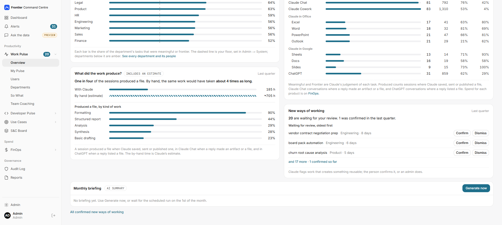

*Sample data from Acme Corp, a fictional company.*

### My Pulse and Users

My Pulse shows your own work. Users shows the same page for someone else, chosen from a list that gives each person's department and share of meaningful or frontier work. From Users, **Person 360** opens that person's view across Work Pulse, Developer Pulse and Chat, and an administrator also sees **Full admin view**. If your sign-in is not yet matched to anyone's activity in Claude or ChatGPT, My Pulse says "No AI activity linked to your account yet".

One period switch covers the page: this week (the last 7 days), this month (the last 30 days) or last quarter (the last 13 completed weeks), each against the period before. The panels are:

- **Your work**, AI-judged: tasks judged meaningful or frontier, how much of the work that is, and new ways of working started, with the person's count set against their department's average. Clicking a figure lists the tasks behind it.
- **Best work this week**: the deepest session of the last 7 days, ranked by tier, then whether it was new, then steps, then active time, with its tier shown by name.
- **Is your work getting deeper?**, AI-judged: a grid of six weeks with the week in progress last, and longer views of a quarter, two quarters or a year.
- **By hand vs with Claude**, an AI estimate, when human time is on.
- **What you produced**: files from the period's sessions, by kind.
- **Skills and connectors colleagues use**: ones that two or more colleagues in the department use and this person has not tried, with a link to each on the S&C Board.
- **Your spend**: this calendar month's spend by product (Claude Cowork, Claude Code, ChatGPT and Codex, following the switch), from the same figures as FinOps, with the pace against last month. It says when part of it is estimated at list prices, and links to Spend Review while FinOps is switched on. It is shown only to the person, administrators and managers, never to a colleague.
- **Your week, in a paragraph**, an AI summary (see Briefings below).
- **Waiting for review**: new ways of working Claude thinks this person started. On My Pulse you can confirm or dismiss your own.

Prompt text in a task list is shown only to the person, an administrator, or a manager in that person's department, and each read by someone else is logged. A colleague in the same department sees the titles, not the text.

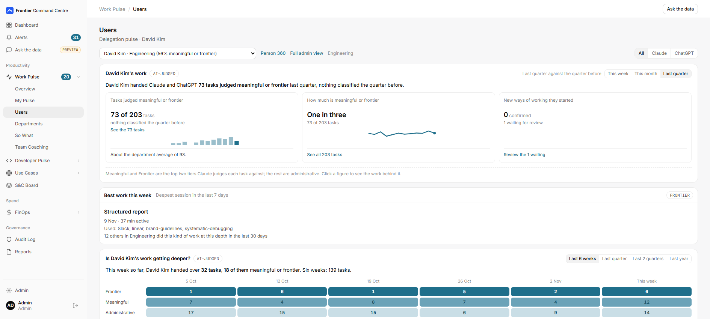

*Sample data from Acme Corp, a fictional company.*

### Departments

Departments shows one department, chosen from a list with each department's member count. It has the same period switch and the same panels as My Pulse, written for the department, plus:

- **Best work this week**: how many people did top-tier work in the last 7 days, and the three strongest sessions, one per person.
- **Who is in it**, AI-judged: each person's meaningful or frontier tasks, their share, their share then and now over the last quarter, and when they were last active. For those who can open Users, a name opens that person.
- **Work only one person does**, AI-judged, over the last 30 days: kinds of work and skills that exactly one person in the department has used, by the same rule as Team Coaching.
- **Coaching**, updated weekly: people doing a use case's work without its skill. **Mark done** records that the conversation took place, and that person and use case do not come back.
- **New ways of working**, with Confirm and Dismiss for administrators.
- **Skills and connectors other teams use**.
- **The department, in a paragraph**, an AI summary written when an administrator or manager selects **Generate now**.

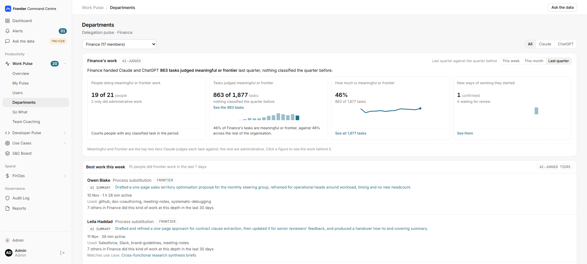

*Sample data from Acme Corp, a fictional company.*

### Best work and new ways of working

Best work describes a session by what was done: its kind of work, when, active time, steps, the connectors and skills used, and the files it produced. It also says how many others in the department did that kind of work at that depth in the last 30 days, and the use case it matches. It can carry a one-sentence description written by Claude from the session's prompts, with personal data masked on the way in and scrubbed from the reply. Descriptions and file names are shown to administrators and managers for everyone and to each person for their own work. Everyone else sees the counts, and the withheld text never reaches their browser. An administrator can switch descriptions off with **Session descriptions** under **Admin → Work Pulse**, which also hides existing ones.

When the classifier judges a piece of work to be new to the organisation, it raises a candidate new way of working. Each person can confirm or dismiss their own candidates, and administrators can confirm or dismiss anyone's.

### So What

So What answers a leader's question with a recommendation, the figures behind it and two buttons. It reads the last 30 days of Claude Cowork, Claude in Office and Google, Claude Chat and ChatGPT, leaving out any product an administrator has hidden. It names nobody, but because it is built from each person's figures and recommends decisions about headcount, only administrators and managers can open it, and every read is recorded in the access audit log.

**Asking a question.** Choose a team and the question: **They want to hire**, with the number of people asked for, or **Someone has left**. The answer compares two groups in that team over the last 30 days:

- people who do mostly meaningful work: at least 10 graded prompts, more than half of them in the top two tiers;
- people who do not: at least 10 graded prompts, half or fewer in the top two tiers.

People with fewer than two sessions have hardly used it, and people with fewer than 10 graded prompts used it too little to judge; neither is in either group, and the card says how many there are. For each group the card shows a dot per person and the share of the group's sessions that produced something. That share is measured; which group a person is in comes from the AI-judged tiers. If the first group's sessions produce something at least 10 points more often, the card recommends holding the hire, or not replacing the person yet, and closing the gap first. Otherwise it recommends approving the hire or replacing the person.

The card refuses rather than guesses. If either group has fewer than three people, or fewer than five sessions where Command Centre could see whether something was produced, it says the figures cannot answer the question. It also says what it cannot see: Work Pulse counts whether a session produced something, not how much each person produced, so it cannot say how many people a gap is worth.

**What the page finds on its own.** For an administrator, the page also suggests up to five decisions across the organisation, biggest first by how many people each touches:

- make a kind of work that several people in a team repeat with no skill behind it a standard skill;
- decide what a team does with time freed by a kind of work that now takes at least a fifth less measured time than in the 30 days that ended two months ago;
- give AI to the next wave of people, or hold, from how long earlier waves (everyone whose first prompt was in the same month) took for half of them to start doing meaningful work;
- decide what to do about people who have had fewer than two sessions in 90 days, with an estimated monthly cost, tagged Estimate, only when a Claude seat price is set under **Admin → System**;
- spread what one or two people know when they hold most of a team's meaningful work;
- take a new way of working that a team confirmed to other teams doing the same kind of work;
- look at the workload in a team that does far more of its AI work in the evening or at weekends than the organisation, counted for the team and never for one person.

Each card says which of its figures are measured and which are the classifier's judgement. Time on this page is always measured active time, never the by-hand estimate.

**Deciding.** Each card has two buttons, the recommended one first, and an optional note. A decision records who made it, when, the choice, whether it went against the recommendation, and the figures as they stood that day. It can be undone. After 30 days the card returns to the top, marked "30 days on", with the same figures then and now. It says what has changed since the decision, never that the decision caused it.

### Team Coaching

Team Coaching gives one team a coaching plan, written in code from the team's figures with no model call. It reads the last 30 days of every Work Pulse product an administrator has left visible, against the 30 days before. Because it names people, only administrators and managers can open it, and every read is recorded in the access audit log.

The plan has these panels:

- **Where the team is**, AI-judged. How many pieces of work, from how many people, and the share that was meaningful or frontier against the organisation and the department floor. How many people use it regularly, who uses it a lot but still gets single answers, and who started in the last six weeks.
- **What to work on**, AI-judged: the kinds of work the team handed over, commonest first; work several people repeat with no shared skill behind it; kinds of work only one person does; and new ways of working that came up. How a session ran, through a skill or a connector, is not counted as a kind of work.
- **Who to learn from**, AI-judged: up to three people with at least 10 pieces of work, more than half of it meaningful or frontier.
- **What it freed**, an AI estimate, when human time is on: Claude's estimate of the time by hand against measured active time, for Claude Cowork, Claude in Office/Google and ChatGPT. Claude Chat sessions carry no estimate.
- **Did the work come out**, measured: how many sessions ended with something saved, sent or published, and the list of what was produced, newest first, with file names masked for personal data.
- **What to try**: actions, each tied to the figure it should move. **Mark done** records that figure as it stands, for the team and for the organisation. From 30 days on, the page compares both with today's and reports the team's change less the organisation's, so a team carried up by a general rise does not read as better. A team of fewer than five people reads "too few to tell".
- **Done before**: actions that are no longer suggested because the figure that raised them has moved.

### Human time and AI time

For sessions of everyday work in the top two tiers, in Claude Cowork, Claude in Office/Google and ChatGPT, Command Centre can set an AI estimate of how long the same result would take by hand beside the measured time the AI spent. The estimate is a low, likely and high range, made from the session's masked prompts and the names of any files it produced, and framed in the person's department. AI time is measured active time from the session's events, which for ChatGPT are the times of its prompts and replies. Only sessions with both figures are counted. The ratio appears once there are at least 20 such sessions, a minimum an administrator can change.

It appears in three places:

- as **By hand vs with Claude** (or ChatGPT, or AI in the All view) on My Pulse, Users and Departments, over the last 30 days;
- inside **What did the work produce?** on the Overview, over the last quarter;
- as **What it freed** on Team Coaching.

Figures for one person are shown only to administrators, managers and that person. An administrator can spot-check a monthly sample of estimates under **Admin → Work Pulse → Audit**, and the panel says how many were about right. It ships switched off: an administrator turns it on with **Human time vs AI time** under **Admin → Work Pulse**. Developer Pulse's own estimate follows the Work Pulse switch until an administrator sets it under **Admin → Developer Pulse**.

### Briefings

Each person has a weekly paragraph on their own work, written every Sunday from 22:00 server time. Anyone can generate their own again with **Generate now** on My Pulse. Administrators and managers can generate it for anyone on Users, and can generate a department's paragraph on Departments; department paragraphs are written only when someone generates one. The Overview carries a monthly organisation briefing, written on the 1st of each month, which administrators and managers can also generate at any time. All are written by Claude from figures computed in code, are labelled as an AI summary, and are checked so that every number in them appears in the figures they were given. When more than one product was used in the period, the organisation and department briefings are given each product's sessions and people so they can compare them.

## Developer Pulse

Developer Pulse is the productivity view of coding with Claude Code and Codex. It has eight pages: Overview, My Developer Pulse, Users, Departments, So What, Team Coaching, Dev Framework Alignment and Value.

Most of what it shows is measured. Three things are not, and each is tagged where it appears:

- **AI-judged**: the tier and kind of work a classifier gives each session, and everything built on them (Work mix, Best work, "Is the work getting deeper?", the groups on So What and Team Coaching), plus the weekly summary.
- **AI estimate**: how long a session's work would have taken by hand.
- **Estimate**: the Value page's benchmark figures and time saved, and the month-end spend projection.

A figure that is not measured reads "not measured", and a model with no price reads "not priced". Neither is ever shown as zero.

### Who sees which page

| Page | Administrator | Manager | Viewer | Pulse and Developer Pulse roles |
|---|---|---|---|---|
| Overview | Yes | Yes | Yes | No |
| My Developer Pulse | Yes | Yes | Yes | Yes |
| Users | Anyone | Anyone | No | Their own department |
| Departments | Any department | Any department | Any department | Their own department |
| So What | Any team | Their own department | No | No |
| Team Coaching | Any team | Their own department | No | No |
| Dev Framework Alignment | Yes | Yes | Yes | No |
| Value | Yes | Yes | Yes | No |

When only OpenAI is connected, Dev Framework Alignment and Value are left out of the menu.

### The All, Claude and ChatGPT switch

Once Codex data arrives, a switch reading All, Claude or ChatGPT appears on the Overview, My Developer Pulse, Users, Departments, Value and Dev Framework Alignment. It is the dashboard's switch, with the same wording, and the choice carries across pages. On Developer Pulse, ChatGPT means Codex, and the page says "Showing Codex only." Claude narrows the figures to Claude Code.

In the All view each headline figure shows its Claude Code and Codex parts underneath, and Work mix shows each kind of work's split. A part is shown only when both tools have a figure.

Engaged time, lines of code, pull requests, edit acceptance, languages, and spend by skill and subagent come from Claude Code's own telemetry. Codex does not send them, so they show Claude Code only and are not shown for Codex. Codex's actions, failed actions and commits come from its log, counted and never stored as commands. Codex spend is priced from the same rate table, which has OpenAI's published USD rates built in; a model the table does not know is named as not priced until an administrator adds its rate under **Admin → Developer Pulse → Rates**.

So What and Team Coaching have no switch. They cover Claude Code and Codex together.

### Overview

The Overview is for administrators, managers and viewers. Every figure covers the last 30 days unless it says otherwise, and the toolbar shows how many tokens were processed.

**Productivity strip.** Four measured figures from Claude Code's telemetry, with commits from both tools:

- Engaged time: active AI-assisted engineering time, split into time interacting and time processing.
- Code output: lines added with Claude Code, with lines removed underneath.
- Shipping: AI-assisted commits from Claude Code and Codex, with pull requests opened underneath.
- Edit acceptance: the share of proposed edits accepted, with the counts accepted and rejected.

Until Claude Code's metrics arrive, each reads "Awaiting metrics".

**Four questions.** Each card gives a figure, a plain status (Healthy, Building, Worth a look or Context), a sentence explaining it, an 8-week trend with the week so far drawn hollow, and the change on the 30 days before.

- **What is AI coding costing us?** Priced spend and spend per session. The card says the figure is context, not a verdict. From the seventh day of the month it adds a projected month-end figure, marked "≈" and tagged Estimate. The projection is this month's priced spend divided by the share of the month gone, the same method FinOps uses. Spend through Amazon Bedrock or Google Vertex AI is priced at Anthropic's list rate, and the card says so.
- **Are developers delegating, or just typing faster?** Actions the AI takes per human instruction. Three or more reads Healthy, one to three Building, under one Worth a look. It also gives the share of turns driven by subagents.
- **Is AI-assisted work actually shipping?** AI-assisted commits, with the commits and merged pull requests GitHub saw on the tracked repositories in the last 7 days.
- **How much of our codebase does this reach?** Repositories with activity in the last 30 days, and those quiet for 30 days or more. Codex does not report which repository it worked in, so in the All view this card counts Claude Code's repositories. On the Codex view it counts tracked repositories that received commits matched to Codex in the last 7 days, worked out from GitHub. The card is left out where no repository data exists.

**By hand vs with AI.** An AI estimate of how long the work in the top two tiers would have taken by hand, beside measured active time. It carries both an Estimate tag and a Measured tag. See [Human time and AI time](#human-time-and-ai-time).

**This week in Code.** A weekly summary written by Claude and tagged "AI summary", with one suggested action. It is written on Sundays after 22:00 server time; administrators and managers can generate it again. Every number in it must appear in the figures it was given, or it is rejected.

**Shipping alignment.** Shown once GitHub is connected; see [GitHub overlay](#github-overlay).

**Work mix.** AI-judged. Sessions by kind of work over 30 days, with how many reached the top tier.

**Model mix.** Which models carried the work, by share of input and output tokens, with turns and cache tokens beside each. Cache tokens are listed but not counted in the share. Models reached through a third-party provider are marked.

**Further down:**

- Repo coverage: active and quiet repositories. Where there is no repository data, Language mix shows edits by programming language instead.
- Top skills in Code and Top connectors in Code.
- Leverage: Claude Code spend and prompts by the skill or subagent active at the time.
- Efficiency: lines per engaged hour and tokens per accepted edit, from Claude Code only. Cost per commit and per pull request are on Value.
- Spend concentration: the share of spend held by the top 1, 5 and 10 spenders.
- High-friction sessions: sessions in the last 7 days where over a quarter of tool actions failed, as a coaching signal.

A model with no price set is named in a notice, which points to **Admin → Developer Pulse → Rates**; its tokens are counted but left out of spend.

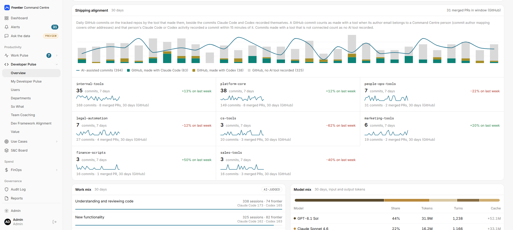

*Sample data from Acme Corp, a fictional company.*

### My Developer Pulse and Users

My Developer Pulse is your own page. Users is the same page for someone else, chosen from a list that opens on the person with the highest spend. For roles that can open it, Users also links to that person's Person 360. If your sign-in is not linked to any activity, My Developer Pulse says "No AI activity linked to your account yet".

The panels, top to bottom:

- **Coding work.** One period for the page: This week, This month or Last quarter (the default, 13 completed weeks), against the period before. One sentence says how many sessions were run and what shipped. Four measured cards follow: sessions, what it shipped (commits, with pull requests opened and lines added), engaged time and spend. A line under them gives actions per instruction, the share of edits accepted, the share of context served from cache, and codebases touched.
- **Best work in the last 7 days.** AI-judged. The person's deepest session of the week, by the tier the classifier gave it and then by time at the keyboard, with its kind of work, repository and branch.
- **Is the work getting deeper?** AI-judged. A grid of sessions per tier for the last six weeks, the current week included. Last quarter, Last 2 quarters and Last year show the same as a chart. The rows carry the tier names set under **Admin → Developer Pulse → Tiers**.
- **Work mix.** AI-judged. Sessions by kind of work over the last 30 days, and how many reached the top two tiers.
- **By hand vs with Claude Code** (or Codex, or AI in the All view). AI estimate beside measured active time. Shown only to administrators, managers and the person themselves, and only when the estimate is switched on.
- **Measured detail.** Spend over 30 days, automation (actions per instruction), repositories active in the last 30 days and cache efficiency. With GitHub connected, the repository count comes from GitHub commits matched to the person.
- **Model mix** and the ten most recent **sessions**, each with its spend (or "not priced") and its source.

My Developer Pulse also shows the productivity strip and 8-week trends for engaged time and code output. When FinOps is on, a link opens the person's Spend Review.

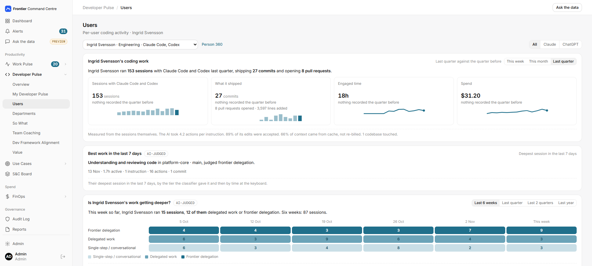

*Sample data from Acme Corp, a fictional company.*

### Departments

Departments shows the same panels for a whole department, chosen from a list that gives each department's head count: coding work for the period, "Is the work getting deeper?", Work mix, By hand vs with AI, and the measured detail. There is no Best work panel.

A Members table lists each person with their spend over 30 days, automation, sessions, commits, repositories, cache efficiency and tokens. It sorts by spend by default. Each person's spend is shown to administrators and managers, and to the person themself; anyone else sees "hidden" against a colleague. Pulse and Developer Pulse members see their own department only. For those who can open Users, a name opens that person.

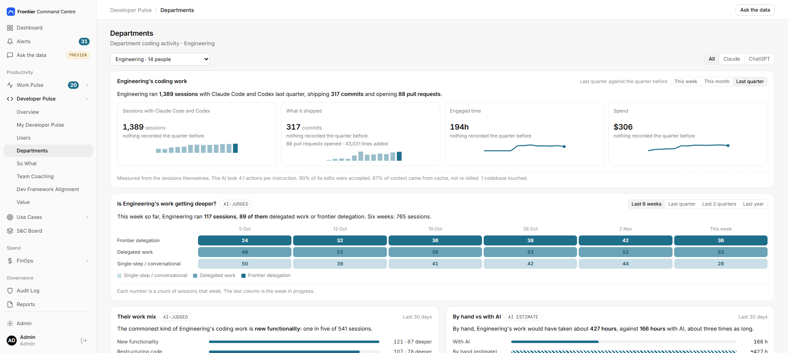

*Sample data from Acme Corp, a fictional company.*

### Developer Pulse So What

Developer Pulse So What is for administrators and managers. It shows the gap between the people who get the most from AI and everyone else doing the same work, and what closing it is worth. It is built from figures Command Centre already holds. No model writes it.

**The two groups.** Within a team, over the last 30 days, a person with fewer than two sessions has hardly used it and is in neither group. Anyone else is in the first group if more than half their sessions reached the top two tiers ("multi-step work"), and in the second if not. Output is commits per person from GitHub, counting commits made with Claude Code, with Codex and with no AI tool. Commits are measured; which group a person is in comes from the AI-judged tiers, and the chart says so. The chart shows a dot per person and never a name.

**Asking a question.** Pick a team and a question:

- **They want to hire**, with the number of people asked for. If the second group worked like the first and that would cover the request, the card recommends holding the hires. If it would cover part, it says how many to hold. If there is no gap, it recommends approving them.
- **Someone has left.** If closing the gap is worth at least one person, the card recommends not replacing them yet. Otherwise it recommends replacing them.

The page refuses rather than guesses. With fewer than three people in either group it says there are too few to tell. With no commits attributable to anyone in the team it says it cannot answer. Every card says what the page cannot see: work done without AI beyond the commits shown, people left out because no commits can be matched to them, and people who hardly used it.

**What the page finds on its own.** Administrators also see up to five cards about engineering as a whole:

- **Make a kind of work a standard skill**, where the people who do it as multi-step work finish it quicker than the rest, with the hours a month that moving the rest across would free. Both sides are measured active time, not a by-hand estimate.
- **Give AI coding to the next wave of people**, or hold until the current wave lands. A wave is everyone whose first session was in the same month, and the card says how long half of them took to start doing multi-step work.
- **People who have hardly used it**: fewer than two sessions in 90 days. Where an administrator has set a Claude seat price on **Admin → System**, the card gives an estimated monthly cost, tagged Estimate.
- **Spread what one or two people know**, in a team where they hold 60% or more of the multi-step work. The people are named on the team's Team Coaching plan, not here.

**Deciding.** Each card has two buttons, the recommendation first, and an optional note. The decision records who decided, the date and the figures as they stood. Undo takes it back. Thirty days later the card returns to the top with what has happened since. It says "since then", never "because of". An administrator can decide for any team and for the cards about the whole organisation; a manager for their own team only.

### Developer Pulse Team Coaching

Developer Pulse Team Coaching is a plan for one team, for administrators and managers. Administrators choose any team; a manager sees their own department. Every sentence is written in code from stored figures; no model is asked anything. It covers the last 30 days, with no switch.

- **Where the team is** (AI-judged). Sessions and people. The share of sessions that were multi-step work, against the 30 days before and the organisation. How many people use it regularly and how many have hardly used it. Who uses it often but still gets single answers. Who started in the last six weeks and how they are getting on. Multi-step work means the classifier judged the session in one of the top two tiers, using the names set under **Admin → Developer Pulse → Tiers**.
- **What to work on** (AI-judged). The commonest kind of work, and the share each kind takes. Where an administrator has set an intended share per kind of work on **Admin → Developer Pulse**, the bars show it, and a kind five points or more away is named. It also notes long sessions, over an hour, that committed nothing, and the share of Claude Code's suggested edits the team keeps against the organisation (Codex sends no edit decisions). It names work several people repeat with no shared skill behind it, and the model that ran more single-answer sessions than any other.
- **Who to learn from** (AI-judged). Up to three people who hand the most over, named, with their sessions and share. The page says they are named because it is for administrators and managers only.
- **What it freed** (AI estimate). By-hand hours against measured hours with the assistant, for sessions that carry both. Shown only when by-hand estimates exist.
- **What to try.** Actions, each tied to the figure it should move. Mark done, with an optional note of what the team did, records that figure for the team and for the organisation on that day. From 30 days later the page says whether it moved: the team's change less the organisation's, so a general rise does not count as the team's. A team of fewer than five people reads "too few to tell".
- **Done before.** Actions marked done that the plan no longer suggests, because the figure that raised them has moved.

### Value

Value is for administrators, managers and viewers. It is on by default; an administrator can switch it off under **Admin → Developer Pulse → Value**, where its assumptions are also set.

- **Industry benchmark model** (Estimate, annualised). Value is team size × productivity lift × loaded annual cost per engineer. Return and net value set it against annual spend. Time recovered is team size × coding hours a week × 52 × lift. Team size and annual spend come from your data unless an administrator sets them: people with Claude Code or Codex activity in the last 30 days, each counted once, and 30-day spend annualised. The lift (30% by default), loaded cost ($300,000 by default) and coding hours (15 a week by default) are assumptions.
- **Time saved** (Estimate). Pull requests opened and AI-assisted commits, each × an assumed number of minutes: 150 per pull request and 20 per commit by default. Coding work only, from Claude Code and Codex.
- **Observed signal** (Beta). AI-assisted commits a week in the weeks with the most engaged time against those with the least, over the last eight completed weeks. It is a correlation, not a cause, and is never added to the estimate. Claude Code only, because Codex reports no engaged time.
- **Measured, not estimated.** Spend over 30 days, active users, commits, pull requests opened and engaged hours. In the All view, spend, users and commits show their Claude Code and Codex parts; a person using both tools counts once in each part.
- **Unit economics** (Measured). Cost per commit, per pull request, per engaged hour and per session. Cost per pull request and per engaged hour are Claude Code's alone. On the Codex view they read "not measured".
- **Calibrations.** The five inputs, each tagged From your data, Default or Edited.

### Dev Framework Alignment

Dev Framework Alignment is switched off by default; an administrator turns it on under **Admin → Developer Pulse → Framework**. It is an example of how Developer Pulse's indicators could be organised using DORA, SPACE and DX Core 4 concepts. Each indicator is tagged Measured, Proxy, AI-judged, AI-specific or Not captured here, and indicators Codex never reports are marked as not captured. It informs your framework numbers and does not replace them. It has not been fully tested. Its getDX overlay shows demo data, tagged "Demo data": a live getDX integration is not yet available.

### Work mix and tiers

The session classifier grades each Claude Code and Codex session once it has been idle for 30 minutes, giving a kind of work and a tier from a short digest of the session. A session still running after two hours gets a provisional grade, replaced when it ends. An administrator can stop Codex sessions being graded by switching off **Classify Codex sessions** under **Admin → Developer Pulse**. The Classifier health tab shows the queue, confidence and failures, and, once Codex sessions exist, classified and failed sessions for each tool.

Pages show tiers by the names set under **Admin → Developer Pulse → Tiers**: Single-step / conversational, Delegated work and Frontier delegation by default. Renaming a tier renames it on the pages. Kinds of work are shown in plain words: New functionality, Fixing defects, Restructuring code, Writing or fixing tests, Docs and comments, Build, deploy and tooling, Understanding and reviewing code, and Other coding work. A kind an administrator adds or redefines shows its own name.

### GitHub overlay

The GitHub overlay, connected with a read-only GitHub token, adds daily commit and merged pull request counts for repositories an administrator selects. It attributes commits to people by matching commit author emails to Command Centre users, with an administrator's identity map for exceptions. A GitHub commit counts as made with Claude Code or Codex when its author email belongs to a Command Centre person and that person's Claude Code or Codex activity recorded a commit within 15 minutes of it. Anything else counts as no AI tool recorded.

On the Overview, Shipping alignment draws 30 days of GitHub commits beside the commits Claude Code and Codex recorded. In the All view GitHub's commits are stacked by tool; on the Claude and Codex views each tool is compared with its own matched commits. A card per repository gives commits in the last 7 days against the week before, and commits and merged pull requests over 30 days. Each person's and department's repository count covers the last 30 days and follows the same matching, because Codex does not report which repository it worked in. The overlay never reads commit messages and stores daily counts only, never commit identifiers.

### Developer Pulse alerts

Developer Pulse raises deterministic alerts on the hourly cycle. No AI is involved.

- **Spend.** A person's Claude Code spend in the last 24 hours is over a daily limit an administrator sets ($100 by default), whatever they usually spend. Over twice the limit it is high priority, and a person who passes twice the limit within 24 hours of a lower-priority alert gets a high-priority alert too. The alert states the 24-hour window and the person's spend for the calendar month so far. Codex has its own daily limit ($500 by default), on the same rule.
- **Unapproved model**, in Claude Code or Codex, against a list an administrator sets. With no list set, nothing is checked.
- **Sensitive repository**, Claude Code only, because Codex does not report which repository it worked in. Off by default.
- **High friction**: a session in either tool where over a quarter of tool actions failed. Off by default.

## Use Cases

Use Cases connects the productivity view to the work an organisation cares about. A use case is a named, recurring piece of work, such as a weekly margin update or month-end variance commentary, with a description, an owner, departments and products. Use Cases ships switched off; an administrator turns it on under **Admin → Use Cases**. Use Cases has two pages: Overview, the register, for administrators and managers, and Governance, for administrators, managers and viewers.

### The register

Administrators and managers maintain the register on the Overview page. A use case can be added in four ways:

- through a guided form (**Add use case**);
- extracted from an uploaded meeting transcript in text, Markdown, subtitle, PDF or Word format (**Import transcript**);
- developed in a brainstorming conversation with Claude, grounded in the organisation's own activity (**Ideate**);
- from a suggestion.

Each has a status set by people (candidate, confirmed or archived) and a lifecycle derived from activity.

The register groups use cases by status. Each row shows the use case's matched sessions over the last 13 completed weeks for each product that did the work (Claude Cowork, Claude Code, ChatGPT and Codex, the last two once OpenAI is connected and shown), its lifecycle and its departments. A use case with no sessions in those 13 weeks but some this week reads "0 · 2 this week", because its lifecycle already counts this week's work. While ChatGPT and Codex are hidden, a use case whose work was only there reads "0 · used in hidden products". An archived use case is no longer tracked and shows no lifecycle. The register can be filtered by lifecycle, to the use cases you own, and to include archived ones. A star marks a strategic bet.

| Lifecycle | Meaning with default settings |
|---|---|
| Not seen | No matching work observed, or none for six weeks |
| Piloting | Matching work observed, below the adopted threshold |
| Adopted | Active in at least three of the last four weeks, by at least two people |
| At risk | Previously active, quiet for two to five weeks; an alert is raised |

Marking a use case as a strategic bet, on its own page, places it on the Governance page once it is confirmed.

### How sessions are matched to use cases

Command Centre decides who is doing a use case by reading the work. Once a session in Claude Cowork, ChatGPT, Claude Code or Codex has been idle for 30 minutes, a Claude model reads up to six of its prompts. They are drawn from the beginning, middle and end, cleaned to the person's own words, and sent with clues such as the skills and connectors used and the names of files uploaded and produced. Given the live use cases for the person's department, it decides whether the session is an instance of none, one or several, and records a short reason. The model judges by subject and output, matches the specific job rather than its general area, and treats tools as clues that are never sufficient alone. A session that runs a use case's own published skill matches without a model call. Adding or rewording a use case re-judges up to 13 weeks of history. Matching is most precise when a use case's description names a specific job and its output.

ChatGPT conversations count as Work and Codex sessions as Code, so a use case scoped to Work takes in Claude Cowork and ChatGPT, and one scoped to Code takes in Claude Code and Codex.

Each use case's page shows, under Activity, the sessions judged to be this work in the last 30 days, labelled AI-judged, and the clues (phrases, skills and connectors) that help the judge recognise it. A session never counts just because a clue appears in it.

### Suggested department processes

Command Centre reads each department's recent prompts in every connected product, everyday work and coding separately, with personal data masked, and suggests specific recurring jobs that produce a named output and that at least two people carry out. General activities, personal development and one-off projects are excluded. A second pass finds jobs carried out across at least two departments.

The suggestions appear above the register as one list, tagged AI-suggested, ranked by the number of people behind each one and then by sessions. Filters show the cross-department suggestions or one department's. Each row names its department and the products its work came from, with its measured people and sessions. Opening a suggestion shows it as a process opportunity: what the work is, the opportunity, and what Command Centre observed over the last 28 days by default: people, sessions, rhythm, systems seen, active hours, and the delegation depth, which is AI-judged and labelled so. The counts come from telemetry; the grouping and wording are Claude's. A reviewer confirms or dismisses each suggestion, then moves on to the next. The owner, baseline and measure of success are added on the use case's page after confirming.

### Spread and coaching

Once a confirmed use case has a skill, its Spread panel lists the people who did the work in at least two judged sessions over the last four completed weeks without using the skill: who to show it to. The department page turns the strongest into up to three coaching prompts for the manager, each naming the person, the use case and the evidence. A manager can mark a conversation done, which clears it everywhere. The weekly digest carries only counts per department. Spread suggests a skill only to people doing the work in Claude, because the skill is a Claude skill.

### Workflow impact

Each use case's page has a Workflow impact panel covering the last 13 completed weeks:

- **Time in this workflow** (measured): active time on the matched sessions, split by product, with a weekly line. If no matched session carries measured time yet, the panel shows an estimate instead (sessions multiplied by the minutes per session an administrator sets), labelled as an estimate.
- **AI footprint** (measured): the skills, connectors and models the work relies on, each with its session count, and the sessions in each product.
- **Are they handing it bigger jobs?** (AI-judged): the weekly tier mix, by tier number, because a use case can mix everyday work and coding. A change to the tier rubric is marked, because the weeks either side are not comparable.

An administrator or manager can ask Claude for a short summary of these facts, labelled as an AI-written summary and checked against the facts before it is stored. Below the panel sit a measured weekly activity table (users, sessions and messages), the skill draft and Spread.

### Use Case Governance

The Governance page is read-only and open to administrators, managers and viewers. It covers the last quarter, meaning the 13 completed weeks to the date it names. Administrators and managers can open each use case from its name; viewers see the names without a link, because a use case's own page is for administrators and managers.

Five figures lead the page: declared bets, and how many are adopted, piloting and at risk (with the number not seen), and **Value recovered**. Value recovered is an estimate: hours recovered multiplied by an administrator-set loaded annual cost over 1,800 working hours a year. The minutes per session, the sessions and the annual cost are stated beneath it. A one-line summary, built in code from the bets, says where adoption is concentrated and names the first at-risk bet.

The strategic bets table groups bets by lifecycle. For each bet it shows:

- the owner and departments;
- how long it has been at that stage ("Since this week" or "For 10 weeks");
- a 13-week activity line;
- measured sessions and users, with each product's sessions beneath;
- measured hours, with each product's hours beneath;
- hours recovered, an estimate: the minutes per session an administrator sets, multiplied by the bet's sessions.

A bet with no sessions in the 13 completed weeks reads "Not estimated", never zero hours, and a bet with no measured time reads "Not measured". A bet whose only sessions are this week's shows "1 session this week", so Piloting never sits beside a bare 0. A week without measurement appears as a gap in the activity line.

Below, **Other confirmed use cases** lists every confirmed use case that is not a strategic bet, grouped by lifecycle and ranked by measured hours, with its 13-week line, sessions by product and users, up to 50 rows. It carries no value estimate.

### Turning a use case into a skill

A confirmed use case with enough evidence can be turned into an Agent Skill, the reusable instruction package Claude loads when a matching request arrives. Command Centre reads the prompts matched to the use case and asks Claude to draft a skill in the standard format. That is a name, a description telling Claude when to use it, and sections from purpose and steps through quality rules and edge cases, with questions for the owner. The Skill panel shows the evidence the draft reads: prompts, people, separate days and follow-ups over the last 13 weeks, and the size of the sample sent to Claude. Drafting is available once the evidence clears a readiness bar: by default three people, ten distinct prompts, three separate days and three follow-up prompts, or, for work one person does, six separate days spread over at least four weeks.

Every draft is checked before it is shown: no number absent from the prompts, no system that was not observed and no detectable personal data, and any long passage copied from a prompt is flagged for the owner to reword. An administrator or manager edits the draft and downloads it as a zip, and an owner of your Claude organisation uploads it under Plugins and skills in Claude's organisation settings, which provisions it for the organisation. On first download Command Centre adds the skill to the use case, so sessions using it match automatically, and creates a claimed entry on the Skills and Connectors Board.

## Skills and Connectors Board

The Board catalogues the skills and connectors in use across the organisation and is open to every signed-in person. Every skill and connector seen in any connected product is registered automatically, from Claude Cowork, Claude Code and Claude Chat to ChatGPT's skills and Codex's connectors, and each entry is tagged with the products it is used in: Claude, ChatGPT or Codex. Skills and connectors that are part of Claude itself are never listed or counted: Claude's internal connectors, Claude in Chrome and Claude Preview, and Claude Code's bundled skills such as run, init, code-review and verify. Their use is still recorded. Anthropic skills and connectors that Command Centre recognises are labelled as Anthropic's; other entries start unclaimed. While ChatGPT and Codex are hidden, entries used only there are left out of the list and every count.

The page opens on five figures:

- the share of entries that have an owner;
- skill uses this week, with how many entries are new to the Board this week;
- the number of the organisation's own skills;
- the number of its own connectors;
- your own standing on the leaderboard.

A banner counts the unclaimed skills and connectors people have actually used, such as "8 skills and connectors in use have no owner", with a link to them. Highlights show what is hot this week, new to the Board, top voted, unclaimed, and your department's picks.

The main list has a Skills tab and a Connectors tab. The Connectors tab also counts Anthropic's connectors, which the figures above leave out, and says how many, such as "Connectors 16 (4 from Anthropic)". Each row shows the entry's products, whether it is claimed, its uses and people, and install and upvote buttons. Beside the list sit usage by department, a leaderboard of skill and connector uses (all time), skills to try, and two cards:

- **Stuck with one person:** skills and connectors only one person used in the last 30 days. If that person left, the work would stop.
- **Used by nobody:** claimed entries nobody used in the last 30 days, worth retiring or a nudge.

Anthropic's own skills follow in Explore from Anthropic, each with its uses and people. Search, filters (skills, connectors, Anthropic, unclaimed), a department filter and a sort order (most used, trending, most voted, newest) narrow the list.

Anyone signed in can claim an unclaimed entry and add a description, installation guidance and a source link. The author, administrators and managers can edit an entry; only administrators and managers can restrict an entry to one department or delete it. An entry offers installation only once it is claimed and carries guidance.

Each entry's page shows its total uses, uses this week against last week, its people and upvotes, usage over the last seven days, and who uses it. It lists the use cases it powers, with their lifecycle, and for a skill, whether people type it or Claude, ChatGPT or Codex chains it. Usage is measured.

## FinOps

FinOps is for administrators and managers. Any other role that opens it sees "FinOps is for admins and managers." and no figures; each person can still open their own Spend Review (see below). FinOps ships switched off, as does its Model Efficiency view; an administrator turns both on under **Admin → System**. FinOps attributes Claude Code, Claude Cowork, ChatGPT and Codex spend to people and rolls it up by cost centre for each calendar month. Claude in Office/Google spend is shown in its own section, app by app, as an estimate priced from the model rates, because Claude in Office/Google sends no cost; it is never part of the chargeback total, a closed month's snapshot or the CSV export. Developer Pulse carries its own Claude Code and Codex spend figures, and its department page lists each member's spend over 30 days to administrators and managers.

### The FinOps page

The page answers first and folds the detail away. Four figures lead it:

- **Spend so far** (measured), with its Claude part and its ChatGPT and Codex part.
- **On pace for** (estimate): the month-end projection, from day 7 of the month, with how it compares with last month. Before day 7, and for a past month, it reads "Not projected".
- **Unallocated** (measured): spend from people with no department, with how many people that is.
- **Caching saved** (estimate): what the prompt cache saved at list rates, or "Not measured".

**Where it goes** shows the month's spend as one bar by product (Claude Cowork, Claude Code, ChatGPT and Codex), with the token total. It says how each product is priced: Claude Code estimated at list rates, Claude Cowork as Claude reports it, and ChatGPT and Codex at OpenAI's USD token rates. A product with no captured spend, such as Claude Chat, is named as not captured, never shown as $0. A fold explains why the figures differ from your Anthropic and OpenAI invoices.

**By cost centre** lists each cost centre with its people, share and spend, top rows first and Unallocated last; **Show people** opens every centre on its members. **Export CSV** is here, and an administrator closes the month from here. **Where to save** (estimate) says how many people have a better route for their work and links to Spend Review.

The folded sections are:

- **Spend trend and month-end projection:** 12 months split by product, and the projection with its Claude and OpenAI parts.
- **Model efficiency and cost drivers** (when switched on): tabs for Claude Code, Claude Cowork, ChatGPT and Codex. For each kind of work (AI-judged) it shows the model split, spend and friction (measured), and flags work where a cheaper model merits review. Cost drivers show spend by model, cost by type (input, output, cache write and cache read) and the share of input tokens served from cache.
- **Claude in Office and Google (estimate):** app users, model calls, tokens and estimated spend for Excel, Word, PowerPoint, Outlook, Google Sheets, Docs and Slides, not included in the totals.
- **This month in cost and spend concentration:** a plain-language summary of the month, built in code from the figures with no model involved, and the share of spend in the top cost centres, split by product.
- **Top spenders.**
- **Seats and licences** (current month): unused Claude seats with an estimated monthly cost, and the ChatGPT licence on its own line, where seat counts and prices are recorded.

With only OpenAI connected, the page shows no Claude figures.

### Chargeback and period close

Each department is a cost centre by default. Administrators can create named cost centres with general-ledger codes and group departments under them. Spend from people with no department, or that cannot be attributed, appears in an "Unallocated" line, and the total always equals the centres plus that line.

List-rate spend, such as Claude Code through Amazon Bedrock, is labelled "Estimated, for visibility, not billing".

**How ChatGPT and Codex spend is priced.** ChatGPT (Chat and Work) and Codex are priced from tokens at OpenAI's published USD rates for token-based Enterprise contracts, the same figures Work Pulse and Developer Pulse show. On plans where OpenAI's cost records carry only token totals, which cannot be split into input and output, those records are valued at the dollar figure OpenAI reports in them; one with no dollar figure either is named as not priced, never counted as $0. The page says how the OpenAI figures are priced: a credit-based contract, negotiated discounts and seat fees are not reflected. ChatGPT or Codex models with no rate are named and left out, never counted as $0; an administrator adds their rates under **Admin → Developer Pulse → Rates**. Where an administrator records ChatGPT seats and a seat price under **Admin → System**, the licence cost appears on its own line, never added to usage, with how many seats were used in the last 30 days. Claude's own seat count leaves out ChatGPT and Codex users. In Model Efficiency, the ChatGPT and Codex tabs flag only a cheaper model the same work already uses, so a flag never crosses vendors; ChatGPT's split by kind of work is an estimate, because OpenAI reports cost per hour. The caching estimate includes ChatGPT's and Codex's cached input.

An administrator can close a month, which stores an immutable snapshot; every later view and CSV export of that month returns the snapshot exactly, so a billed figure cannot drift.

With department sync on, the directory can move someone to another department during a month that has not been closed. Their spend before the move then counts to the old department, and their spend after it to the new one. The leaderboard and Spend Review still show them once. Otherwise a person's spend for the month counts to their current department.

### Spend Review

Spend Review shows, for one month and across every connected product, what each person's spend went on, whether it produced anything and whether a better route exists. Where at least three colleagues and five sessions of the same kind of work exist in the last 90 days, it compares the person with them, without naming anyone, and suggests a route:

- a skill or connector colleagues commonly use;
- a cheaper model colleagues use with comparable outcomes, once colleagues have 20 or more sessions on it;
- a model worth a trial, where colleagues' results cannot be compared yet;
- a stronger model, where colleagues' outcomes are clearly better;
- a change of approach, where long conversations spend heavily on re-reading context.

Spend Review also identifies scheduled tasks running repeatedly on the most expensive class of model. Kinds of work are AI-judged, spend is measured and savings are estimates: the month's sessions repriced at list price, a ceiling rather than a promise. Command Centre does not judge answer quality.

**The index** is for administrators and managers. Four figures lead it: spend so far against last month's pace, how many people make up half the spend, the biggest kind of work, and how many people have a better route waiting. **Better routes, proven savings first** lists one row per person: their largest saving that colleagues' results back up, else their largest untested trial, else the route on their biggest work, with the estimated saving. Two folded sections follow:

- **Most efficient** ranks up to ten people whose sessions cost least against colleagues' typical session for the same kind of work: each session is compared, and the middle of those comparisons is the person's figure. A person needs at least 10 sessions, and only people whose share of top-tier work is no more than 10 points below colleagues' are ranked, so cheaper because shallower work does not count. Claude work (Claude Code and Cowork) and ChatGPT and Codex work are ranked on separate boards. Early in a month, before anyone has 10 sessions, the board shows last month and says so; an empty board says why.
- **Everyone** lists each person's main kind of work, measured spend with its split by product, the change against last month at the same point in the month, and their better routes, with filters for people with a better route and by department.

Where an Analytics API key with the `read:spend_limits` scope is set under **Admin → Access & Keys**, Spend Review also shows each person's Anthropic spend limit for the current month. It shows who is over or close to it, and who has asked for more usage, which is approved or denied in claude.ai's organisation settings. Anthropic's figures cover every Claude surface, including Chat, so they can differ from Command Centre's.

**A person's review** opens with their measured spend split by product, their sessions, and the largest estimated saving among their routes. **Do this** lists their better routes, proven savings first. **Where the money goes** lists each kind of work with its spend and share, the person's typical session cost beside colleagues', and the route, or why there is none (not classified, too few colleagues, a small share of spend, or no better route). A row opens on its model split and a table of the models used for this work, with colleagues' typical session cost and their share of top-tier work. Scheduled tasks, the person's Claude in Office and Google spend as a separate estimate, cost drivers and the sessions themselves, most expensive first, follow. Opening a session shows its prompts only to those who can read them in the Audit Log: administrators for anyone, managers for their own department.

Administrators and managers can open anyone's review, across the organisation. Each person can open their own, from **Your spend review** on My Pulse or My Developer Pulse, while FinOps is switched on.

Codex sessions carry the cost of their own turns. OpenAI reports ChatGPT cost per person, model and hour, not per conversation, so each hour's cost is shared evenly across the replies in that hour; a conversation's ChatGPT figure is therefore an estimate, and the page says so. Cost in an hour with no reply on record stays in the person's total, which always equals FinOps's. Each product's work is compared only with colleagues' work on the same product, and model suggestions stay with the same vendor: Codex work is never pointed at a model OpenAI offers only in Chat, and ChatGPT advice keeps to models offered in Chat or Work.

## Governance and risk

Command Centre applies its controls to what it stores. It sees a prompt only after the prompt has reached Claude, ChatGPT or Codex, so it can flag, alert, restrict access and apply retention, but cannot block.

### Personal data, secrets and intent

Every stored prompt from every surface is scanned at ingest by 20 patterns. They cover personal data under GDPR and LGPD, such as email addresses, UK National Insurance numbers, payment card numbers with checksum validation, IBANs, passport numbers and Brazilian CPF numbers. They also cover secrets, such as cloud access keys, API keys, tokens, private keys and database connection strings.

On Claude Cowork, Claude Code, ChatGPT and Codex prompts, seven patterns that match on shape alone, such as phone numbers and IP addresses, are confirmed by a Claude model before an alert fires. A match judged to be something else is recorded as dismissed, with a one-sentence reason. Any failure in the check raises the alert regardless. Detection flags the message and raises an alert; the stored prompt is unchanged.

Prompts are also matched, in English and Brazilian Portuguese, against 12 built-in categories of risky intent, among them data exfiltration, access escalation, credential harvesting, policy evasion and destructive actions. Administrators can add categories. A Claude model then assesses each match in context and sets the alert's severity, and the alert names the product the prompt came from.

A message raises at most one alert for each intent category, however often it is checked.

### Alerts

Alerts from detection, Developer Pulse, at-risk use cases and system health appear on one Alerts page. A status switch (All, Open, Acknowledged, Resolved and Dismissed, each with its count) and a category (Security, Compliance & Risk; Cost & Efficiency; Adoption & Use Cases) filter the list. Each alert shows its severity, a plain explanation, the person, the time, its type in words, such as Sensitive data or Risky request, and its category, with its evidence under **Detail** and a link to the prompt in the Audit Log where there is one. Administrators, managers and viewers can read alerts. Only administrators see the buttons to acknowledge, resolve or dismiss them, one at a time or all at once, and to clear closed ones. A prompt quoted in an alert's evidence is shown only to someone who may read that person's prompts in the Audit Log; for anyone else the quote is removed, and an intent alert's reasoning is withheld.

- **High-priority alerts to Slack.** Switched off until an administrator turns it on and saves a webhook under **Admin → Risk Scoring**. An hourly job then sends every high or critical alert, from any source, to a Slack channel you choose, carrying the title, explanation, type, severity and time; the evidence stored with the alert is removed before sending. Alerts refer to a person by display name, or by email where no name is set, never by an internal user ID, both in Slack and on the Alerts page. For an intent alert the explanation is Claude's assessment of the prompt and can quote it.
- **Anomaly detection.** Once a day, while a Claude API key is set and at least one of its alert types is on under **Admin → Risk Scoring**, a Claude model reviews recent activity for unusual patterns. It reads activity metadata, flag reasons and per-person counts, including Codex turns and tokens and ChatGPT replies, but no prompt text. It takes your acceptable use policy into account where one is set.
- **Telemetry-silence alerts.** When system-health alerting is on, Command Centre raises a high-severity alert if a connected source sends nothing for a set number of working hours (three by default, Monday to Friday within a working day and time zone you configure). The sources watched are Claude Cowork, Claude Code, Claude Code metrics, ChatGPT and Codex, each on its own, and a source that has never sent anything is never raised; ChatGPT and Codex are not watched while the OpenAI sync is paused. This catches a client configuration change, collector fault or sync failure that stops activity arriving. A rejected OpenAI Admin API key raises its own alert, as a rejected Anthropic key does.

### The Audit Log

The Audit Log is where people's prompt text is browsed. It opens with a short note of what Command Centre stores from each product, and that replies from Claude, ChatGPT and Codex are never stored. It lists each captured message with:

- its product: Claude Chat, Claude Cowork, the Claude in Office/Google app such as Excel or Google Sheets, Claude Code, ChatGPT Chat, ChatGPT Work or Codex;
- its source: OpenTelemetry, Anthropic Compliance API or OpenAI Compliance API;
- the person's department, a preview and its flag severity;
- a conversation thread view, and the reason for any dismissed match.

It can be searched, and filtered by product, source, person, department and date, and to flagged prompts only. The product filter takes Claude Chat, Cowork alone, all of Claude in Office or one Office app, all of Claude in Google or one Google app, Claude Code, ChatGPT Chat, ChatGPT Work or Codex. A prompt removed under the retention policy reads "Content removed under the retention policy".

Opening a prompt shows the flag reason, the session's cost, tokens, tool calls, duration and model, and where the money went: the prompt's own share and the split by model. For ChatGPT and Codex, each reply or turn counts towards the prompt before it; a ChatGPT figure is an estimate, because OpenAI reports cost per hour and each hour's cost is shared across the replies in it, so the cost reads "Estimated cost". A conversation that used one model reads as one line, such as "This conversation: $0.15, all on gpt-6.1-sol".

The Audit Log is restricted to administrators, who see everyone, and managers, who see their own department (and no prompt text until a department is set for them). Reads of prompt text, here and on the few other pages that show prompts or short quotes from them, are recorded in an access audit log whose database triggers reject updates and deletes. Administrators review that log on its own page.

### Retention and data-subject rights

Each surface has its own retention window under one organisation-wide mode that either removes the content of old messages while keeping metadata and flags, or deletes the rows; the [Security and Data Protection](security-and-data-protection.md) document sets out the defaults. The names of files attached in a session are cleared once the session is past its window. On request, an administrator can export a defined set of one person's records as JSON:

- their person record;
- Claude Cowork and Claude Code prompts and activity messages;
- Claude Chat prompts and reply metadata;
- ChatGPT and Codex prompts with their reply records, conversation times, Codex turns, tool calls and hourly costs;
- telemetry events, Compliance activity, usage snapshots and alerts.

An administrator can also erase the person. That deletes their monitoring record and the records keyed to it, including the OpenAI account identifier stored for them. Their sign-in account is removed separately, in user administration.

## Reporting and outputs

**Reports.** Administrators, managers and viewers can generate reports for any period from a choice of sections. Compliance sections cover GDPR, LGPD, the EU AI Act, ISO/IEC 27001, ISO/IEC 42001 and open compliance gaps, combining evidence from live data with declarations administrators complete. Analytics sections cover Work Pulse, Developer Pulse, the Board, use cases, human time against AI time and, for administrators and managers only, chargeback and Spend Review, each with the Claude in Office/Google spend estimate on its own line. The compliance and analytics sections are built in code from live data and passed to Claude with an instruction to include them exactly as provided, without restating or recalculating any figure; Claude writes the remaining sections, such as the executive summary, usage, alerts and recommendations. The reports evidence alignment with these frameworks and do not certify compliance. Every section reports each connected product on its own line. The data sources table lists each source, and usage and adoption are reported per product from Command Centre's own counts. The audit sections give each product its own figures, Developer Pulse shows Claude Code and Codex in separate tables, the Board names each tool's product, and alerts name the product they came from. The human time section counts ChatGPT conversations and Codex sessions while they are shown, with Claude Cowork's and ChatGPT's parts on their own lines, and the Spend Review section carries the Claude and OpenAI efficiency boards, with the top tier named as in the rubric. A missing value reads in words, such as "not measured" or "not priced", never as a dash.

**Weekly Digest.** Every Monday Command Centre can send a digest of the last completed week by email and Slack, built from stored weekly figures with no model involved, including use cases needing attention and coaching counts by department. Its coding figures cover Claude Code and Codex, with spend split between them. Its "By hand vs with Claude" line is an estimate and counts ChatGPT conversations and Codex sessions while they are shown. Engaged hours that were not measured read "not measured", and spend with no price reads "not priced".

**Weekly Highlights.** Switched off until an administrator turns it on from its card under **Admin → System**. An administrator can then generate a draft "what the week produced" post from the last completed week's top-tier work (Frontier, unless renamed), with personal data and identifying paths removed. Claude writes the descriptive sentences, each checked against a real work item; figures are inserted from measured data. Weekly Highlights names Claude Code on its code-output line, which only Claude Code reports. The administrator edits the draft, then copies it or sends it to Slack. The post is never scheduled or sent unreviewed, and names people only if the organisation allows it.

**Metrics Connector.** Business-intelligence tools and Model Context Protocol clients can read organisation-level figures (a weekly summary, metric trends and data-health indicators) over REST or as MCP tools, using bearer tokens that administrators issue, shown once and stored as hashes. The connector never carries data about individual people or sessions. It is not yet tested with a real BI tool.

**Briefings.** The Work Pulse briefings, the weekly coding briefing covering Claude Code and Codex, and the dashboard's intelligence briefing are all number-checked. The Work Pulse briefings describe the work with counts and shares, never scores, and name the tiers as the rubric does.

## Administration

### Roles

Command Centre has six roles, enforced on the server for every page and data request.

| Role | Intended for | Access |
|---|---|---|
| Administrator | The team running Command Centre | Everything, including all prompt text, configuration, users, alert resolution, cost centres, period close and, when it is turned on, Ask the data |
| Manager | Department and functional leaders | Dashboard, Alerts (read), Reports, Audit Log for their department (none until a department is set), all Work Pulse and Developer Pulse views, So What and Team Coaching for their own department, FinOps and Spend Review, Use Cases (overview and governance), the Board, and the Work Pulse administration page; not Ask the data |
| Viewer | Executives and reviewers | Dashboard, Alerts (read), Reports, the Work Pulse and Developer Pulse overviews and department pages, Developer Pulse Value, Use Case governance, the Board, their own Spend Review; not the Users pages, the Audit Log, FinOps, So What, Team Coaching or Ask the data |
| Pulse (Work and Developer) | People whose work is observed | Their own and their department's Work Pulse and Developer Pulse views, the Board, their own Spend Review |
| Work Pulse | As above, Work Pulse only (Claude Cowork, Claude Chat, Claude in Office/Google and ChatGPT) | Their own and their department's Work Pulse views, the Board, their own Spend Review |
| Developer Pulse | As above, Developer Pulse only (Claude Code and Codex) | Their own and their department's Developer Pulse views, the Board, their own Spend Review |

FinOps is for administrators and managers only. Anyone else who opens it is told so, and the page asks for no figures. A person who is not an administrator or manager reaches their own Spend Review from My Pulse or My Developer Pulse, when FinOps is switched on. A person's own spend, on Work Pulse and Developer Pulse alike, is shown to them, administrators and managers, never to a colleague or a viewer.

When telemetry, Anthropic's Compliance API or OpenAI's Compliance API first shows a new person, Command Centre creates a record with the Pulse (Work and Developer) role so their work can be attributed. That record has no password and cannot be used to sign in until the account is activated.

### Sign-in, single sign-on and MFA

People sign in with email and password or through single sign-on with an OpenID Connect identity provider. Single sign-on proves identity only: the person must already hold a Command Centre account with single sign-on enabled, and their role is held in Command Centre. With single sign-on through Microsoft Entra ID, department sync can also keep each person's department in step with the directory; it never changes a role. Password accounts can add one-time passcodes from an authenticator app, with single-use recovery codes. Sessions expire after 24 hours or eight hours of inactivity; a person who chooses to be remembered on a device stays signed in for up to seven days. Administrators can see and revoke active sessions. When a session has ended, the next page or request takes the person straight to sign-in, and back to the same page afterwards.

### Configuration

Settings live in the database and are edited in the administration area. They cover users, tokens and integration keys, alert thresholds, intent categories, rubrics and tier names, model choices, department targets, cost centres, compliance declarations, retention, Ask the data and system health. Keys and other secrets are encrypted in the database and never displayed after saving. Administrators choose the Claude models Command Centre uses from those available to the Claude API key; Ask the data is the exception and always runs on Claude Haiku 5.5.

### The admin pages

Administrators reach these from **Admin** in the sidebar, listed here in the menu's order. Managers see only the Work Pulse page. On a phone the pages are a drop-down at the top.

| Page | What it does | Read more |
|---|---|---|
| **Overview** | Shows the health of the installation at a glance: people, database size, open alerts, events in the last 24 hours, archive status and compliance progress, so administrators can spot problems early. | |
| **User Insights** | Lists everyone whose Claude, ChatGPT or Codex activity has been seen, with each person's main product and how active they are, and lets administrators deactivate people who should no longer be monitored. | [How accounts come to exist](security-and-data-protection.md#how-accounts-come-to-exist) |
| **Ingestion** | Connects each product and confirms its activity is arriving: the Claude collector's address, bearer token and settings to copy for Claude Code, Claude Cowork and Claude in Office/Google, and the sync status for ChatGPT and Codex. Recent users shows the product each person was first seen in, identity conflicts catch one Claude installation or one OpenAI account arriving under two emails, and people can be excluded from monitoring here, in every product. | [Connect Claude](connect-claude.md) · [Troubleshooting](troubleshooting.md#connecting-claude) |
| **Access & Keys** | Holds the Claude API key and the keys that connect Claude Chat, ChatGPT and Codex, with a switch to show or hide ChatGPT and Codex on the pages while collection carries on. It controls who can sign in: accounts, roles, departments, single sign-on, two-factor authentication and active sessions, so each person sees only what their role allows. With single sign-on through Microsoft Entra ID, department sync keeps everyone's department in step with the directory, at sign-in and in a daily lookup, after an administrator has previewed and applied it. It also holds the email (SMTP) settings the Weekly Digest uses. | [Roles](security-and-data-protection.md#roles) · [Sign-in methods](security-and-data-protection.md#sign-in-methods) |
| **Risk Scoring** | Tunes how alerts are raised: anomaly detection sensitivity and thresholds, which alert types are on, Claude Code alerts for a daily spend limit, unapproved models and sensitive repositories, a separate daily spend limit for Codex, file-name patterns for files uploaded to Claude Cowork or attached in ChatGPT, and the Slack channel that receives high-priority alerts. | [Alerts](#alerts) |
| **Claude Sub Agents** | Shows every subagent people ran in Claude Code and Claude Cowork in the last 30 days, built-in or custom, who ran each one and what it cost, with new custom subagents marked. Hidden when only ChatGPT and Codex are connected. | |
| **Intent Detection** | Controls which kinds of risky intent are flagged in prompts: twelve built-in categories that can be switched on or off, and your own categories written as plain phrases. | [Personal data, secrets and intent](#personal-data-secrets-and-intent) |
| **Work Pulse** | Configures how everyday work in Claude and ChatGPT is graded: the AI models, the tiers and their names (which every Pulse page uses), whether ChatGPT prompts are graded, and optional features, with drill-downs by person and department, classifier health, and a monthly audit an administrator can run against the AI's grades. Managers can open this page. | [Work Pulse](#work-pulse) · [Measured and AI-judged](ai-data-flow.md#measured-and-ai-judged) |
| **Developer Pulse** | Configures Claude Code and Codex analytics: the grading models, the tiers and their names, whether Codex sessions are graded, the intended share of sessions for each kind of work that Team Coaching reads each team against, the model prices used for spend, the GitHub connection, Dev Framework Alignment, the assumptions behind the value estimate and time saved (minutes per pull request and per AI-assisted commit), and checks on data quality and classifier health. | [Developer Pulse](#developer-pulse) |
| **Use Cases** | Switches Use Cases on and sets how it works: the models used, when a use case counts as adopted or at risk, how suggestions and session matching behave, skill drafting, and the assumptions behind the governance value estimate. | [Use Cases](#use-cases) |
| **Ask the data** | Turns Ask the data on (it is off until then), sets the monthly spend cap (5 US dollars unless changed) and how long the question log is kept (90 days unless changed), and shows this month's spend and questions. The log lists each question, who asked, the lookups that ran and the outcome, never the answer. Ask the data always runs on Claude Haiku 5.5. | [Ask the data](#ask-the-data) · [Setting it up](configure-command-centre.md#ask-the-data-preview) · [What it sends](ai-data-flow.md#ask-the-data) |
| **Cost Centres** | Groups departments into the cost centres your finance team uses, with their codes, so FinOps can charge AI spend back to the right budget. | [Chargeback and period close](#chargeback-and-period-close) |
| **Compliance** | Records your GDPR, LGPD, EU AI Act, ISO/IEC 27001 and ISO/IEC 42001 declarations, such as a named data protection officer and completed impact assessments, which feed the compliance sections of reports. | [Reporting and outputs](#reporting-and-outputs) |
| **Access Audit** | Keeps an unalterable record of who read what and when, including prompt text, exports and reports, as evidence for security reviews and audits. | [Audit logging](security-and-data-protection.md#audit-logging) |
| **Files** | Lists the files people attached in Claude Cowork, Claude Chat and ChatGPT across the organisation, with the product each came from, a product filter and a breakdown by kind of document. | |
| **Data** | Sets how long each kind of data is kept, exports the audit trail as CSV for any date range and product, and archives data to your own storage before it is removed. | [Retention and deletion](security-and-data-protection.md#retention-and-deletion) |
| **System** | Sets the organisation name, the ingest interval, licensed seats and seat prices, the department adoption target (50% unless changed) and depth floor (33% unless changed), the acceptable use policy and the Core AI model. It switches on FinOps, Weekly Digest and Weekly Highlights, issues read-only Metrics Connector tokens for BI tools, and shows whether every scheduled job and the database are healthy. The Claude seat price also prices So What's estimate for people who hardly use their seat. | [Reporting and outputs](#reporting-and-outputs) |

## What Command Centre does not do

- **Command Centre does not sit between people and Claude, ChatGPT or Codex.** Activity arrives after a prompt has reached the model, so Command Centre can flag, alert and restrict access to what it stores, but cannot block, alter or delay a prompt.
- **Command Centre does not store the AI's replies.** For Claude Code, Claude Cowork and Claude in Office/Google, Command Centre stores people's prompts (up to 4,000 characters each) and metadata about Claude's activity: model, tokens, cost, and tool names and outcomes. For Claude Cowork and Claude in Office, it also keeps the file name of an output or document Claude wrote or changed. Claude in Google sends no file name. Command Centre never stores the text of Claude's answers or the contents of files. For Claude Chat it stores prompts and, for replies, only the model, the counts of artifacts and generated files, and their titles and file names. For ChatGPT and Codex it stores prompts up to the same 4,000 characters; for ChatGPT replies it keeps only the model, the time, and how many files are listed on them and their names, and it never stores the commands Codex runs. File names and titles are names only, never a folder, with personal data masked; administrators and managers see them for everyone, and each person for their own work.

Several features send prompt text from every connected product, Claude and OpenAI alike, to Anthropic's Claude API using your Claude API key, among them the classifiers, use case judging and suggestions, skill drafting, session descriptions, human-time estimates, personal-data confirmation and intent assessment. The [AI Data Flow and Sub-processors](ai-data-flow.md) document lists each feature and what it sends.

Ask the data, when an administrator turns it on, sends the administrator's question, the page it was asked from and what that page shows, and the figures the pages hold for the lookups the model chooses, to Anthropic's Claude API on Claude Haiku 5.5. Those figures can include people's names, departments and per-person figures, but never prompt text: fields that could hold a prompt, a reply or an alert's evidence are removed first. Command Centre logs each question, who asked, the lookups that ran, the outcome and the cost, and never stores the answer.
